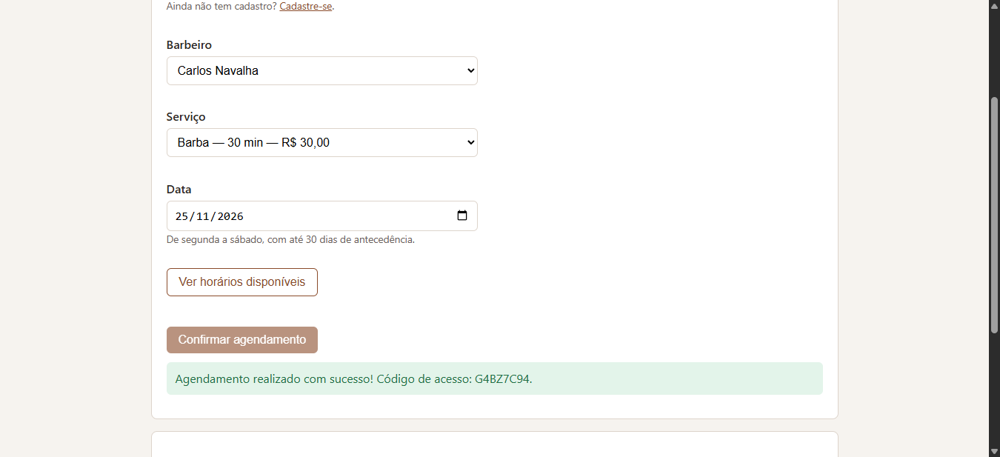
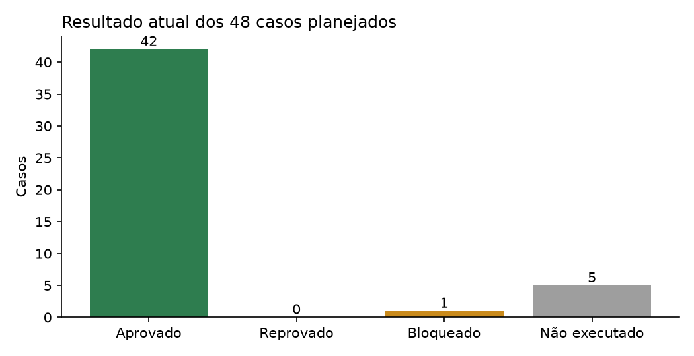

**UNISAGRADO — Centro Universitário Sagrado Coração**

**Curso de Ciência da Computação**

**Disciplina:** Testes e Qualidade de Software

**Professor:** Prof. Dr. Elvio Gilberto da Silva

**Sistema testado:** BarberAgenda — sistema web de agendamento de barbearia (versão 1.2.0)

**Integrantes:** Guilherme Ribeiro Zangrande (RA 23110757) e José Paulo Dassie Felippi (RA 24111563)

**Turma:** A — **Grupo:** Guilherme e José Paulo

Bauru, 2026

```{=openxml}
<w:p><w:r><w:br w:type="page"/></w:r></w:p>
```

# Folha de identificação

| Item | Informação |
|---|---|
| Grupo | Turma A — Grupo Guilherme e José Paulo |
| Integrantes | Guilherme Ribeiro Zangrande (RA 23110757, GitHub `ZangrandeG`); José Paulo Dassie Felippi (RA 24111563, GitHub `zepadf`) |
| Sistema | BarberAgenda 1.2.0 (tag `v1.2.0-sistema`) |
| Repositório | https://github.com/ZangrandeG/barberagenda |
| Pipeline (GitHub Actions) | https://github.com/ZangrandeG/barberagenda/actions |
| Defeitos (GitHub Issues) | https://github.com/ZangrandeG/barberagenda/issues?q=label%3Adefeito |
| Pasta de entrega | `P2_TQS_2026_A_GRUPO_GUILHERME_JOSEPAULO_BARBERAGENDA` (espelho em `entrega/` no repositório) |

**Declaração de participação (Apêndice M).** Declaramos que os arquivos entregues representam o trabalho efetivamente realizado pelo grupo, que as execuções e métricas são reais, que os dados utilizados são fictícios e que respeitamos as autorizações, licenças e orientações da disciplina.

Integrante 1: ______________________________ Data: ___/___/______

Integrante 2: ______________________________ Data: ___/___/______

**Declaração de uso de inteligência artificial (seção 15 do manual).** O grupo utilizou ferramenta de IA generativa (Claude Code) como apoio na construção do sistema, dos scripts e dos documentos e, a pedido do grupo, na execução assistida dos casos de teste, sempre registrada como tal (coluna Executor). Todos os resultados vêm de execuções reais e verificáveis no repositório; os integrantes são responsáveis por compreender, validar e explicar todo o conteúdo.

```{=openxml}
<w:p><w:r><w:br w:type="page"/></w:r></w:p>
```

# Sumário

1. Introdução
2. Caracterização do sistema
3. Escopo, requisitos e riscos
4. Planejamento dos testes
5. Especificação dos casos
6. Execução manual e defeitos
7. Automação
8. Integração e sistema
9. Aceitação e não funcionais
10. Métricas e indicadores
11. TDD, CI/CD e melhoria contínua
12. Discussão dos resultados
13. Conclusão
Referências
Apêndices e anexos

```{=openxml}
<w:p><w:r><w:br w:type="page"/></w:r></w:p>
```

# 1. Introdução

**Contexto.** Este relatório integra o Projeto Integrado P2 da disciplina Testes e Qualidade de Software, cujo objeto de avaliação é o processo de qualidade aplicado a um sistema escolhido pelo grupo.

**Problema.** Como demonstrar, por um processo de teste planejado, executado e documentado, que o BarberAgenda atende aos requisitos selecionados e quais riscos, defeitos e oportunidades de melhoria permanecem antes de sua disponibilização?

**Justificativa.** O agendamento de serviços envolve regras com intervalos, datas e conflitos de horário — terreno adequado para particionamento de equivalência e valores limite — além de API, interface web, persistência e controle de acesso, que permitem aplicar todos os níveis e ferramentas previstos na disciplina.

**Objetivo.** Elaborar e executar uma estratégia integrada de testes e qualidade para o BarberAgenda, produzindo evidências técnicas e gerenciais sobre seu comportamento, confiabilidade, usabilidade e prontidão para uso no escopo definido.

# 2. Caracterização do sistema

**Finalidade e usuários.** Sistema web de uma barbearia fictícia. O **cliente** (sem login) cadastra-se, consulta horários livres, agenda, consulta e cancela usando um código de acesso aleatório e o e-mail. O **administrador** (login) mantém barbeiros e serviços e acompanha a agenda do dia.

**Tecnologias.** Java 21, Spring Boot 3.5.16 (Web, Data JPA, Validation, Security), Maven Wrapper, H2 (arquivo/memória), interface em HTML/CSS/JavaScript consumindo a API REST.

**Arquitetura resumida.** Interface → API REST (controllers) → regras de negócio (services, com `Clock` injetável) → repositórios Spring Data JPA → banco H2. Erros padronizados em JSON (`status`, `erro`, `mensagem`, `campos`); Spring Security com login por formulário, HTTP Basic e CSRF.

**Versões.** 1.0.0 (base) → 1.0.1 (restauração de dados protegida) → 1.1.0 (código de acesso aleatório) → **1.2.0** (RF-09, criada por TDD; correções do SonarQube). As versões 1.0.1 e 1.1.0 resultaram de uma revisão automatizada de segurança do código feita antes do início dos testes. Detalhes: `README.md` e `docs/ESPECIFICACAO_SISTEMA.md`.

# 3. Escopo, requisitos e riscos

**Itens incluídos.** 14 requisitos (P02): 9 funcionais (cadastro, horários disponíveis, agendamento, conflito e limite de ativos, consulta e cancelamento, login administrativo, cadastro de barbeiros/serviços, agenda do dia e RF-09, criada por TDD) e 5 não funcionais (desempenho, segurança, compatibilidade, confiabilidade e usabilidade), todos com critério de aceitação mensurável.

**Itens excluídos.** Login de clientes, pagamentos e notificações, perfil PostgreSQL, testes de carga/estresse/invasão, concorrência real, Safari/Edge/iOS, acessibilidade formal e outros idiomas (P02, seção 2.2).

**Prioridades e matriz de riscos.** 12 riscos de produto (R-01 a R-12), classificados por probabilidade e impacto; prioridade Alta para R-01 (horários sobrepostos), R-02 (agendamento fora do funcionamento) e R-03 (acesso indevido), executados primeiro e incluídos em todas as regressões.

| Prioridade | Riscos |
|---|---|
| Alta | R-01, R-02, R-03 |
| Média | R-04 a R-10, R-12 |
| Baixa | R-11 |

*Tabela 1 — Riscos por prioridade (matriz completa no P02 e na aba Riscos do P05).*

# 4. Planejamento dos testes

**Estratégia** (Marco 1 e P03): priorização por risco; pirâmide de testes (muitos testes de unidade nas regras, menos de API, poucos de interface); `Clock` injetável para regras de data; dados fictícios restauráveis por `POST /api/dev/reset`; casos derivados da especificação (caixa-preta) e aceitação por pessoa externa para reduzir o viés de quem construiu o sistema.

**Níveis:** unidade, integração, sistema e aceitação. **Tipos:** funcional, não funcional, confirmação e regressão, com teste estático (SonarQube) como complemento. **Técnicas:** particionamento de equivalência, valor limite, transição de estados, tabela de decisão e teste baseado em experiência.

**Ambiente e recursos.** Windows 11, Java 21.0.13, Maven 3.10.1, Chrome 157, Firefox 160, Newman 6.2.3, Python 3.11, SonarQube Community Build 26.11 local, GitHub Actions (`entrega/01_SISTEMA_ALVO/ambiente.md`).

**Critérios.** Entrada: versão identificada, build e verificação rápida aprovados, dados restaurados. Saída: 100% dos casos executados ou justificados, cobertura de requisitos de 100%, nenhum defeito Crítico/Alto aberto, suítes automatizadas verdes no pipeline. Suspensão e retomada, responsabilidades, cronograma e controle de versão: P03.

# 5. Especificação dos casos

O catálogo (P04) tem **36 casos manuais** (CT-001 a CT-036) no modelo do Apêndice E: 7 positivos, 9 negativos, 9 de fronteira, 6 alternativos e 5 de exceção. Cada regra tem suas partições e limites documentados, por exemplo:

| Regra | Valores limite testados | Casos |
|---|---|---|
| RN-01 — nome com 3 a 60 caracteres | 2 ✗, 3 ✓, 60 ✓, 61 ✗ | CT-002, CT-003 |
| RN-04 — 09:00 às 19:00 | início 08:30 ✗ / 09:00 ✓; término 19:00 ✓ / 19:30 ✗ | CT-011, CT-012 |
| RN-06 — até 30 dias | D+30 ✓, D+31 ✗ | CT-015 |
| RN-08 — até 3 ativos | 3º ✓, 4º ✗ | CT-021 |
| RN-09 — duração 15 a 180, múltipla de 15 | 14 ✗, 15 ✓, 20 ✗, 180 ✓, 195 ✗ | CT-030, CT-031 |
| RF-09 — 2 horas para cancelar | 1h59 ✗, 2h00 ✓ | CT-036 |

*Tabela 2 — Exemplos de valores limite (tabelas completas, transição de estados e tabela de decisão no P04, seção 2).*

A rastreabilidade requisito → risco → caso → execução → defeito → situação está na planilha **P05** (`P05_Matriz_Rastreabilidade.xlsx`), gerada a partir de `dados/` e com as métricas em fórmulas.

# 6. Execução manual e defeitos

**Execução.** Os 36 casos foram executados pelos passos do P04 por **execução assistida por script** (`scripts/execucao_assistida.py`: Selenium para os passos de tela e chamadas reais à API), feita por Claude (IA) a pedido do grupo e registrada como tal; antes, um ensaio fora do registro oficial separou erros do script de possíveis defeitos. Resultado: **35 aprovados** na versão 1.1.0 (EX-008 a EX-042) e, na regressão da versão 1.2.0, CT-022, CT-025 e CT-026 aprovados (EX-043 a EX-045) e **CT-036 bloqueado** (EX-046: exige horário comercial; foi executado às 23h). Cada execução tem transcrição das verificações e capturas de tela em `entrega/05_EXECUCAO_MANUAL/evidencias/`.

**Defeitos.** Nenhum defeito foi observado na execução dos casos; portanto, nenhum foi registrado no GitHub Issues, que está preparado com o modelo do Apêndice G, etiquetas de severidade/prioridade/status e exportação automática (P07). Os problemas relevantes do projeto foram encontrados **antes** dos testes dinâmicos, por revisão de código e análise estática, e corrigidos (seção 2 e seção 11).

**Retestes e regressão.** Após a mudança de versão (TDD), foram reexecutados os casos de cancelamento e todas as suítes automatizadas (seção 11).

# 7. Automação

| Nível | Ferramenta | Quantidade | Resultado |
|---|---|---|---|
| Unidade | JUnit 5, Mockito, AssertJ | 37 métodos (56 execuções com parametrizados) | 0 falhas |
| Integração (Java) | Spring Boot Test + MockMvc | 2 testes (RF-09) | 0 falhas |
| Integração/API | Postman + Newman | 26 requisições, 63 asserções | 0 falhas |
| Sistema/interface | Selenium WebDriver (Page Objects) | 11 testes × 4 combinações | 0 falhas |

*Tabela 3 — Testes automatizados (versão 1.2.0).*

Todos os 39 casos candidatos à automação estão automatizados (taxa de automação de 100%); cada teste indica no nome/`@DisplayName` o caso e o requisito que representa. Cobertura JaCoCo das suítes de unidade e integração: 74,4% das linhas (serviços acima de 90%). **Limitação:** a captura de tela automática em caso de falha do Selenium não chegou a ser exercitada por um erro real, pois nenhum teste de interface falhou.

# 8. Integração e sistema

**Comunicações validadas.** A coleção do Postman verifica a cadeia interface→API→serviço→banco: status, contrato (campos, tipos, cabeçalho `Location`, código de acesso), mensagens de erro sem detalhes internos e **encadeamento** (cadastro → agendamento → consulta → cancelamento), com preparação e limpeza dos dados. Há fluxo positivo e negativo para cada operação crítica (P08 API).

**Fluxos ponta a ponta.** Selenium com Page Objects e esperas explícitas: cadastro (válido e inválido), agendamento completo, consulta e cancelamento com liberação do horário, e login do administrador com cadastro de serviço e saída (P08 interface).

{width=90%}

*Figura 1 — Evidência do teste de interface do agendamento completo.*

# 9. Aceitação e não funcionais

**Aceitação.** Quatro cenários Dado/Quando/Então (CA-01 a CA-04), do ponto de vista do cliente e do dono, estão prontos para uma pessoa externa ao grupo (P09, parte A). **Ainda não foram executados**; a decisão (Aceito / Aceito com ressalvas / Não aceito) será registrada após a sessão.

| Teste | Categoria | Medida / critério | Resultado |
|---|---|---|---|
| TNF-01 | Desempenho | p95 < 500 ms (30 medições) | Atende: 26,2 ms e 33,6 ms |
| TNF-02 | Segurança | Rotas restritas sem credencial → 401/403 sem dados | Atende: 28/28 |
| TNF-03 | Segurança | Senha só como hash BCrypt | Atende |
| TNF-04 | Segurança | HTML/script não executado | Atende |
| TNF-05 | Confiabilidade | Dados preservados após reinício | Atende |
| TNF-06 | Confiabilidade | Entradas inválidas nunca geram HTTP 500 | Atende: 16/16 |
| TNF-07 | Compatibilidade | Chrome e Firefox, 1366×768 e 375×667 | Atende: 44/44 |
| TNF-08 | Usabilidade | Até 5 min e nota ≥ 4 | Não executado (pessoa externa) |

*Tabela 4 — Testes não funcionais (5 categorias; Apêndice I completo no P09).*

# 10. Métricas e indicadores

Fórmulas da seção 9.13 do manual, dados de `dados/` (P10 e aba Métricas do P05).

| Indicador | Valor | Leitura resumida |
|---|---|---|
| Percentual de execução | 87,5% (42/48) | Faltam 5 atividades com pessoa externa e o CT-036 (bloqueado por horário) |
| Taxa de aprovação | 100% (42/42) | Nenhuma falha observada nos casos executados |
| Taxa de reprovação | 0% | Nenhum defeito inventado; falhas de script e a demonstração do pipeline não são defeitos |
| Cobertura de requisitos | 85,7% (12/14) | RNF-05 (usabilidade) e RF-09 (caso manual bloqueado; coberto pela automação) |
| Taxa de automação | 100% (39/39) | Todos os candidatos automatizados |
| Defeitos por severidade | 0 | Sem defeitos na execução |
| Defeitos por status | 0 | Nenhum aberto |
| Taxa de reabertura | não se aplica (0/0) | Sem defeitos retestados |

*Tabela 5 — Painel de métricas.*

{width=80%}

*Figura 2 — Resultado atual dos 48 casos planejados.*

{width=80%}

*Figura 3 — Indicadores percentuais.*

# 11. TDD, CI/CD e melhoria contínua

**TDD (RF-09).** RED `35ce2a2` (4 falhas pelo motivo esperado: nenhuma exceção e 200 em vez de 422) → GREEN `c9c6e4c` (implementação mínima; 58 testes aprovados) → REFACTOR `78b44e3` (`PoliticaCancelamento`; 58 aprovados). Saídas em `entrega/12_TDD_CICD_MELHORIA/tdd/`.

**CI/CD.** `.github/workflows/ci.yml` com gatilhos `push` e `pull_request`; jobs de unidade+integração+JaCoCo, API (Newman) e interface (Selenium), com relatórios publicados como artefatos. Execução aprovada: run 44441467718. Falha controlada (teste alterado de propósito na branch `demo/falha-pipeline`): run 44441895872, job de testes reprovado e demais jobs pulados. Correção: run 44442093641, 3 jobs aprovados.

**Análise de qualidade (SonarQube).** Linha de base → final: bugs 3 → 0; vulnerabilidades 2 → 2 (decisões de projeto justificadas); code smells 0 → 0; duplicação 0% → 0%; cobertura 38,9% → 72,3%; confiabilidade D → A; quality gate OK.

**Plano de melhoria.** Ações M-01 a M-07 com responsável e critério de verificação (P11, seção 3): aceitação e usabilidade com pessoa externa, CT-036 em horário comercial, reavaliação das vulnerabilidades, limite de tentativas na consulta, teste de concorrência, SonarQube no pipeline e validação do PostgreSQL.

# 12. Discussão dos resultados

**Pontos fortes.** Rastreabilidade completa e gerada a partir de uma fonte única (`dados/`); técnicas aplicadas com limites explícitos; automação em todos os níveis rodando no pipeline; testes de data reproduzíveis graças ao `Clock` injetável; evidências reais para cada execução.

**Pontos frágeis e limitações.** Taxa de aprovação de 100% e nenhum defeito: o sistema é pequeno e foi construído pelo grupo com apoio de IA, o que aumenta o risco de viés (testar o que foi construído). A aceitação e a usabilidade ainda dependem de pessoa externa. A execução manual foi assistida por script, não feita manualmente pelos integrantes. Os testes de desempenho são locais e de pequena escala; concorrência real não foi testada.

**Riscos residuais.** R-07 (tentativas de adivinhar códigos — sem limite de tentativas), as duas vulnerabilidades aceitas no SonarQube e o perfil PostgreSQL não validado.

**Lição principal.** O teste estático (revisão de segurança e SonarQube) encontrou mais problemas do que a execução dos casos; combinar técnicas estáticas e dinâmicas foi decisivo.

# 13. Conclusão

Dentro do escopo, o BarberAgenda 1.2.0 atende aos 12 requisitos com teste executado, sem defeitos observados e com todas as suítes automatizadas aprovadas no pipeline. **Prontidão:** apto para uso em ambiente de demonstração; para uso real, recomenda-se concluir a aceitação e a usabilidade com pessoas externas, executar o CT-036 em horário comercial e implementar as ações M-03 e M-04 (segurança da consulta e do CSRF).

# Referências

- UNISAGRADO. *Projeto Integrado P2 — Manual completo de desenvolvimento e entrega*. Disciplina Testes e Qualidade de Software, Prof. Dr. Elvio Gilberto da Silva, 2026.
- Documentação do Spring Boot 3.5 e do Spring Security 6 — https://docs.spring.io
- JUnit 5 User Guide — https://junit.org/junit5/docs/current/user-guide/
- Selenium WebDriver Documentation — https://www.selenium.dev/documentation/
- Postman/Newman Documentation — https://learning.postman.com/docs/
- SonarQube Community Build Documentation — https://docs.sonarsource.com/sonarqube-community-build/
- GitHub Actions Documentation — https://docs.github.com/actions
- JaCoCo Documentation — https://www.jacoco.org/jacoco/

# Apêndices e anexos

| Produto | Local (pasta de entrega) |
|---|---|
| P01 Ficha do sistema | `00_IDENTIFICACAO_E_README/` |
| Ambiente e verificação da versão base | `01_SISTEMA_ALVO/` |
| P02 Requisitos, escopo e riscos | `02_REQUISITOS_ESCOPO_RISCOS/` |
| P03 Plano de testes e documento do Marco 1 | `03_PLANO_DE_TESTES/` |
| P04 Catálogo e P05 Matriz (XLSX) | `04_CASOS_E_RASTREABILIDADE/` |
| P06 Execução manual e evidências | `05_EXECUCAO_MANUAL/` |
| P07 Defeitos | `06_DEFEITOS/` |
| P08 Unidade, API, interface | `07_AUTOMACAO_UNITARIA/`, `08_INTEGRACAO_API/`, `09_SISTEMA_INTERFACE/` |
| P09 Aceitação e não funcionais | `10_ACEITACAO_NAO_FUNCIONAIS/` |
| P10 Métricas e análises SonarQube | `11_METRICAS_E_QUALIDADE/` |
| P11 TDD, CI/CD e melhoria | `12_TDD_CICD_MELHORIA/` |
| P13 Apresentação e roteiros | `14_APRESENTACAO_E_VIDEO_CONTINGENCIA/` |
| P14 Diário de participação | `15_DIARIO_DE_PARTICIPACAO/` |
