::: {custom-style="Capa"}
Centro Universitário Sagrado Coração – UNISAGRADO

Curso de Ciência da Computação

Disciplina: Testes e Qualidade de Software
:::

```{=openxml}
<w:p/><w:p/><w:p/>
```

::: {custom-style="Capa"}
Guilherme Ribeiro Zangrande

José Paulo Dassie Felippi
:::

```{=openxml}
<w:p/><w:p/><w:p/><w:p/><w:p/>
```

::: {custom-style="CapaTitulo"}
Planejamento, execução e avaliação da qualidade do sistema BarberAgenda
:::

::: {custom-style="CapaTexto"}
Relatório final do Projeto Integrado P2

Professor: Prof. Dr. Elvio Gilberto da Silva

Turma A · Grupo Guilherme e José Paulo
:::

```{=openxml}
<w:p/><w:p/><w:p/><w:p/><w:p/><w:p/><w:p/><w:p/>
```

::: {custom-style="Capa"}
Bauru

2026
:::

::: {custom-style="TituloPre"}
Folha de identificação
:::

::: {custom-style="Legenda"}
Tabela 1 – Identificação do projeto
:::

| Item | Informação |
|---------------------|-------------------------------------------------------------------------------|
| Curso / disciplina | Ciência da Computação – UNISAGRADO / Testes e Qualidade de Software |
| Professor | Prof. Dr. Elvio Gilberto da Silva |
| Turma e grupo | Turma A · Grupo Guilherme e José Paulo |
| Integrantes | Guilherme Ribeiro Zangrande (RA 23110757, GitHub `ZangrandeG`); José Paulo Dassie Felippi (RA 24111563, GitHub `zepadf`) |
| Sistema testado | BarberAgenda – sistema web de agendamento de barbearia, desenvolvido pelo grupo para a disciplina |
| Versão testada | 1.1.0 (tag `v1.1.0-sistema-base`) no ciclo principal; 1.2.0 (tag `v1.2.0-sistema`) após o ciclo de TDD |
| Aprovação do sistema | Ficha P01 aprovada pelo professor em 19/11/2026, sem ajustes |
| Repositório | https://github.com/ZangrandeG/barberagenda |
| Pipeline e defeitos | GitHub Actions (`.github/workflows/ci.yml`) e GitHub Issues (etiqueta `defeito`) do repositório |
| Pasta de entrega | `P2_TQS_2026_A_GRUPO_GUILHERME_JOSEPAULO_BARBERAGENDA` (espelho em `entrega/` no repositório) |

::: {custom-style="Fonte"}
Fonte: Elaborado pelos autores (2026).
:::


**Declaração de participação.** Os dois integrantes participaram do planejamento, da execução e da análise do projeto e estão preparados para explicar qualquer parte do trabalho. Os papéis seguem o plano de testes (P03, seção 10); o detalhe de cada atividade está no Diário de Participação (P14).

::: {custom-style="Legenda"}
Tabela 2 – Principais contribuições de cada integrante
:::

| Integrante | Papel principal | Principais contribuições |
|-------------------|------------------------|--------------------------------------------------------|
| Guilherme Ribeiro Zangrande | Coordenação e planejamento; automação e qualidade | Plano de testes, ambiente e versões; testes de unidade e integração (JUnit, Mockito, MockMvc); coleção Postman/Newman; Selenium; SonarQube; ciclo de TDD; pipeline de CI/CD; casos CT-019 a CT-036 |
| José Paulo Dassie Felippi | Análise e execução manual | Requisitos, riscos e casos CT-001 a CT-018; dados de teste; acompanhamento da execução e das evidências; roteiros de aceitação e usabilidade; métricas e plano de melhoria |

::: {custom-style="Fonte"}
Fonte: Elaborado pelos autores (2026).
:::


**Uso de inteligência artificial (manual, seção 15).** O grupo usou IA generativa (Claude Code), com autorização do professor, na construção do sistema, dos scripts e dos documentos e na execução assistida dos casos, registrada como tal (seção 4.10). Todos os resultados vêm de execuções reais e verificáveis no repositório.

::: {custom-style="TituloPre"}
Lista de figuras
:::

```{=openxml}
<w:p><w:pPr><w:pStyle w:val="Lista"/></w:pPr><w:r><w:t xml:space="preserve">Figura 1 – Tela inicial do BarberAgenda</w:t></w:r><w:r><w:tab/></w:r><w:r><w:t>12</w:t></w:r></w:p>
<w:p><w:pPr><w:pStyle w:val="Lista"/></w:pPr><w:r><w:t xml:space="preserve">Figura 2 – Arquitetura em camadas do BarberAgenda</w:t></w:r><w:r><w:tab/></w:r><w:r><w:t>13</w:t></w:r></w:p>
<w:p><w:pPr><w:pStyle w:val="Lista"/></w:pPr><w:r><w:t xml:space="preserve">Figura 3 – Mapa de calor dos riscos: probabilidade × impacto</w:t></w:r><w:r><w:tab/></w:r><w:r><w:t>20</w:t></w:r></w:p>
<w:p><w:pPr><w:pStyle w:val="Lista"/></w:pPr><w:r><w:t xml:space="preserve">Figura 4 – Pirâmide de testes aplicada ao BarberAgenda (quantidades da versão 1.2.0)</w:t></w:r><w:r><w:tab/></w:r><w:r><w:t>22</w:t></w:r></w:p>
<w:p><w:pPr><w:pStyle w:val="Lista"/></w:pPr><w:r><w:t xml:space="preserve">Figura 5 – Resultado atual dos casos e testes planejados</w:t></w:r><w:r><w:tab/></w:r><w:r><w:t>34</w:t></w:r></w:p>
<w:p><w:pPr><w:pStyle w:val="Lista"/></w:pPr><w:r><w:t xml:space="preserve">Figura 6 – EX-022 (CT-003): cadastro recusado com nome de 2 caracteres, abaixo do limite de 3</w:t></w:r><w:r><w:tab/></w:r><w:r><w:t>35</w:t></w:r></w:p>
<w:p><w:pPr><w:pStyle w:val="Lista"/></w:pPr><w:r><w:t xml:space="preserve">Figura 7 – EX-034 (CT-024): consulta recusada quando o código SEMENTE2 é usado com o e-mail de outro cliente</w:t></w:r><w:r><w:tab/></w:r><w:r><w:t>35</w:t></w:r></w:p>
<w:p><w:pPr><w:pStyle w:val="Lista"/></w:pPr><w:r><w:t xml:space="preserve">Figura 8 – Teste Selenium do agendamento completo (CT-010): mensagem de sucesso com o código de acesso gerado</w:t></w:r><w:r><w:tab/></w:r><w:r><w:t>40</w:t></w:r></w:p>
<w:p><w:pPr><w:pStyle w:val="Lista"/></w:pPr><w:r><w:t xml:space="preserve">Figura 9 – Agenda do dia na área administrativa após marcar um atendimento como concluído (EX-040, CT-034)</w:t></w:r><w:r><w:tab/></w:r><w:r><w:t>43</w:t></w:r></w:p>
<w:p><w:pPr><w:pStyle w:val="Lista"/></w:pPr><w:r><w:t xml:space="preserve">Figura 10 – Tempos de resposta das 60 medições do TNF-01 comparados com o critério</w:t></w:r><w:r><w:tab/></w:r><w:r><w:t>45</w:t></w:r></w:p>
<w:p><w:pPr><w:pStyle w:val="Lista"/></w:pPr><w:r><w:t xml:space="preserve">Figura 11 – Agendamento concluído pelo Selenium na largura de celular (375×667): Chrome à esquerda e Firefox à direita</w:t></w:r><w:r><w:tab/></w:r><w:r><w:t>47</w:t></w:r></w:p>
<w:p><w:pPr><w:pStyle w:val="Lista"/></w:pPr><w:r><w:t xml:space="preserve">Figura 12 – Indicadores percentuais</w:t></w:r><w:r><w:tab/></w:r><w:r><w:t>48</w:t></w:r></w:p>
<w:p><w:pPr><w:pStyle w:val="Lista"/></w:pPr><w:r><w:t xml:space="preserve">Figura 13 – Resultado atual dos casos e testes por requisito</w:t></w:r><w:r><w:tab/></w:r><w:r><w:t>49</w:t></w:r></w:p>
<w:p><w:pPr><w:pStyle w:val="Lista"/></w:pPr><w:r><w:t xml:space="preserve">Figura 14 – Bugs e cobertura no SonarQube: linha de base e análise final</w:t></w:r><w:r><w:tab/></w:r><w:r><w:t>50</w:t></w:r></w:p>
<w:p><w:pPr><w:pStyle w:val="Lista"/></w:pPr><w:r><w:t xml:space="preserve">Figura 15 – Ciclo de TDD aplicado ao RF-09</w:t></w:r><w:r><w:tab/></w:r><w:r><w:t>52</w:t></w:r></w:p>
<w:p><w:pPr><w:pStyle w:val="Lista"/></w:pPr><w:r><w:t xml:space="preserve">Figura 16 – Etapas do pipeline de CI/CD</w:t></w:r><w:r><w:tab/></w:r><w:r><w:t>54</w:t></w:r></w:p>
```

::: {custom-style="TituloPre"}
Lista de tabelas
:::

```{=openxml}
<w:p><w:pPr><w:pStyle w:val="Lista"/></w:pPr><w:r><w:t xml:space="preserve">Tabela 1 – Identificação do projeto</w:t></w:r><w:r><w:tab/></w:r><w:r><w:t>2</w:t></w:r></w:p>
<w:p><w:pPr><w:pStyle w:val="Lista"/></w:pPr><w:r><w:t xml:space="preserve">Tabela 2 – Principais contribuições de cada integrante</w:t></w:r><w:r><w:tab/></w:r><w:r><w:t>2</w:t></w:r></w:p>
<w:p><w:pPr><w:pStyle w:val="Lista"/></w:pPr><w:r><w:t xml:space="preserve">Tabela 3 – Usuários do BarberAgenda e o que cada um pode fazer</w:t></w:r><w:r><w:tab/></w:r><w:r><w:t>12</w:t></w:r></w:p>
<w:p><w:pPr><w:pStyle w:val="Lista"/></w:pPr><w:r><w:t xml:space="preserve">Tabela 4 – Tecnologias e responsabilidades de cada camada</w:t></w:r><w:r><w:tab/></w:r><w:r><w:t>13</w:t></w:r></w:p>
<w:p><w:pPr><w:pStyle w:val="Lista"/></w:pPr><w:r><w:t xml:space="preserve">Tabela 5 – Integrações do BarberAgenda e onde cada uma foi verificada</w:t></w:r><w:r><w:tab/></w:r><w:r><w:t>13</w:t></w:r></w:p>
<w:p><w:pPr><w:pStyle w:val="Lista"/></w:pPr><w:r><w:t xml:space="preserve">Tabela 6 – Regras de negócio do BarberAgenda (base dos valores limite)</w:t></w:r><w:r><w:tab/></w:r><w:r><w:t>14</w:t></w:r></w:p>
<w:p><w:pPr><w:pStyle w:val="Lista"/></w:pPr><w:r><w:t xml:space="preserve">Tabela 7 – Versões do BarberAgenda e motivo de cada mudança</w:t></w:r><w:r><w:tab/></w:r><w:r><w:t>14</w:t></w:r></w:p>
<w:p><w:pPr><w:pStyle w:val="Lista"/></w:pPr><w:r><w:t xml:space="preserve">Tabela 8 – Itens fora do escopo e motivo</w:t></w:r><w:r><w:tab/></w:r><w:r><w:t>16</w:t></w:r></w:p>
<w:p><w:pPr><w:pStyle w:val="Lista"/></w:pPr><w:r><w:t xml:space="preserve">Tabela 9 – Requisitos funcionais (modelo do Apêndice B do manual)</w:t></w:r><w:r><w:tab/></w:r><w:r><w:t>16</w:t></w:r></w:p>
<w:p><w:pPr><w:pStyle w:val="Lista"/></w:pPr><w:r><w:t xml:space="preserve">Tabela 10 – Requisitos não funcionais</w:t></w:r><w:r><w:tab/></w:r><w:r><w:t>18</w:t></w:r></w:p>
<w:p><w:pPr><w:pStyle w:val="Lista"/></w:pPr><w:r><w:t xml:space="preserve">Tabela 11 – Matriz de riscos do produto (modelo do Apêndice C do manual)</w:t></w:r><w:r><w:tab/></w:r><w:r><w:t>19</w:t></w:r></w:p>
<w:p><w:pPr><w:pStyle w:val="Lista"/></w:pPr><w:r><w:t xml:space="preserve">Tabela 12 – Identificação e objetivo do plano de testes</w:t></w:r><w:r><w:tab/></w:r><w:r><w:t>21</w:t></w:r></w:p>
<w:p><w:pPr><w:pStyle w:val="Lista"/></w:pPr><w:r><w:t xml:space="preserve">Tabela 13 – Níveis de teste: planejado e realizado</w:t></w:r><w:r><w:tab/></w:r><w:r><w:t>22</w:t></w:r></w:p>
<w:p><w:pPr><w:pStyle w:val="Lista"/></w:pPr><w:r><w:t xml:space="preserve">Tabela 14 – Técnicas de especificação e onde foram aplicadas</w:t></w:r><w:r><w:tab/></w:r><w:r><w:t>22</w:t></w:r></w:p>
<w:p><w:pPr><w:pStyle w:val="Lista"/></w:pPr><w:r><w:t xml:space="preserve">Tabela 15 – Ambiente e ferramentas (versões registradas em entrega/01_SISTEMA_ALVO/ambiente.md)</w:t></w:r><w:r><w:tab/></w:r><w:r><w:t>23</w:t></w:r></w:p>
<w:p><w:pPr><w:pStyle w:val="Lista"/></w:pPr><w:r><w:t xml:space="preserve">Tabela 16 – Papéis e responsabilidades</w:t></w:r><w:r><w:tab/></w:r><w:r><w:t>24</w:t></w:r></w:p>
<w:p><w:pPr><w:pStyle w:val="Lista"/></w:pPr><w:r><w:t xml:space="preserve">Tabela 17 – Critérios de entrada e de saída</w:t></w:r><w:r><w:tab/></w:r><w:r><w:t>24</w:t></w:r></w:p>
<w:p><w:pPr><w:pStyle w:val="Lista"/></w:pPr><w:r><w:t xml:space="preserve">Tabela 18 – Critérios de suspensão e retomada</w:t></w:r><w:r><w:tab/></w:r><w:r><w:t>24</w:t></w:r></w:p>
<w:p><w:pPr><w:pStyle w:val="Lista"/></w:pPr><w:r><w:t xml:space="preserve">Tabela 19 – Cronograma de marcos e datas de conclusão</w:t></w:r><w:r><w:tab/></w:r><w:r><w:t>25</w:t></w:r></w:p>
<w:p><w:pPr><w:pStyle w:val="Lista"/></w:pPr><w:r><w:t xml:space="preserve">Tabela 20 – Riscos do processo de teste e respostas</w:t></w:r><w:r><w:tab/></w:r><w:r><w:t>25</w:t></w:r></w:p>
<w:p><w:pPr><w:pStyle w:val="Lista"/></w:pPr><w:r><w:t xml:space="preserve">Tabela 21 – Severidade, prioridade e ciclo de vida dos defeitos</w:t></w:r><w:r><w:tab/></w:r><w:r><w:t>26</w:t></w:r></w:p>
<w:p><w:pPr><w:pStyle w:val="Lista"/></w:pPr><w:r><w:t xml:space="preserve">Tabela 22 – Distribuição dos casos por técnica de projeto</w:t></w:r><w:r><w:tab/></w:r><w:r><w:t>28</w:t></w:r></w:p>
<w:p><w:pPr><w:pStyle w:val="Lista"/></w:pPr><w:r><w:t xml:space="preserve">Tabela 23 – Distribuição dos casos por classificação</w:t></w:r><w:r><w:tab/></w:r><w:r><w:t>28</w:t></w:r></w:p>
<w:p><w:pPr><w:pStyle w:val="Lista"/></w:pPr><w:r><w:t xml:space="preserve">Tabela 24 – Casos e testes por requisito</w:t></w:r><w:r><w:tab/></w:r><w:r><w:t>28</w:t></w:r></w:p>
<w:p><w:pPr><w:pStyle w:val="Lista"/></w:pPr><w:r><w:t xml:space="preserve">Tabela 25 – Partições e valores limite por regra (P04, seção 2.1)</w:t></w:r><w:r><w:tab/></w:r><w:r><w:t>29</w:t></w:r></w:p>
<w:p><w:pPr><w:pStyle w:val="Lista"/></w:pPr><w:r><w:t xml:space="preserve">Tabela 26 – Valores limite do CT-012 e resultado obtido (EX-012)</w:t></w:r><w:r><w:tab/></w:r><w:r><w:t>30</w:t></w:r></w:p>
<w:p><w:pPr><w:pStyle w:val="Lista"/></w:pPr><w:r><w:t xml:space="preserve">Tabela 27 – Transições de estado do agendamento (P04, seção 2.2)</w:t></w:r><w:r><w:tab/></w:r><w:r><w:t>31</w:t></w:r></w:p>
<w:p><w:pPr><w:pStyle w:val="Lista"/></w:pPr><w:r><w:t xml:space="preserve">Tabela 28 – Tabela de decisão da consulta pelo cliente (P04, seção 2.3)</w:t></w:r><w:r><w:tab/></w:r><w:r><w:t>31</w:t></w:r></w:p>
<w:p><w:pPr><w:pStyle w:val="Lista"/></w:pPr><w:r><w:t xml:space="preserve">Tabela 29 – Resultado de cada execução dos casos manuais (detalhes no Apêndice B)</w:t></w:r><w:r><w:tab/></w:r><w:r><w:t>32</w:t></w:r></w:p>
<w:p><w:pPr><w:pStyle w:val="Lista"/></w:pPr><w:r><w:t xml:space="preserve">Tabela 30 – Problemas encontrados antes da execução dos casos (detalhes no Apêndice C)</w:t></w:r><w:r><w:tab/></w:r><w:r><w:t>36</w:t></w:r></w:p>
<w:p><w:pPr><w:pStyle w:val="Lista"/></w:pPr><w:r><w:t xml:space="preserve">Tabela 31 – Reexecuções e regressão após a mudança para a versão 1.2.0</w:t></w:r><w:r><w:tab/></w:r><w:r><w:t>36</w:t></w:r></w:p>
<w:p><w:pPr><w:pStyle w:val="Lista"/></w:pPr><w:r><w:t xml:space="preserve">Tabela 32 – Testes de unidade e integração por classe (regressão da versão 1.2.0)</w:t></w:r><w:r><w:tab/></w:r><w:r><w:t>38</w:t></w:r></w:p>
<w:p><w:pPr><w:pStyle w:val="Lista"/></w:pPr><w:r><w:t xml:space="preserve">Tabela 33 – Coleção do Postman por pasta (lista completa no Apêndice F)</w:t></w:r><w:r><w:tab/></w:r><w:r><w:t>39</w:t></w:r></w:p>
<w:p><w:pPr><w:pStyle w:val="Lista"/></w:pPr><w:r><w:t xml:space="preserve">Tabela 34 – Testes de interface por classe (Chrome, 1366×768)</w:t></w:r><w:r><w:tab/></w:r><w:r><w:t>40</w:t></w:r></w:p>
<w:p><w:pPr><w:pStyle w:val="Lista"/></w:pPr><w:r><w:t xml:space="preserve">Tabela 35 – Integrações validadas e resultado</w:t></w:r><w:r><w:tab/></w:r><w:r><w:t>42</w:t></w:r></w:p>
<w:p><w:pPr><w:pStyle w:val="Lista"/></w:pPr><w:r><w:t xml:space="preserve">Tabela 36 – Cenários de aceitação e situação</w:t></w:r><w:r><w:tab/></w:r><w:r><w:t>44</w:t></w:r></w:p>
<w:p><w:pPr><w:pStyle w:val="Lista"/></w:pPr><w:r><w:t xml:space="preserve">Tabela 37 – Resultados dos testes não funcionais</w:t></w:r><w:r><w:tab/></w:r><w:r><w:t>44</w:t></w:r></w:p>
<w:p><w:pPr><w:pStyle w:val="Lista"/></w:pPr><w:r><w:t xml:space="preserve">Tabela 38 – Tempos de resposta medidos no TNF-01</w:t></w:r><w:r><w:tab/></w:r><w:r><w:t>45</w:t></w:r></w:p>
<w:p><w:pPr><w:pStyle w:val="Lista"/></w:pPr><w:r><w:t xml:space="preserve">Tabela 39 – Painel das 8 métricas obrigatórias (modelo do Apêndice K do manual)</w:t></w:r><w:r><w:tab/></w:r><w:r><w:t>48</w:t></w:r></w:p>
<w:p><w:pPr><w:pStyle w:val="Lista"/></w:pPr><w:r><w:t xml:space="preserve">Tabela 40 – Indicadores do SonarQube: linha de base e análise final</w:t></w:r><w:r><w:tab/></w:r><w:r><w:t>50</w:t></w:r></w:p>
<w:p><w:pPr><w:pStyle w:val="Lista"/></w:pPr><w:r><w:t xml:space="preserve">Tabela 41 – Resumo da matriz de rastreabilidade por requisito (matriz completa no Apêndice D e na planilha P05)</w:t></w:r><w:r><w:tab/></w:r><w:r><w:t>51</w:t></w:r></w:p>
<w:p><w:pPr><w:pStyle w:val="Lista"/></w:pPr><w:r><w:t xml:space="preserve">Tabela 42 – Ciclo Red-Green-Refactor (modelo do Apêndice J do manual)</w:t></w:r><w:r><w:tab/></w:r><w:r><w:t>52</w:t></w:r></w:p>
<w:p><w:pPr><w:pStyle w:val="Lista"/></w:pPr><w:r><w:t xml:space="preserve">Tabela 43 – Jobs do pipeline</w:t></w:r><w:r><w:tab/></w:r><w:r><w:t>54</w:t></w:r></w:p>
<w:p><w:pPr><w:pStyle w:val="Lista"/></w:pPr><w:r><w:t xml:space="preserve">Tabela 44 – Execuções do pipeline documentadas</w:t></w:r><w:r><w:tab/></w:r><w:r><w:t>54</w:t></w:r></w:p>
<w:p><w:pPr><w:pStyle w:val="Lista"/></w:pPr><w:r><w:t xml:space="preserve">Tabela 45 – Ações de melhoria priorizadas</w:t></w:r><w:r><w:tab/></w:r><w:r><w:t>55</w:t></w:r></w:p>
<w:p><w:pPr><w:pStyle w:val="Lista"/></w:pPr><w:r><w:t xml:space="preserve">Tabela 46 – Situação dos riscos de produto após os testes</w:t></w:r><w:r><w:tab/></w:r><w:r><w:t>58</w:t></w:r></w:p>
<w:p><w:pPr><w:pStyle w:val="Lista"/></w:pPr><w:r><w:t xml:space="preserve">Tabela 47 – Critérios de saída do plano de testes e situação final</w:t></w:r><w:r><w:tab/></w:r><w:r><w:t>60</w:t></w:r></w:p>
<w:p><w:pPr><w:pStyle w:val="Lista"/></w:pPr><w:r><w:t xml:space="preserve">Tabela 48 – Registro de todas as execuções (modelo do Apêndice F do manual)</w:t></w:r><w:r><w:tab/></w:r><w:r><w:t>77</w:t></w:r></w:p>
<w:p><w:pPr><w:pStyle w:val="Lista"/></w:pPr><w:r><w:t xml:space="preserve">Tabela 49 – Matriz de rastreabilidade completa</w:t></w:r><w:r><w:tab/></w:r><w:r><w:t>83</w:t></w:r></w:p>
<w:p><w:pPr><w:pStyle w:val="Lista"/></w:pPr><w:r><w:t xml:space="preserve">Tabela 50 – Lista dos testes JUnit (código em src/test/java/br/com/barberagenda/unit e integration)</w:t></w:r><w:r><w:tab/></w:r><w:r><w:t>90</w:t></w:r></w:p>
<w:p><w:pPr><w:pStyle w:val="Lista"/></w:pPr><w:r><w:t xml:space="preserve">Tabela 51 – Requisições e asserções da coleção do Postman</w:t></w:r><w:r><w:tab/></w:r><w:r><w:t>91</w:t></w:r></w:p>
<w:p><w:pPr><w:pStyle w:val="Lista"/></w:pPr><w:r><w:t xml:space="preserve">Tabela 52 – Lista dos testes Selenium (código em src/test/java/br/com/barberagenda/e2e)</w:t></w:r><w:r><w:tab/></w:r><w:r><w:t>94</w:t></w:r></w:p>
<w:p><w:pPr><w:pStyle w:val="Lista"/></w:pPr><w:r><w:t xml:space="preserve">Tabela 53 – Registro de TDD e CI/CD</w:t></w:r><w:r><w:tab/></w:r><w:r><w:t>95</w:t></w:r></w:p>
<w:p><w:pPr><w:pStyle w:val="Lista"/></w:pPr><w:r><w:t xml:space="preserve">Tabela 54 – Pendências</w:t></w:r><w:r><w:tab/></w:r><w:r><w:t>97</w:t></w:r></w:p>
<w:p><w:pPr><w:pStyle w:val="Lista"/></w:pPr><w:r><w:t xml:space="preserve">Tabela 55 – Inventário de evidências por pasta</w:t></w:r><w:r><w:tab/></w:r><w:r><w:t>98</w:t></w:r></w:p>
```

::: {custom-style="TituloPre"}
Sumário
:::

```{=openxml}
<w:p><w:pPr><w:pStyle w:val="Sumario1"/></w:pPr><w:r><w:t xml:space="preserve">1 INTRODUÇÃO</w:t></w:r><w:r><w:tab/></w:r><w:r><w:t>9</w:t></w:r></w:p>
<w:p><w:pPr><w:pStyle w:val="Sumario2"/></w:pPr><w:r><w:t xml:space="preserve">1.1 Contexto</w:t></w:r><w:r><w:tab/></w:r><w:r><w:t>9</w:t></w:r></w:p>
<w:p><w:pPr><w:pStyle w:val="Sumario2"/></w:pPr><w:r><w:t xml:space="preserve">1.2 Problema</w:t></w:r><w:r><w:tab/></w:r><w:r><w:t>9</w:t></w:r></w:p>
<w:p><w:pPr><w:pStyle w:val="Sumario2"/></w:pPr><w:r><w:t xml:space="preserve">1.3 Justificativa</w:t></w:r><w:r><w:tab/></w:r><w:r><w:t>9</w:t></w:r></w:p>
<w:p><w:pPr><w:pStyle w:val="Sumario2"/></w:pPr><w:r><w:t xml:space="preserve">1.4 Objetivos</w:t></w:r><w:r><w:tab/></w:r><w:r><w:t>10</w:t></w:r></w:p>
<w:p><w:pPr><w:pStyle w:val="Sumario2"/></w:pPr><w:r><w:t xml:space="preserve">1.5 Resultado em resumo</w:t></w:r><w:r><w:tab/></w:r><w:r><w:t>10</w:t></w:r></w:p>
<w:p><w:pPr><w:pStyle w:val="Sumario2"/></w:pPr><w:r><w:t xml:space="preserve">1.6 Organização do relatório</w:t></w:r><w:r><w:tab/></w:r><w:r><w:t>11</w:t></w:r></w:p>
<w:p><w:pPr><w:pStyle w:val="Sumario1"/></w:pPr><w:r><w:t xml:space="preserve">2 CARACTERIZAÇÃO DO SISTEMA</w:t></w:r><w:r><w:tab/></w:r><w:r><w:t>12</w:t></w:r></w:p>
<w:p><w:pPr><w:pStyle w:val="Sumario2"/></w:pPr><w:r><w:t xml:space="preserve">2.1 Finalidade e usuários</w:t></w:r><w:r><w:tab/></w:r><w:r><w:t>12</w:t></w:r></w:p>
<w:p><w:pPr><w:pStyle w:val="Sumario2"/></w:pPr><w:r><w:t xml:space="preserve">2.2 Tecnologias e arquitetura</w:t></w:r><w:r><w:tab/></w:r><w:r><w:t>12</w:t></w:r></w:p>
<w:p><w:pPr><w:pStyle w:val="Sumario2"/></w:pPr><w:r><w:t xml:space="preserve">2.3 Integrações entre componentes</w:t></w:r><w:r><w:tab/></w:r><w:r><w:t>13</w:t></w:r></w:p>
<w:p><w:pPr><w:pStyle w:val="Sumario2"/></w:pPr><w:r><w:t xml:space="preserve">2.4 Regras de negócio</w:t></w:r><w:r><w:tab/></w:r><w:r><w:t>14</w:t></w:r></w:p>
<w:p><w:pPr><w:pStyle w:val="Sumario2"/></w:pPr><w:r><w:t xml:space="preserve">2.5 Versões e ambiente testado</w:t></w:r><w:r><w:tab/></w:r><w:r><w:t>14</w:t></w:r></w:p>
<w:p><w:pPr><w:pStyle w:val="Sumario1"/></w:pPr><w:r><w:t xml:space="preserve">3 ESCOPO, REQUISITOS E RISCOS</w:t></w:r><w:r><w:tab/></w:r><w:r><w:t>16</w:t></w:r></w:p>
<w:p><w:pPr><w:pStyle w:val="Sumario2"/></w:pPr><w:r><w:t xml:space="preserve">3.1 Escopo</w:t></w:r><w:r><w:tab/></w:r><w:r><w:t>16</w:t></w:r></w:p>
<w:p><w:pPr><w:pStyle w:val="Sumario2"/></w:pPr><w:r><w:t xml:space="preserve">3.2 Requisitos</w:t></w:r><w:r><w:tab/></w:r><w:r><w:t>16</w:t></w:r></w:p>
<w:p><w:pPr><w:pStyle w:val="Sumario2"/></w:pPr><w:r><w:t xml:space="preserve">3.3 Riscos e prioridades</w:t></w:r><w:r><w:tab/></w:r><w:r><w:t>18</w:t></w:r></w:p>
<w:p><w:pPr><w:pStyle w:val="Sumario1"/></w:pPr><w:r><w:t xml:space="preserve">4 PLANEJAMENTO DOS TESTES</w:t></w:r><w:r><w:tab/></w:r><w:r><w:t>21</w:t></w:r></w:p>
<w:p><w:pPr><w:pStyle w:val="Sumario2"/></w:pPr><w:r><w:t xml:space="preserve">4.1 Identificação, objetivo e escopo</w:t></w:r><w:r><w:tab/></w:r><w:r><w:t>21</w:t></w:r></w:p>
<w:p><w:pPr><w:pStyle w:val="Sumario2"/></w:pPr><w:r><w:t xml:space="preserve">4.2 Níveis, tipos e técnicas</w:t></w:r><w:r><w:tab/></w:r><w:r><w:t>21</w:t></w:r></w:p>
<w:p><w:pPr><w:pStyle w:val="Sumario2"/></w:pPr><w:r><w:t xml:space="preserve">4.3 Ambiente, ferramentas e dados</w:t></w:r><w:r><w:tab/></w:r><w:r><w:t>23</w:t></w:r></w:p>
<w:p><w:pPr><w:pStyle w:val="Sumario2"/></w:pPr><w:r><w:t xml:space="preserve">4.4 Responsabilidades</w:t></w:r><w:r><w:tab/></w:r><w:r><w:t>24</w:t></w:r></w:p>
<w:p><w:pPr><w:pStyle w:val="Sumario2"/></w:pPr><w:r><w:t xml:space="preserve">4.5 Critérios</w:t></w:r><w:r><w:tab/></w:r><w:r><w:t>24</w:t></w:r></w:p>
<w:p><w:pPr><w:pStyle w:val="Sumario2"/></w:pPr><w:r><w:t xml:space="preserve">4.6 Cronograma realizado</w:t></w:r><w:r><w:tab/></w:r><w:r><w:t>25</w:t></w:r></w:p>
<w:p><w:pPr><w:pStyle w:val="Sumario2"/></w:pPr><w:r><w:t xml:space="preserve">4.7 Riscos do processo de teste</w:t></w:r><w:r><w:tab/></w:r><w:r><w:t>25</w:t></w:r></w:p>
<w:p><w:pPr><w:pStyle w:val="Sumario2"/></w:pPr><w:r><w:t xml:space="preserve">4.8 Gestão de defeitos</w:t></w:r><w:r><w:tab/></w:r><w:r><w:t>26</w:t></w:r></w:p>
<w:p><w:pPr><w:pStyle w:val="Sumario2"/></w:pPr><w:r><w:t xml:space="preserve">4.9 Produtos, versionamento e comunicação</w:t></w:r><w:r><w:tab/></w:r><w:r><w:t>26</w:t></w:r></w:p>
<w:p><w:pPr><w:pStyle w:val="Sumario2"/></w:pPr><w:r><w:t xml:space="preserve">4.10 Método de execução e uso de ferramentas de IA</w:t></w:r><w:r><w:tab/></w:r><w:r><w:t>27</w:t></w:r></w:p>
<w:p><w:pPr><w:pStyle w:val="Sumario1"/></w:pPr><w:r><w:t xml:space="preserve">5 ESPECIFICAÇÃO DOS CASOS DE TESTE</w:t></w:r><w:r><w:tab/></w:r><w:r><w:t>28</w:t></w:r></w:p>
<w:p><w:pPr><w:pStyle w:val="Sumario2"/></w:pPr><w:r><w:t xml:space="preserve">5.1 Particionamento de equivalência e valores limite</w:t></w:r><w:r><w:tab/></w:r><w:r><w:t>29</w:t></w:r></w:p>
<w:p><w:pPr><w:pStyle w:val="Sumario2"/></w:pPr><w:r><w:t xml:space="preserve">5.2 Transição de estados</w:t></w:r><w:r><w:tab/></w:r><w:r><w:t>30</w:t></w:r></w:p>
<w:p><w:pPr><w:pStyle w:val="Sumario2"/></w:pPr><w:r><w:t xml:space="preserve">5.3 Tabela de decisão</w:t></w:r><w:r><w:tab/></w:r><w:r><w:t>31</w:t></w:r></w:p>
<w:p><w:pPr><w:pStyle w:val="Sumario2"/></w:pPr><w:r><w:t xml:space="preserve">5.4 Candidatos à automação</w:t></w:r><w:r><w:tab/></w:r><w:r><w:t>31</w:t></w:r></w:p>
<w:p><w:pPr><w:pStyle w:val="Sumario1"/></w:pPr><w:r><w:t xml:space="preserve">6 EXECUÇÃO MANUAL E DEFEITOS</w:t></w:r><w:r><w:tab/></w:r><w:r><w:t>32</w:t></w:r></w:p>
<w:p><w:pPr><w:pStyle w:val="Sumario2"/></w:pPr><w:r><w:t xml:space="preserve">6.1 Procedimento</w:t></w:r><w:r><w:tab/></w:r><w:r><w:t>32</w:t></w:r></w:p>
<w:p><w:pPr><w:pStyle w:val="Sumario2"/></w:pPr><w:r><w:t xml:space="preserve">6.2 Resultado do ciclo principal</w:t></w:r><w:r><w:tab/></w:r><w:r><w:t>32</w:t></w:r></w:p>
<w:p><w:pPr><w:pStyle w:val="Sumario2"/></w:pPr><w:r><w:t xml:space="preserve">6.3 Caso bloqueado</w:t></w:r><w:r><w:tab/></w:r><w:r><w:t>35</w:t></w:r></w:p>
<w:p><w:pPr><w:pStyle w:val="Sumario2"/></w:pPr><w:r><w:t xml:space="preserve">6.4 Defeitos registrados</w:t></w:r><w:r><w:tab/></w:r><w:r><w:t>36</w:t></w:r></w:p>
<w:p><w:pPr><w:pStyle w:val="Sumario2"/></w:pPr><w:r><w:t xml:space="preserve">6.5 Reteste e regressão</w:t></w:r><w:r><w:tab/></w:r><w:r><w:t>36</w:t></w:r></w:p>
<w:p><w:pPr><w:pStyle w:val="Sumario2"/></w:pPr><w:r><w:t xml:space="preserve">6.6 Observações que não são defeitos</w:t></w:r><w:r><w:tab/></w:r><w:r><w:t>37</w:t></w:r></w:p>
<w:p><w:pPr><w:pStyle w:val="Sumario1"/></w:pPr><w:r><w:t xml:space="preserve">7 AUTOMAÇÃO</w:t></w:r><w:r><w:tab/></w:r><w:r><w:t>38</w:t></w:r></w:p>
<w:p><w:pPr><w:pStyle w:val="Sumario2"/></w:pPr><w:r><w:t xml:space="preserve">7.1 Arquitetura dos testes</w:t></w:r><w:r><w:tab/></w:r><w:r><w:t>38</w:t></w:r></w:p>
<w:p><w:pPr><w:pStyle w:val="Sumario2"/></w:pPr><w:r><w:t xml:space="preserve">7.2 Testes de unidade (JUnit 5)</w:t></w:r><w:r><w:tab/></w:r><w:r><w:t>38</w:t></w:r></w:p>
<w:p><w:pPr><w:pStyle w:val="Sumario2"/></w:pPr><w:r><w:t xml:space="preserve">7.3 Testes de integração/API (Postman + Newman)</w:t></w:r><w:r><w:tab/></w:r><w:r><w:t>39</w:t></w:r></w:p>
<w:p><w:pPr><w:pStyle w:val="Sumario2"/></w:pPr><w:r><w:t xml:space="preserve">7.4 Testes de sistema/interface (Selenium)</w:t></w:r><w:r><w:tab/></w:r><w:r><w:t>40</w:t></w:r></w:p>
<w:p><w:pPr><w:pStyle w:val="Sumario2"/></w:pPr><w:r><w:t xml:space="preserve">7.5 Como executar</w:t></w:r><w:r><w:tab/></w:r><w:r><w:t>40</w:t></w:r></w:p>
<w:p><w:pPr><w:pStyle w:val="Sumario2"/></w:pPr><w:r><w:t xml:space="preserve">7.6 Limitações da automação</w:t></w:r><w:r><w:tab/></w:r><w:r><w:t>41</w:t></w:r></w:p>
<w:p><w:pPr><w:pStyle w:val="Sumario1"/></w:pPr><w:r><w:t xml:space="preserve">8 TESTES DE INTEGRAÇÃO E DE SISTEMA</w:t></w:r><w:r><w:tab/></w:r><w:r><w:t>42</w:t></w:r></w:p>
<w:p><w:pPr><w:pStyle w:val="Sumario1"/></w:pPr><w:r><w:t xml:space="preserve">9 TESTES DE ACEITAÇÃO E NÃO FUNCIONAIS</w:t></w:r><w:r><w:tab/></w:r><w:r><w:t>44</w:t></w:r></w:p>
<w:p><w:pPr><w:pStyle w:val="Sumario2"/></w:pPr><w:r><w:t xml:space="preserve">9.1 Testes de aceitação</w:t></w:r><w:r><w:tab/></w:r><w:r><w:t>44</w:t></w:r></w:p>
<w:p><w:pPr><w:pStyle w:val="Sumario2"/></w:pPr><w:r><w:t xml:space="preserve">9.2 Testes não funcionais</w:t></w:r><w:r><w:tab/></w:r><w:r><w:t>44</w:t></w:r></w:p>
<w:p><w:pPr><w:pStyle w:val="Sumario2"/></w:pPr><w:r><w:t xml:space="preserve">9.3 Desempenho (TNF-01)</w:t></w:r><w:r><w:tab/></w:r><w:r><w:t>45</w:t></w:r></w:p>
<w:p><w:pPr><w:pStyle w:val="Sumario2"/></w:pPr><w:r><w:t xml:space="preserve">9.4 Segurança básica (TNF-02 a TNF-04)</w:t></w:r><w:r><w:tab/></w:r><w:r><w:t>46</w:t></w:r></w:p>
<w:p><w:pPr><w:pStyle w:val="Sumario2"/></w:pPr><w:r><w:t xml:space="preserve">9.5 Confiabilidade (TNF-05 e TNF-06)</w:t></w:r><w:r><w:tab/></w:r><w:r><w:t>46</w:t></w:r></w:p>
<w:p><w:pPr><w:pStyle w:val="Sumario2"/></w:pPr><w:r><w:t xml:space="preserve">9.6 Compatibilidade (TNF-07)</w:t></w:r><w:r><w:tab/></w:r><w:r><w:t>47</w:t></w:r></w:p>
<w:p><w:pPr><w:pStyle w:val="Sumario2"/></w:pPr><w:r><w:t xml:space="preserve">9.7 Usabilidade (TNF-08)</w:t></w:r><w:r><w:tab/></w:r><w:r><w:t>47</w:t></w:r></w:p>
<w:p><w:pPr><w:pStyle w:val="Sumario1"/></w:pPr><w:r><w:t xml:space="preserve">10 MÉTRICAS E INDICADORES</w:t></w:r><w:r><w:tab/></w:r><w:r><w:t>48</w:t></w:r></w:p>
<w:p><w:pPr><w:pStyle w:val="Sumario2"/></w:pPr><w:r><w:t xml:space="preserve">10.1 Indicadores complementares de qualidade (SonarQube)</w:t></w:r><w:r><w:tab/></w:r><w:r><w:t>50</w:t></w:r></w:p>
<w:p><w:pPr><w:pStyle w:val="Sumario2"/></w:pPr><w:r><w:t xml:space="preserve">10.2 Rastreabilidade</w:t></w:r><w:r><w:tab/></w:r><w:r><w:t>51</w:t></w:r></w:p>
<w:p><w:pPr><w:pStyle w:val="Sumario1"/></w:pPr><w:r><w:t xml:space="preserve">11 TDD, CI/CD E MELHORIA CONTÍNUA</w:t></w:r><w:r><w:tab/></w:r><w:r><w:t>52</w:t></w:r></w:p>
<w:p><w:pPr><w:pStyle w:val="Sumario2"/></w:pPr><w:r><w:t xml:space="preserve">11.1 Evolução por TDD (RF-09)</w:t></w:r><w:r><w:tab/></w:r><w:r><w:t>52</w:t></w:r></w:p>
<w:p><w:pPr><w:pStyle w:val="Sumario2"/></w:pPr><w:r><w:t xml:space="preserve">11.2 Pipeline de CI/CD</w:t></w:r><w:r><w:tab/></w:r><w:r><w:t>54</w:t></w:r></w:p>
<w:p><w:pPr><w:pStyle w:val="Sumario2"/></w:pPr><w:r><w:t xml:space="preserve">11.3 Análise estática (SonarQube)</w:t></w:r><w:r><w:tab/></w:r><w:r><w:t>55</w:t></w:r></w:p>
<w:p><w:pPr><w:pStyle w:val="Sumario2"/></w:pPr><w:r><w:t xml:space="preserve">11.4 Plano de melhoria contínua</w:t></w:r><w:r><w:tab/></w:r><w:r><w:t>55</w:t></w:r></w:p>
<w:p><w:pPr><w:pStyle w:val="Sumario1"/></w:pPr><w:r><w:t xml:space="preserve">12 DISCUSSÃO DOS RESULTADOS</w:t></w:r><w:r><w:tab/></w:r><w:r><w:t>57</w:t></w:r></w:p>
<w:p><w:pPr><w:pStyle w:val="Sumario2"/></w:pPr><w:r><w:t xml:space="preserve">12.1 Pontos fortes</w:t></w:r><w:r><w:tab/></w:r><w:r><w:t>57</w:t></w:r></w:p>
<w:p><w:pPr><w:pStyle w:val="Sumario2"/></w:pPr><w:r><w:t xml:space="preserve">12.2 Pontos frágeis</w:t></w:r><w:r><w:tab/></w:r><w:r><w:t>57</w:t></w:r></w:p>
<w:p><w:pPr><w:pStyle w:val="Sumario2"/></w:pPr><w:r><w:t xml:space="preserve">12.3 Riscos residuais</w:t></w:r><w:r><w:tab/></w:r><w:r><w:t>58</w:t></w:r></w:p>
<w:p><w:pPr><w:pStyle w:val="Sumario2"/></w:pPr><w:r><w:t xml:space="preserve">12.4 Limitações deste trabalho</w:t></w:r><w:r><w:tab/></w:r><w:r><w:t>58</w:t></w:r></w:p>
<w:p><w:pPr><w:pStyle w:val="Sumario2"/></w:pPr><w:r><w:t xml:space="preserve">12.5 Lições aprendidas</w:t></w:r><w:r><w:tab/></w:r><w:r><w:t>59</w:t></w:r></w:p>
<w:p><w:pPr><w:pStyle w:val="Sumario1"/></w:pPr><w:r><w:t xml:space="preserve">13 CONCLUSÃO</w:t></w:r><w:r><w:tab/></w:r><w:r><w:t>60</w:t></w:r></w:p>
<w:p><w:pPr><w:pStyle w:val="Sumario1"/></w:pPr><w:r><w:t xml:space="preserve">REFERÊNCIAS</w:t></w:r><w:r><w:tab/></w:r><w:r><w:t>61</w:t></w:r></w:p>
<w:p><w:pPr><w:pStyle w:val="Sumario1"/></w:pPr><w:r><w:t xml:space="preserve">APÊNDICE A – CATÁLOGO COMPLETO DOS CASOS DE TESTE</w:t></w:r><w:r><w:tab/></w:r><w:r><w:t>62</w:t></w:r></w:p>
<w:p><w:pPr><w:pStyle w:val="Sumario1"/></w:pPr><w:r><w:t xml:space="preserve">APÊNDICE B – REGISTRO DE EXECUÇÃO</w:t></w:r><w:r><w:tab/></w:r><w:r><w:t>77</w:t></w:r></w:p>
<w:p><w:pPr><w:pStyle w:val="Sumario1"/></w:pPr><w:r><w:t xml:space="preserve">APÊNDICE C – RELATÓRIOS DE DEFEITO E ACHADOS</w:t></w:r><w:r><w:tab/></w:r><w:r><w:t>81</w:t></w:r></w:p>
<w:p><w:pPr><w:pStyle w:val="Sumario2"/></w:pPr><w:r><w:t xml:space="preserve">C.1 Defeitos da execução</w:t></w:r><w:r><w:tab/></w:r><w:r><w:t>81</w:t></w:r></w:p>
<w:p><w:pPr><w:pStyle w:val="Sumario2"/></w:pPr><w:r><w:t xml:space="preserve">C.2 Achados antes da execução</w:t></w:r><w:r><w:tab/></w:r><w:r><w:t>81</w:t></w:r></w:p>
<w:p><w:pPr><w:pStyle w:val="Sumario1"/></w:pPr><w:r><w:t xml:space="preserve">APÊNDICE D – MATRIZ DE RASTREABILIDADE</w:t></w:r><w:r><w:tab/></w:r><w:r><w:t>83</w:t></w:r></w:p>
<w:p><w:pPr><w:pStyle w:val="Sumario1"/></w:pPr><w:r><w:t xml:space="preserve">APÊNDICE E – REGISTROS DOS TESTES DE ACEITAÇÃO E NÃO FUNCIONAIS</w:t></w:r><w:r><w:tab/></w:r><w:r><w:t>85</w:t></w:r></w:p>
<w:p><w:pPr><w:pStyle w:val="Sumario2"/></w:pPr><w:r><w:t xml:space="preserve">E.1 Cenários de aceitação</w:t></w:r><w:r><w:tab/></w:r><w:r><w:t>85</w:t></w:r></w:p>
<w:p><w:pPr><w:pStyle w:val="Sumario2"/></w:pPr><w:r><w:t xml:space="preserve">E.2 Testes não funcionais</w:t></w:r><w:r><w:tab/></w:r><w:r><w:t>86</w:t></w:r></w:p>
<w:p><w:pPr><w:pStyle w:val="Sumario1"/></w:pPr><w:r><w:t xml:space="preserve">APÊNDICE F – TESTES AUTOMATIZADOS</w:t></w:r><w:r><w:tab/></w:r><w:r><w:t>90</w:t></w:r></w:p>
<w:p><w:pPr><w:pStyle w:val="Sumario2"/></w:pPr><w:r><w:t xml:space="preserve">F.1 Testes de unidade e integração (JUnit 5)</w:t></w:r><w:r><w:tab/></w:r><w:r><w:t>90</w:t></w:r></w:p>
<w:p><w:pPr><w:pStyle w:val="Sumario2"/></w:pPr><w:r><w:t xml:space="preserve">F.2 Requisições da coleção do Postman</w:t></w:r><w:r><w:tab/></w:r><w:r><w:t>91</w:t></w:r></w:p>
<w:p><w:pPr><w:pStyle w:val="Sumario2"/></w:pPr><w:r><w:t xml:space="preserve">F.3 Testes de interface (Selenium)</w:t></w:r><w:r><w:tab/></w:r><w:r><w:t>94</w:t></w:r></w:p>
<w:p><w:pPr><w:pStyle w:val="Sumario1"/></w:pPr><w:r><w:t xml:space="preserve">APÊNDICE G – REGISTRO DE TDD E CI/CD</w:t></w:r><w:r><w:tab/></w:r><w:r><w:t>95</w:t></w:r></w:p>
<w:p><w:pPr><w:pStyle w:val="Sumario1"/></w:pPr><w:r><w:t xml:space="preserve">APÊNDICE H – PENDÊNCIAS E COMO CONCLUÍ-LAS</w:t></w:r><w:r><w:tab/></w:r><w:r><w:t>97</w:t></w:r></w:p>
<w:p><w:pPr><w:pStyle w:val="Sumario1"/></w:pPr><w:r><w:t xml:space="preserve">APÊNDICE I – INVENTÁRIO DE EVIDÊNCIAS</w:t></w:r><w:r><w:tab/></w:r><w:r><w:t>98</w:t></w:r></w:p>
<w:p><w:pPr><w:pStyle w:val="Sumario1"/></w:pPr><w:r><w:t xml:space="preserve">APÊNDICE J – DECLARAÇÃO FINAL DO GRUPO</w:t></w:r><w:r><w:tab/></w:r><w:r><w:t>99</w:t></w:r></w:p>
```

# 1 INTRODUÇÃO

## 1.1 Contexto

O BarberAgenda é um sistema web de agendamento para uma barbearia fictícia. O cliente se cadastra, escolhe barbeiro, serviço, data e um horário livre e recebe um código de acesso, com o qual consulta ou cancela o próprio agendamento sem precisar de login. O dono da barbearia acessa uma área administrativa protegida por usuário e senha, onde mantém barbeiros e serviços e acompanha a agenda do dia de cada barbeiro.

Este relatório documenta o Projeto Integrado P2 da disciplina Testes e Qualidade de Software: o planejamento, a especificação, a execução, a automação e a avaliação dos testes do BarberAgenda, aplicando os nove tópicos do plano de ensino – fundamentos, níveis e tipos de teste, planejamento, técnicas de projeto de casos, execução e gestão de defeitos, automação, métricas, TDD e integração e entrega contínuas.

## 1.2 Problema

O problema orientador definido no manual da disciplina é: **como demonstrar, por meio de um processo de teste planejado, executado e documentado, que um sistema atende aos requisitos selecionados e quais riscos, defeitos e oportunidades de melhoria permanecem antes de sua disponibilização aos usuários?**

## 1.3 Justificativa

Um sistema de agendamento parece simples, mas concentra regras que falham com facilidade perto dos limites: horário de funcionamento, intervalos de 30 minutos, antecedência máxima de 30 dias, conflito entre agendamentos do mesmo barbeiro e limite de agendamentos ativos por cliente. Uma falha nessas regras gera dois clientes no mesmo horário, atendimentos fora do expediente ou horários ociosos, com prejuízo direto para a barbearia e para o cliente. Além disso, o sistema guarda dados pessoais (nome, telefone e e-mail) e tem uma área administrativa que não pode ser acessada sem autenticação. Por isso, a qualidade precisa ser demonstrada com evidências, e não apenas presumida.

O sistema também foi escolhido porque permite aplicar todos os níveis e ferramentas previstos na disciplina: regras de negócio isoláveis para testes de unidade e TDD, uma API REST própria para testes de integração com Postman/Newman, uma interface web para testes de sistema com Selenium e código-fonte completo para análise estática com SonarQube e para um pipeline de CI/CD.

## 1.4 Objetivos

**Objetivo geral:** elaborar e executar uma estratégia integrada de testes e qualidade para o BarberAgenda, produzindo evidências técnicas e gerenciais que permitam avaliar seu comportamento, sua confiabilidade, sua usabilidade e sua prontidão para uso dentro do escopo definido.

**Objetivos específicos:**

- definir o escopo, os requisitos, os riscos, os recursos e os critérios do processo de teste;

- especificar casos de teste com técnicas de projeto (particionamento de equivalência, análise de valor limite, transição de estados e tabela de decisão) e executá-los com evidências;

- registrar e acompanhar defeitos de forma reproduzível e rastreável;

- automatizar testes de unidade, de integração/API e de sistema/interface e integrá-los a um pipeline de CI/CD;

- aplicar TDD na criação de uma nova regra de negócio;

- calcular métricas com os dados reais do projeto, interpretá-las e propor melhorias contínuas.

## 1.5 Resultado em resumo

::: {custom-style="Destaque"}
**Principais números.** 9 requisitos funcionais e 5 não funcionais; 12 riscos de produto. 36 casos de teste manuais especificados e 46 execuções registradas; dos 48 casos e testes planejados (36 manuais, 8 não funcionais e 4 cenários de aceitação), 42 foram executados (87,5%) e todos foram aprovados (100,0%); 1 caso ficou bloqueado e 5 atividades dependem de uma pessoa externa ao grupo.

**Automação em três níveis:** 58 testes de unidade e integração (JUnit), 26 requisições com 63 asserções de API (Postman/Newman) e 11 testes de interface (Selenium) repetidos em 2 navegadores e 2 resoluções, todos aprovados e executados em um pipeline de 3 jobs no GitHub Actions. Taxa de automação de 100,0%.

**Qualidade do código (SonarQube):** bugs de 3 para 0, cobertura de 38,9% para 72,3% e nota de confiabilidade de D para A.

**Defeitos:** nenhum defeito foi observado na execução dos casos. Os problemas relevantes do projeto foram encontrados antes, por revisão de código e análise estática, e corrigidos nas versões 1.0.1, 1.1.0 e 1.2.0.

**Conclusão:** dentro do escopo testado, o BarberAgenda está apto para uso em ambiente de demonstração. Para uso real, faltam a aceitação e a usabilidade com pessoas externas e as melhorias de segurança do plano (seção 11.4).
:::

## 1.6 Organização do relatório

A seção 2 caracteriza o sistema; a seção 3 apresenta escopo, requisitos e riscos; a seção 4 traz o plano de testes; a seção 5 resume a especificação dos casos; as seções 6 a 9 relatam a execução manual e os defeitos, a automação, os testes de integração e de sistema e os testes de aceitação e não funcionais; a seção 10 apresenta as métricas; a seção 11 trata de TDD, CI/CD, análise estática e melhoria contínua; as seções 12 e 13 discutem os resultados e concluem. Os apêndices trazem o catálogo completo dos casos, o registro de cada execução com o resultado obtido, os relatórios de defeito e achados, a matriz de rastreabilidade, os registros dos testes não funcionais e de aceitação, a lista de testes automatizados, o registro de TDD e CI/CD, as pendências, o inventário de evidências e a declaração final do grupo.

# 2 CARACTERIZAÇÃO DO SISTEMA

## 2.1 Finalidade e usuários

O BarberAgenda organiza a agenda de uma barbearia. O sistema tem dois tipos de usuário, com permissões bem separadas:

::: {custom-style="Legenda"}
Tabela 3 – Usuários do BarberAgenda e o que cada um pode fazer
:::

| Usuário | Quem é | O que pode fazer | Autenticação |
|------------------|------------------|-----------------------------------|-----------------------------|
| Cliente | Pessoa que agenda um serviço | Cadastrar-se; ver horários livres; agendar; consultar e cancelar o próprio agendamento | Sem login: usa o código de acesso de 8 caracteres recebido ao agendar, junto com o e-mail |
| Administrador (dono) | Responsável pela barbearia | Cadastrar, editar, desativar e excluir barbeiros e serviços; ver a agenda do dia de cada barbeiro; marcar atendimentos como concluídos | Usuário e senha (login por formulário ou HTTP Basic na API) |

::: {custom-style="Fonte"}
Fonte: Elaborado pelos autores (2026).
:::


::: {custom-style="Legenda"}
Figura 1 – Tela inicial do BarberAgenda
:::

::: {custom-style="Figura"}
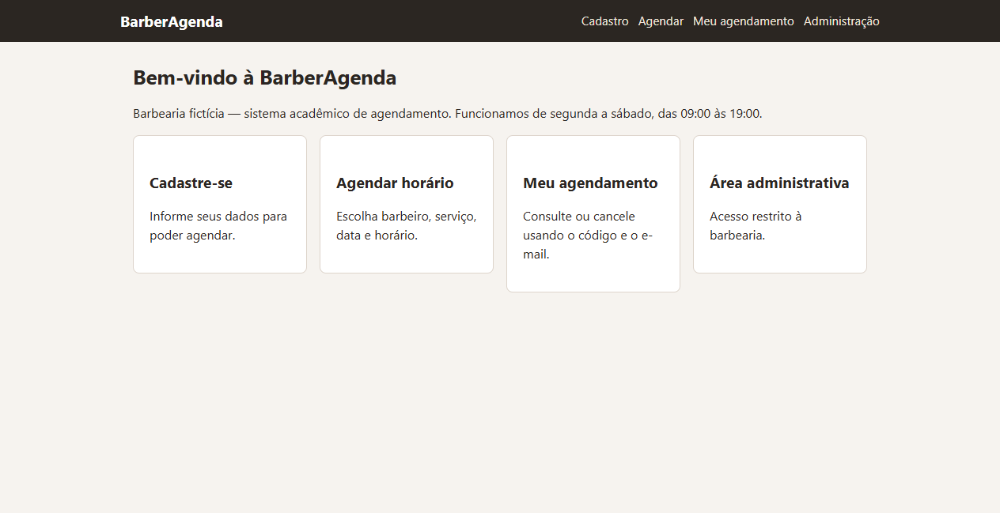{width=78%}
:::

::: {custom-style="Fonte"}
Fonte: Elaborado pelos autores (2026).
:::


## 2.2 Tecnologias e arquitetura

O sistema segue uma arquitetura em camadas. A interface, feita em HTML, CSS e JavaScript sem frameworks, chama a API REST por HTTP/JSON. Os controllers recebem as requisições e validam a entrada; os services aplicam as regras de negócio; os repositories do Spring Data JPA gravam no banco H2. Todas as regras que dependem de data e hora recebem o "agora" de um relógio injetável (`Clock`), o que permite testá-las com uma data fixa. Os erros são devolvidos sempre no mesmo formato JSON (`status`, `erro`, `mensagem`, `campos`), sem detalhes internos.

::: {custom-style="Legenda"}
Figura 2 – Arquitetura em camadas do BarberAgenda
:::

::: {custom-style="Figura"}
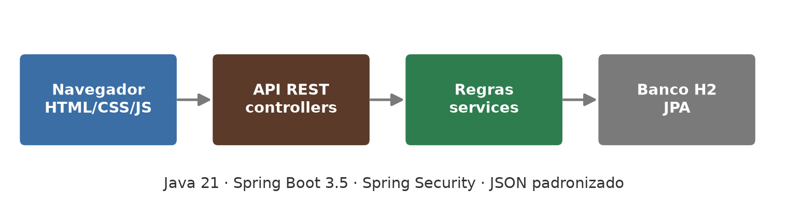{width=92%}
:::

::: {custom-style="Fonte"}
Fonte: Elaborado pelos autores (2026).
:::


::: {custom-style="Legenda"}
Tabela 4 – Tecnologias e responsabilidades de cada camada
:::

| Camada | Tecnologia | Papel |
|-----------------|--------------------------------------------|---------------------------------------|
| Interface | HTML, CSS e JavaScript (páginas estáticas servidas pelo Spring Boot) | Telas do cliente e da área administrativa; chamadas à API com `fetch` |
| API | Java 21, Spring Boot 3.5.16 (Spring Web, Bean Validation) | Rotas REST, validação de entrada, tratamento padronizado de erros (`TratadorErros`) |
| Regras de negócio | Services (`AgendamentoService`, `RegrasAgendamento`, `PoliticaCancelamento`, `ClienteService`, `BarbeiroService`) | Funcionamento, intervalos, antecedência, conflito, limite de ativos, cancelamento |
| Persistência | Spring Data JPA, H2 2.3.232 (arquivo no perfil `dev`, memória no perfil `test`) | Clientes, barbeiros, serviços, agendamentos e usuário administrador |
| Segurança | Spring Security 6 | Login por formulário e HTTP Basic, senha com hash BCrypt, proteção CSRF por cookie e cabeçalho |
| Build | Maven Wrapper (Maven 3.10.1) | Compilação, testes, cobertura (JaCoCo) e empacotamento em um único `.jar` |

::: {custom-style="Fonte"}
Fonte: Elaborado pelos autores (2026).
:::


## 2.3 Integrações entre componentes

::: {custom-style="Legenda"}
Tabela 5 – Integrações do BarberAgenda e onde cada uma foi verificada
:::

| Integração | Mecanismo | Como foi testada |
|------------------------|---------------------------------|-------------------------------------------|
| Interface ↔ API | HTTP/JSON (`fetch`), cookie e cabeçalho CSRF nas alterações administrativas | Casos manuais pela tela; Selenium (cadastro, agendamento, consulta, cancelamento, administração) |
| API ↔ regras de negócio | Chamadas entre camadas, injeção de dependência | Testes de integração com MockMvc (RF-09); Newman (26 requisições) |
| Regras ↔ banco H2 | Spring Data JPA | Encadeamento no Newman (cadastro → agendamento → consulta → cancelamento); TNF-05 (dados preservados após reinício) |
| Spring Security ↔ área administrativa | Sessão, HTTP Basic e CSRF | CT-027 a CT-029; TNF-02 (28 requisições sem credencial ou com senha errada) |
| Repositório ↔ pipeline | GitHub Actions a cada `push` e `pull_request` | 3 execuções documentadas: aprovada, falha proposital e correção (seção 11.2) |

::: {custom-style="Fonte"}
Fonte: Elaborado pelos autores (2026).
:::


## 2.4 Regras de negócio

::: {custom-style="Legenda"}
Tabela 6 – Regras de negócio do BarberAgenda (base dos valores limite)
:::

| ID | Regra |
|----------|------------------------------------------------------------------------------------------|
| RN-01 | Nome do cliente obrigatório, de 3 a 60 caracteres |
| RN-02 | Telefone somente com dígitos, 10 ou 11 dígitos (com DDD) |
| RN-03 | E-mail em formato válido e único entre clientes (sem diferenciar maiúsculas) |
| RN-04 | Funcionamento de segunda a sábado, das 09:00 às 19:00; o serviço precisa terminar até 19:00; domingo fechado |
| RN-05 | Agendamentos começam em intervalos de 30 minutos (minuto 00 ou 30) |
| RN-06 | Não é permitido agendar no passado; antecedência máxima de 30 dias |
| RN-07 | Um barbeiro não pode ter dois agendamentos ativos com horários sobrepostos |
| RN-08 | Um cliente pode ter no máximo 3 agendamentos ativos ao mesmo tempo |
| RN-09 | Serviço com duração de 15 a 180 minutos (múltipla de 15) e preço de R\$ 1,00 a R\$ 1.000,00 |
| RN-10 | Somente barbeiros e serviços ativos recebem agendamentos |
| RN-11 | Área administrativa acessível somente com autenticação |
| RF-09 | Cancelamento pelo cliente somente com no mínimo 2 horas de antecedência (criada por TDD, versão 1.2.0) |

::: {custom-style="Fonte"}
Fonte: Elaborado pelos autores (2026).
:::


## 2.5 Versões e ambiente testado

Todos os testes rodaram em ambiente local, com dados fictícios restaurados antes de cada rodada, e nenhum teste foi executado contra um ambiente de produção ou contra sistemas de terceiros. O sistema passou por quatro versões, todas identificadas por tag no Git:

::: {custom-style="Legenda"}
Tabela 7 – Versões do BarberAgenda e motivo de cada mudança
:::

| Versão (tag) | Mudança | Origem |
|-------------------------|---------------------------------------------------|------------------------|
| 1.0.0 (`v1.0-sistema-base`) | Versão base: cadastro, horários, agendamento, consulta, cancelamento, área administrativa | Construção do sistema |
| 1.0.1 (`v1.0.1-sistema-base`) | A rota de restauração dos dados de teste (`POST /api/dev/reset`) passou a exigir o perfil de administrador | Revisão de segurança do código, antes dos testes |
| 1.1.0 (`v1.1.0-sistema-base`) | A consulta pelo cliente deixou de usar o número sequencial do agendamento e passou a exigir um código de acesso aleatório de 8 caracteres e o e-mail | Revisão de segurança do código, antes dos testes |
| 1.2.0 (`v1.2.0-sistema`) | Nova regra RF-09 (cancelamento com 2 horas de antecedência) e eliminação dos 3 alertas de bug do SonarQube | Ciclo de TDD e análise estática (seção 11) |

::: {custom-style="Fonte"}
Fonte: Elaborado pelos autores (2026).
:::


::: {custom-style="Destaque"}
**Ajustes de segurança feitos antes dos testes.** Na revisão do código da versão 1.0.0, foram encontrados dois problemas: qualquer pessoa podia apagar e recriar os dados pela rota de restauração, e um cliente podia consultar o agendamento de outro trocando o número na URL, porque os números eram sequenciais. Os dois foram corrigidos (versões 1.0.1 e 1.1.0) antes de os casos serem executados e, por isso, não foram registrados como defeitos de execução; estão descritos no Apêndice C como achados de revisão. Os casos CT-024 e CT-029 e o TNF-02 verificam que as correções continuam valendo.
:::

# 3 ESCOPO, REQUISITOS E RISCOS

## 3.1 Escopo

Ficaram no escopo os fluxos do cliente (cadastro, consulta de horários, agendamento, consulta e cancelamento) e do administrador (login, cadastro de barbeiros e serviços, agenda do dia), na interface web, na API REST e no banco H2, nos navegadores Chrome e Firefox. A regra de antecedência mínima para cancelamento foi reservada desde o início para ser criada por TDD e entrou no escopo como RF-09.

::: {custom-style="Legenda"}
Tabela 8 – Itens fora do escopo e motivo
:::

| Item fora do escopo | Motivo |
|-----------------------------------------------|-----------------------------------------------------|
| Login de clientes, recuperação de código de acesso, cadastro de vários administradores | Não existem no sistema. |
| Pagamentos, notificações por e-mail/SMS | Não existem no sistema. |
| Perfil PostgreSQL (`docker-compose.yml`) | Opcional; não há Docker no ambiente do grupo. O banco testado é o H2. |
| Testes de carga, estresse e invasão | Proibidos ou desnecessários pela seção 15 do manual; desempenho é verificado apenas de forma básica (RNF-01). |
| Concorrência real (pedidos simultâneos para o mesmo horário) | Exige carga paralela; o bloqueio existe no código, mas não será testado dinamicamente. |
| Navegadores Safari/Edge e dispositivos iOS | Indisponíveis no ambiente do grupo. |
| Conformidade formal de acessibilidade (WCAG) e outros idiomas/fusos | Não fazem parte dos objetivos do sistema; fuso fixo `America/Sao_Paulo`. |
| Rota de apoio `POST /api/dev/reset` como funcionalidade | É ferramenta de teste; seu controle de acesso entra em RNF-02. |

::: {custom-style="Fonte"}
Fonte: Elaborado pelos autores (2026).
:::


## 3.2 Requisitos

Foram definidos 14 requisitos verificáveis – 9 funcionais e 5 não funcionais –, acima do mínimo do manual (6 funcionais e 2 não funcionais). Cada requisito tem identificador único, prioridade e um critério de aceitação observável, com os valores que tornam o resultado objetivo (códigos HTTP, mensagens e limites). A prioridade indica o efeito de uma falha: Alta quando impede o uso principal ou compromete dados, Média quando prejudica parte do uso mas há alternativa.

::: {custom-style="Legenda"}
Tabela 9 – Requisitos funcionais (modelo do Apêndice B do manual)
:::

| ID | Descrição verificável | Prior. | Critério de aceitação |
|----------|------------------------------|----------|---------------------------------------------------|
| RF-01 | O cliente se cadastra informando nome, telefone e e-mail. Regras RN-01 (nome com 3 a 60 caracteres), RN-02 (telefone só com dígitos, 10 ou 11) e RN-03 (e-mail válido e único). | Alta | (a) Dados válidos → HTTP 201, cliente criado com id e mensagem "Cadastro realizado com sucesso!" na tela. (b) Nome com 2 ou 61 caracteres, telefone com 9 ou 12 dígitos ou com letras, e-mail sem "@" ou sem domínio → HTTP 400 com a mensagem do campo correspondente, e nenhum cliente criado. (c) E-mail já cadastrado, mesmo com letras maiúsculas → HTTP 409 e nenhum cliente criado. |
| RF-02 | O sistema informa os horários de início disponíveis para um barbeiro ativo, um serviço ativo e uma data. | Alta | (a) São listados somente horários a partir de 09:00, de 30 em 30 minutos, cujo término (início + duração) seja até 19:00. (b) Não são listados horários que se sobrepõem a agendamentos `AGENDADO` do barbeiro nem horários que já passaram. (c) Domingo, data passada ou data além de hoje + 30 dias → lista vazia. (d) Barbeiro ou serviço inativo → HTTP 400; inexistente → HTTP 404. |
| RF-03 | O cliente cadastrado cria um agendamento escolhendo barbeiro, serviço, data e horário. Regras RN-04, RN-05, RN-06 e RN-10. | Alta | (a) Pedido válido → HTTP 201, status `AGENDADO`, término = início + duração do serviço e código de acesso de 8 caracteres exibido ao cliente. (b) Início antes de 09:00, término depois de 19:00, domingo, minuto diferente de 00/30, horário passado ou data além de hoje + 30 → HTTP 400 com mensagem da regra, sem agendamento criado. (c) Barbeiro ou serviço inativo → HTTP 400. (d) E-mail não cadastrado → HTTP 404. |
| RF-04 | O sistema impede conflito de horário do barbeiro (RN-07) e limita a 3 os agendamentos ativos por cliente (RN-08). | Alta | (a) Pedido que se sobrepõe a agendamento `AGENDADO` do mesmo barbeiro → HTTP 409. (b) Horário encostado (um termina 10:30 e o outro começa 10:30) e o mesmo horário com outro barbeiro → aceitos (201). (c) 3º agendamento ativo do cliente → aceito; 4º → HTTP 409. (d) Após o cancelamento de um deles, um novo agendamento é aceito. |
| RF-05 | O cliente consulta e cancela o próprio agendamento informando o código de acesso e o e-mail. | Alta | (a) Código (maiúsculas ou minúsculas) e e-mail corretos → HTTP 200 com barbeiro, serviço, data/hora, valor e status. (b) E-mail divergente, código inexistente ou id numérico → HTTP 404 com a mesma mensagem. (c) Cancelar agendamento `AGENDADO` → status `CANCELADO` e o horário volta a aparecer como disponível. (d) Cancelar agendamento `CANCELADO` ou `CONCLUIDO` → HTTP 409. |
| RF-06 | O administrador acessa a área administrativa com usuário e senha (RN-11). | Alta | (a) Credencial válida → acesso ao painel com o nome do usuário exibido. (b) Senha errada → mensagem "Usuário ou senha inválidos." e permanência na tela de login. (c) Página `/admin/*` sem login → redirecionamento para a tela de login. (d) API administrativa sem credenciais → HTTP 401 (consulta) ou 403 (alteração), sem dados no corpo. (e) "Sair" encerra a sessão: a página administrativa volta a exigir login. |
| RF-07 | O administrador cadastra, edita, desativa e exclui barbeiros e serviços. Regras RN-09 e RN-10. | Média | (a) Serviço com duração 15 a 180 minutos, múltipla de 15, e preço de R$ 1,00 a R$ 1.000,00 → HTTP 201. (b) Duração 14, 20 ou 195 e preço 0,99 ou 1.000,01 → HTTP 400 com mensagem do campo. (c) Barbeiro ou serviço desativado deixa de aparecer para o cliente. (d) Excluir item sem agendamentos → HTTP 204; com agendamentos → HTTP 409. |
| RF-08 | O administrador consulta a agenda do dia de um barbeiro e marca atendimentos como concluídos. | Média | (a) A agenda lista todos os agendamentos do barbeiro na data (qualquer status), em ordem de horário, sem exibir códigos de acesso. (b) Concluir agendamento `AGENDADO` → status `CONCLUIDO`. (c) Concluir agendamento já `CANCELADO` ou `CONCLUIDO` → HTTP 409. |
| RF-09 | O cliente só pode cancelar um agendamento com no mínimo 2 horas de antecedência; caso contrário, o sistema recusa com mensagem explicativa. Criado por TDD no Marco 9. | Média | (a) Cancelar 1h59 ou menos antes do início → HTTP 422 com a mensagem "O cancelamento só pode ser feito com no mínimo 2 horas de antecedência." e o agendamento continua AGENDADO. (b) Cancelar exatamente 2h antes ou mais → HTTP 200, status CANCELADO. |

::: {custom-style="Fonte"}
Fonte: Elaborado pelos autores (2026).
:::


::: {custom-style="Legenda"}
Tabela 10 – Requisitos não funcionais
:::

| ID | Descrição | Prior. | Critério de aceitação |
|-----------|-------------------------|----------|------------------------------------------------------|
| RNF-01 | Desempenho básico das operações principais do cliente. | Média | Em ambiente local (perfil `test`), 30 requisições de `GET /api/horarios-disponiveis` e 30 de `POST /api/agendamentos`, após 5 requisições de aquecimento: **p95 < 500 ms** em cada operação; média e p95 registrados. |
| RNF-02 | Segurança básica: controle de acesso, proteção de credenciais e de dados exibidos. | Alta | (a) Nenhuma rota `/api/admin/**` nem `GET /api/clientes` devolve dados sem credencial. (b) A senha do administrador é armazenada apenas como hash BCrypt (valor iniciando com `$2a$`, `$2b$` ou `$2y$`), nunca em texto. (c) Nome com `<script>alert(1)</script>` é exibido como texto, sem executar. (d) Nenhuma resposta de erro contém stack trace ou nome de classe Java. |
| RNF-03 | Compatibilidade de navegador e resolução. | Média | Os fluxos de cadastro, agendamento e consulta são concluídos no Chrome e no Firefox, nas resoluções 1366×768 e 375×667, sem rolagem horizontal da página e com todos os campos e botões visíveis. |
| RNF-04 | Confiabilidade: persistência e tratamento de falhas. | Média | (a) Após reinício controlado da aplicação no perfil `dev`, 100% dos clientes e agendamentos criados antes do reinício continuam disponíveis com os mesmos dados. (b) Entradas inválidas (JSON malformado, tipos errados, parâmetros ausentes) nunca produzem HTTP 500. |
| RNF-05 | Usabilidade do fluxo de agendamento. | Média | Participante externo ao grupo, sem instruções além do objetivo da tarefa, conclui cadastro + agendamento em **até 5 minutos**, sem ajuda, e avalia a facilidade com nota **≥ 4 em 5**. |

::: {custom-style="Fonte"}
Fonte: Elaborado pelos autores (2026).
:::


## 3.3 Riscos e prioridades

Cada risco de produto foi classificado por probabilidade e impacto (Baixa, Média ou Alta). A prioridade combina os dois e define a ordem de execução: os riscos de prioridade Alta foram especificados e executados primeiro, foram automatizados em mais de um nível e entram em todas as regressões.

::: {custom-style="Legenda"}
Tabela 11 – Matriz de riscos do produto (modelo do Apêndice C do manual)
:::

| ID | Risco | Req. | Prob. | Impacto | Prior. | Resposta / teste |
|--------|----------------------|------------|---------|------------|----------|--------------------------|
| R-01 | Dois clientes agendados para o mesmo barbeiro em horários sobrepostos. | RF-04 | Média | Alto | Alta | Casos de sobreposição total, parcial e encostada (valor limite); testes de unidade da verificação de sobreposição; teste de API com 409; regressão a cada correção. |
| R-02 | Agendamento aceito fora do funcionamento, no domingo ou fora dos intervalos de 30 minutos. | RF-03, RF-02 | Média | Alto | Alta | Valor limite de início (08:30, 09:00) e de término (19:00, 19:15/19:30); domingo; minutos 00/15/30; testes de unidade com relógio fixo. |
| R-03 | Acesso à área administrativa ou a dados pessoais sem autenticação. | RF-06, RNF-02 | Média | Alto | Alta | Acesso direto às páginas e à API sem login, com senha errada e sem token CSRF; verificação de 401/403 e de corpo sem dados. |
| R-04 | Regras de data falham perto dos limites (horário que acabou de passar, 30 e 31 dias). | RF-03, RF-02 | Média | Médio | Média | Valor limite de antecedência (hoje em horário passado, hoje + 30, hoje + 31); testes de unidade com `Clock` fixo. |
| R-05 | Dados inválidos aceitos no cadastro de cliente ou de serviço. | RF-01, RF-07 | Média | Médio | Média | Partições e limites de nome, telefone, e-mail, duração e preço; verificação de que nenhum registro é criado no erro. |
| R-06 | Cliente ultrapassa o limite de 3 agendamentos ativos. | RF-04 | Baixa | Médio | Média | Casos do 3º e do 4º agendamento; cancelamento libera nova vaga. |
| R-07 | Pessoa consulta ou cancela agendamento de outra. | RF-05 | Baixa | Alto | Média | Consulta com e-mail divergente, código inexistente e id numérico; cancelamento com e-mail errado. |
| R-08 | Texto digitado com HTML/script é executado na página. | RNF-02 | Baixa | Alto | Média | Cadastro com `<script>` e `` e verificação visual nas telas de consulta e da agenda administrativa. |
| R-09 | Interface inutilizável no celular ou no Firefox. | RNF-03 | Média | Médio | Média | Execução dos fluxos e da suíte Selenium em Chrome/Firefox e em 375×667. |
| R-10 | Perda de agendamentos após reinício da aplicação. | RNF-04 | Baixa | Alto | Média | Criar dados, reiniciar no perfil `dev` e comparar. |
| R-11 | Consulta de horários lenta, prejudicando o agendamento. | RNF-01, RF-02 | Baixa | Baixo | Baixa | Medição de 30 repetições com média e p95. |
| R-12 | Cancelamento em cima da hora deixa o horário ocioso sem tempo de reocupação. | RF-09 | Média | Médio | Média | Regra criada por TDD; limites 1h59/2h00 em unidade e integração; CT-036. |

::: {custom-style="Fonte"}
Fonte: Elaborado pelos autores (2026).
:::


::: {custom-style="Legenda"}
Figura 3 – Mapa de calor dos riscos: probabilidade × impacto
:::

::: {custom-style="Figura"}
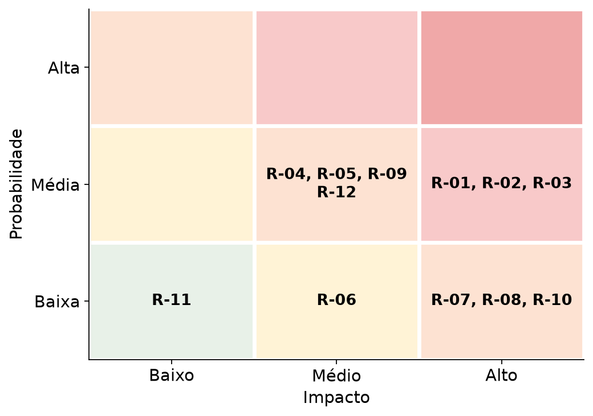{width=62%}
:::

::: {custom-style="Fonte"}
Fonte: Elaborado pelos autores (2026).
:::


Três riscos ficaram com prioridade Alta, todos com impacto alto: R-01 (dois clientes no mesmo horário com o mesmo barbeiro), R-02 (agendamento fora do funcionamento ou fora dos intervalos) e R-03 (acesso à área administrativa ou a dados pessoais sem autenticação). Nenhum deles se concretizou nos testes: as regras de conflito e de funcionamento foram verificadas nos valores limite em três níveis (unidade, API e interface), e as 28 tentativas de acesso sem credencial do TNF-02 foram recusadas. O R-12 (cancelamento em cima da hora) foi tratado por meio de uma nova regra, criada por TDD.

# 4 PLANEJAMENTO DOS TESTES

Esta seção resume o plano de testes do projeto (produto P03), organizado nos campos do Apêndice D do manual. O documento completo está em `entrega/03_PLANO_DE_TESTES/`.

## 4.1 Identificação, objetivo e escopo

::: {custom-style="Legenda"}
Tabela 12 – Identificação e objetivo do plano de testes
:::

| Campo | Definição |
|--------------|--------------------------------------------------------------------------------------|
| Sistema e versão | BarberAgenda 1.1.0 (tag `v1.1.0-sistema-base`); 1.2.0 após o TDD (tag `v1.2.0-sistema`) |
| Base de teste | Especificação do sistema (`docs/ESPECIFICACAO_SISTEMA.md`, v1.3) e P02 (requisitos e riscos) |
| Objetivo | Verificar, com evidências reproduzíveis, se o sistema atende aos requisitos RF-01 a RF-09 e RNF-01 a RNF-05, priorizando os riscos R-01, R-02 e R-03, e informar os defeitos, riscos residuais e oportunidades de melhoria |
| Escopo | Interface web, API REST e banco H2 (perfis `dev` e `test`), Chrome e Firefox, resoluções 1366×768 e 375×667 |
| Fora do escopo | Itens listados na seção 3.1; testes de carga, estresse e invasão; qualquer teste em produção |

::: {custom-style="Fonte"}
Fonte: Elaborado pelos autores (2026).
:::


## 4.2 Níveis, tipos e técnicas

A estratégia segue a pirâmide de testes: muitos testes rápidos onde ficam as regras (unidade), menos testes na API e poucos na interface, que são mais lentos e mais frágeis. Os casos foram derivados da especificação (caixa-preta), e não do código, para reduzir o viés de quem construiu o sistema; a aceitação foi planejada para uma pessoa externa ao grupo pelo mesmo motivo.

::: {custom-style="Legenda"}
Figura 4 – Pirâmide de testes aplicada ao BarberAgenda (quantidades da versão 1.2.0)
:::

::: {custom-style="Figura"}
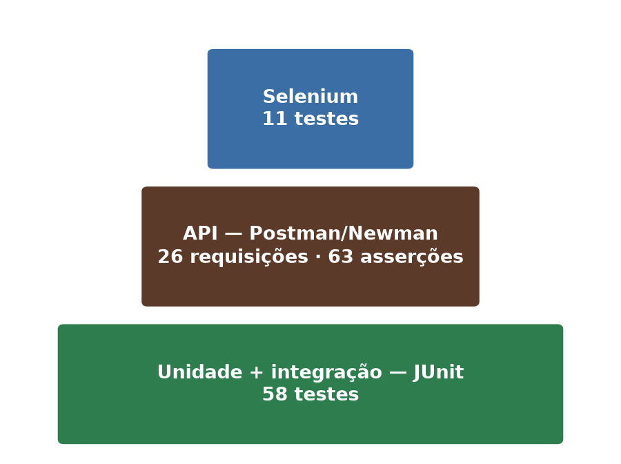{width=62%}
:::

::: {custom-style="Fonte"}
Fonte: Elaborado pelos autores (2026).
:::


::: {custom-style="Legenda"}
Tabela 13 – Níveis de teste: planejado e realizado
:::

| Nível | Objeto | Ferramenta | Mínimo do manual | Realizado |
|----------------|--------------------------|--------------------|-----------------|---------------------|
| Unidade | Regras na camada de serviço e validações de entrada | JUnit 5, AssertJ, Mockito | 6 testes | 58 execuções de teste (unidade + integração), 0 falhas |
| Integração/API | API REST com o banco | Postman/Newman; MockMvc | 5 requisições | 26 requisições, 63 asserções, 0 falhas |
| Sistema (manual) | Aplicação completa | Execução dos casos do P04 | 24 casos | 36 casos: 35 aprovados e 1 bloqueado |
| Sistema (interface) | Fluxos completos no navegador | Selenium WebDriver 4.53 (Page Objects) | 4 testes | 11 testes × 4 combinações = 44 execuções, 0 falhas |
| Aceitação | Cenários do cliente e do dono | Roteiro Dado/Quando/Então | 4 cenários | 4 cenários prontos; aguardam pessoa externa |
| Não funcional | Desempenho, segurança, confiabilidade, compatibilidade, usabilidade | Scripts Python, Selenium, H2 Shell | 6 testes em 3 categorias | 8 testes em 5 categorias; 7 executados |

::: {custom-style="Fonte"}
Fonte: Elaborado pelos autores (2026).
:::


Os **tipos** de teste aplicados foram: funcional (RF-01 a RF-09, em todos os níveis), não funcional (RNF-01 a RNF-05), confirmação (reexecução após mudança de versão), regressão (suítes automatizadas completas a cada mudança e no pipeline) e, como complemento, teste estático (revisão de código e SonarQube).

::: {custom-style="Legenda"}
Tabela 14 – Técnicas de especificação e onde foram aplicadas
:::

| Técnica | Requisitos | Exemplos |
|------------------------|---------------------|--------------------------------------------------------|
| Particionamento de equivalência | RF-01, RF-03, RF-07 | Telefone: válido (10–11 dígitos), inválido (letras, 9 ou 12 dígitos); serviço ativo × inativo |
| Análise de valor limite | RF-01, RF-02, RF-03, RF-04, RF-07 | Nome 2/3/60/61; início 08:30/09:00; término 19:00/19:30; antecedência hoje + 30 / + 31; 3º/4º agendamento; duração 14/15/180/195; preço 0,99/1,00/1.000,00/1.000,01 |
| Transição de estados | RF-05, RF-08 | `AGENDADO` → `CANCELADO`; `AGENDADO` → `CONCLUIDO`; operações inválidas a partir de `CANCELADO`/`CONCLUIDO` |
| Tabela de decisão | RF-05 | Combinações código correto/incorreto × e-mail correto/incorreto |
| Baseada em experiência | RNF-02, RNF-03 | Entradas com HTML/script, espaços e acentos; uso em tela de celular |

::: {custom-style="Fonte"}
Fonte: Elaborado pelos autores (2026).
:::


## 4.3 Ambiente, ferramentas e dados

::: {custom-style="Legenda"}
Tabela 15 – Ambiente e ferramentas (versões registradas em `entrega/01_SISTEMA_ALVO/ambiente.md`)
:::

| Recurso | Especificação usada |
|-----------------------|-----------------------------------------------------------------------------|
| Equipamento | Computador do grupo com Windows 11 Pro 10.0.26200 (64 bits) |
| Aplicação | Local em `http://localhost:8080`; perfil `test` (H2 em memória) para os testes automatizados e `dev` (H2 em arquivo) para os testes manuais e de confiabilidade |
| Linguagem e build | Java 21.0.13 (Temurin), Maven 3.10.1 (wrapper), Spring Boot 3.5.16 |
| Testes de unidade | JUnit Jupiter 5.12.2, Mockito 5.17.0, AssertJ 3.27.7, JaCoCo 0.8.16 |
| API | Postman (coleção gerada por `scripts/gerar_colecao_postman.py`) e Newman 6.2.3 |
| Interface | Selenium WebDriver 4.53.0; Google Chrome 157 e Mozilla Firefox 160 (headless) |
| Não funcionais | Python 3.11.9 (`scripts/nf/`), H2 Shell |
| Análise estática | SonarQube Community Build 26.11 (instalação local) |
| CI/CD | GitHub Actions (runner Ubuntu, Java 21) |
| Defeitos | GitHub Issues com modelo de relatório (Apêndice G do manual) e etiquetas de severidade, prioridade e status |
| Controle e rastreabilidade | Planilha P05 (XLSX) gerada a partir de `dados/` por `scripts/gerar_artefatos.py` |

::: {custom-style="Fonte"}
Fonte: Elaborado pelos autores (2026).
:::


**Dados de teste.** Somente dados fictícios: nomes inventados, telefones fictícios, e-mails `@exemplo.com` e credencial de administrador fictícia (`admin` / `admin123`, apenas nos perfis de teste). A massa inicial tem 3 barbeiros (1 inativo), 5 serviços (1 inativo), 10 clientes e 5 agendamentos com datas relativas ao dia atual e códigos de acesso fixos (`SEMENTE2` a `SEMENTE6`). Antes de cada sessão manual e de cada suíte automatizada, os dados são restaurados por `scripts/reset-dados` (que chama `POST /api/dev/reset` como administrador). Dados criados pelos testes usam e-mails com sufixo único por execução, e os testes de unidade usam um relógio fixo em quarta-feira, 18/11/2026, 10:00.

## 4.4 Responsabilidades

O grupo tem dois integrantes; por isso, os papéis da seção 4.2 do manual foram acumulados, e os dois participaram de todas as etapas.

::: {custom-style="Legenda"}
Tabela 16 – Papéis e responsabilidades
:::

| Papel | Responsabilidades principais | Responsável principal | Apoio |
|--------------------|------------------------------------------|--------------------|------------------|
| Coordenação e planejamento | Prazos, plano de testes, riscos, versões, integração dos documentos, comunicação com o professor | Guilherme Ribeiro Zangrande | José Paulo Dassie Felippi |
| Análise e execução manual | Requisitos, casos de teste, dados, execução manual, registro de defeitos, retestes | José Paulo Dassie Felippi | Guilherme Ribeiro Zangrande |
| Automação e qualidade | Ferramentas, scripts automatizados, métricas, SonarQube, TDD e CI/CD | Guilherme Ribeiro Zangrande | José Paulo Dassie Felippi |

::: {custom-style="Fonte"}
Fonte: Elaborado pelos autores (2026).
:::


O papel de **representante do usuário**, que executa a aceitação e a usabilidade, precisa ser de uma pessoa externa ao grupo e ainda está pendente (Apêndice H).

## 4.5 Critérios

::: {custom-style="Legenda"}
Tabela 17 – Critérios de entrada e de saída
:::

| Critério | Definição adotada |
|------------|----------------------------------------------------------------------------------------|
| Entrada | Versão identificada (tag ou commit) e compilando com `./mvnw -DskipTests package`; aplicação no ar no perfil previsto e `scripts/verificar-sistema.sh` sem falhas; dados restaurados; casos especificados e revisados pelo outro integrante; ferramentas instaladas, com versão registrada |
| Saída | 100% dos casos executados ou com justificativa registrada; todos os requisitos com ao menos um teste executado; nenhum defeito Crítico ou Alto aberto; todo defeito corrigido com reteste e regressão; suítes automatizadas aprovadas no pipeline na versão final; 8 métricas calculadas com dados reais |

::: {custom-style="Fonte"}
Fonte: Elaborado pelos autores (2026).
:::


::: {custom-style="Legenda"}
Tabela 18 – Critérios de suspensão e retomada
:::

| Suspender a execução quando | Retomar quando |
|--------------------------------------------------|--------------------------------------------------|
| A aplicação não compila ou não sobe no perfil previsto | Build e `verificar-sistema.sh` voltam a passar |
| Um defeito Crítico bloqueia 30% ou mais dos casos da rodada | O defeito está "Pronto para reteste" e o reteste foi aprovado |
| Os dados de teste ficam inconsistentes (ex.: restauração falhou) | `reset-dados` executado com sucesso e verificação passando |
| Ferramenta essencial indisponível (navegador, Newman, Java) | Ferramenta reinstalada e versão registrada |
| A versão sob teste mudou sem registro | Nova versão identificada e casos afetados replanejados |

::: {custom-style="Fonte"}
Fonte: Elaborado pelos autores (2026).
:::


## 4.6 Cronograma realizado

Cada marco terminou com uma tag no repositório, o que permite conferir o estado do projeto em cada etapa.

::: {custom-style="Legenda"}
Tabela 19 – Cronograma de marcos e datas de conclusão
:::

| Marco | Entregas | Conclusão (tag) |
|-----------------------|-------------------------------------------------|----------------------------|
| 1 – Fundamentos | Ficha com duas opções de sistema (P01), níveis, tipos e estratégia; sistema base 1.0.0 → 1.1.0 | 18/11/2026 (`marco-1`) |
| 2 – Planejamento | Requisitos, escopo e riscos (P02); plano de testes (P03) | 18/11/2026 (`marco-2`) |
| 3 – Especificação | 36 casos (P04) e matriz de rastreabilidade em XLSX (P05) | 18/11/2026 (`marco-3`) |
| 5 – Automação de unidade | Testes de unidade, JaCoCo e 1ª análise do SonarQube (linha de base) | 18/11/2026 (`marco-5`) |
| 6 – Integração e sistema | Coleção Postman/Newman e testes Selenium | 18/11/2026 (`marco-6`) |
| 7 – Aceitação e não funcionais | Cenários de aceitação, roteiro de usabilidade e 7 testes não funcionais executados | 18/11/2026 (`marco-7`) |
| 4 – Execução e defeitos | Execução dos 35 casos da versão 1.1.0 com evidências (P06); processo de defeitos (P07) | 18/11/2026 (`marco-4`) |
| 9 – TDD, CI/CD e melhoria | Ciclo Red-Green-Refactor (RF-09), versão 1.2.0, pipeline, 2ª análise do SonarQube, plano de melhoria | 18/11/2026 (`marco-9`) |
| 8 – Métricas | 8 indicadores com gráficos e interpretação (P10), calculados com os dados finais | 18/11/2026 (`marco-8`) |
| Aprovação do sistema | Ficha P01 aprovada pelo professor | 19/11/2026 |
| Entrega final | Relatório (P12), apresentação (P13), diário (P14), cópia de segurança | `entrega-final`; relatório ampliado em 26/11/2026 |

::: {custom-style="Fonte"}
Fonte: Elaborado pelos autores (2026).
:::


A automação (marcos 5 e 6) foi feita antes da execução manual (marco 4) de propósito: a execução manual assistida reaproveitou a infraestrutura de Selenium e de chamadas à API, e os testes não funcionais (marco 7) foram executados antes, porque não dependiam do resultado dos casos manuais. O marco 8 foi fechado depois do 9 para que as métricas usassem os dados finais, inclusive a versão 1.2.0.

## 4.7 Riscos do processo de teste

::: {custom-style="Legenda"}
Tabela 20 – Riscos do processo de teste e respostas
:::

| ID | Risco | Probabilidade | Impacto | Resposta |
|----------|-------------------------|------------------|------------|-----------------------------------|
| RP-01 | Prazo curto até a P2 (projeto iniciado em novembro; data da P2 a confirmar) | Alta | Alto | Executar por prioridade de risco; automatizar cedo os casos repetitivos; acompanhar `docs/PROGRESSO.md` a cada fase |
| RP-02 | Falta de pessoa externa para aceitação e usabilidade | Média | Alto | Combinar com antecedência um colega de outro grupo; roteiro pronto para execução em até 20 minutos |
| RP-03 | Ferramenta indisponível no ambiente (Docker para SonarQube, Firefox, Newman) | Média | Médio | Instalar no início da fase que a usa; SonarCloud como alternativa se o repositório for público (exige autorização do professor para troca de ferramenta) |
| RP-04 | Opção 1 não aprovada ou aprovada com ajustes | Baixa | Alto | Documentos versionados; ajuste de escopo registrado como nova versão do P02 e deste plano |
| RP-05 | Viés: o grupo construiu o sistema que testa | Alta | Médio | Casos derivados da especificação (caixa-preta); aceitação por pessoa externa; revisão cruzada dos casos entre os integrantes |
| RP-06 | Testes de interface instáveis (dependência de tempo e de carregamento) | Média | Médio | Esperas explícitas (`WebDriverWait`), dados restaurados antes de cada teste, `Clock`/datas relativas |
| RP-07 | Falha de rede ou equipamento no dia da apresentação | Baixa | Alto | Execução local, capturas, logs e vídeo de contingência (seção 13.2 do manual) |

::: {custom-style="Fonte"}
Fonte: Elaborado pelos autores (2026).
:::


## 4.8 Gestão de defeitos

::: {custom-style="Legenda"}
Tabela 21 – Severidade, prioridade e ciclo de vida dos defeitos
:::

| Item | Definição |
|----------------------|------------------------------------------------------------------------------|
| Ferramenta | GitHub Issues do repositório, no modelo do Apêndice G |
| Severidade (impacto técnico) | **Crítica:** impede o uso principal ou corrompe/expõe dados. **Alta:** regra de negócio importante violada, sem alternativa. **Média:** função prejudicada com alternativa. **Baixa:** problema visual ou de texto sem prejuízo funcional |
| Prioridade (urgência da correção) | **Alta:** corrigir antes da próxima rodada. **Média:** corrigir no ciclo atual. **Baixa:** pode ficar para melhoria futura |
| Status | Novo → Em análise → Em correção → Pronto para reteste → Encerrado (ou Reaberto, se o reteste falhar) |
| Regra | Registrar somente defeitos reais observados na execução; cada defeito aponta requisito, caso, execução e evidência |

::: {custom-style="Fonte"}
Fonte: Elaborado pelos autores (2026).
:::


## 4.9 Produtos, versionamento e comunicação

Código, scripts, dados e documentos ficam no repositório Git, com commits pequenos em português no padrão `tipo: descrição` e uma tag por marco e por versão do sistema; nenhum histórico foi reescrito. A pasta `entrega/` espelha as 17 pastas obrigatórias do Drive (00 a 16). Todos os artefatos derivados – catálogo de casos, registro de execução, planilha de rastreabilidade, gráficos de métricas e este relatório – são gerados por scripts a partir de uma única fonte de dados (`dados/`), o que evita números diferentes entre documentos. A comunicação com o professor segue os canais da disciplina; entre os integrantes, o andamento é registrado em `docs/PROGRESSO.md`.

## 4.10 Método de execução e uso de ferramentas de IA

::: {custom-style="Destaque"}
**Transparência sobre o método.** Os casos manuais foram executados em **execução assistida por script** (`scripts/execucao_assistida.py`), feita por Claude (IA) a pedido do grupo: o script segue os passos exatos de cada caso do P04, usando Selenium nos passos de tela e chamadas reais à API nos demais, compara o obtido com o esperado, grava a transcrição de cada verificação e captura a tela. Antes do registro oficial, um ensaio completo foi feito fora do registro para separar erros do próprio script de possíveis defeitos do sistema; as falhas do ensaio eram do script e foram corrigidas nele. Cada execução registra o executor, e qualquer caso pode ser reexecutado à mão seguindo os mesmos passos. Nenhum dado, defeito ou métrica foi fabricado.
:::

# 5 ESPECIFICAÇÃO DOS CASOS DE TESTE

Foram especificados 36 casos de teste manuais (CT-001 a CT-036; mínimo exigido: 24), no modelo do Apêndice E do manual. Cada caso está ligado a um requisito, a um risco e a uma regra, e tem pré-condições, dados, passos numerados, resultado esperado observável, prioridade e indicação de candidato à automação. O catálogo completo está no Apêndice A.

::: {custom-style="Legenda"}
Tabela 22 – Distribuição dos casos por técnica de projeto
:::

| Técnica (principal) | Casos | Qtd. |
|---------------------------|-----------------------------------------------------------------|--------|
| Análise de valor limite | CT-002, CT-003, CT-004, CT-007, CT-008, CT-011, CT-012, CT-013, CT-015, CT-016, CT-019, CT-020, CT-021, CT-030, CT-031, CT-036 | 16 |
| Particionamento de equivalência | CT-001, CT-005, CT-006, CT-009, CT-014, CT-017, CT-018, CT-028, CT-029, CT-032, CT-033 | 11 |
| Transição de estados | CT-022, CT-025, CT-026, CT-034, CT-035 | 5 |
| Caso de uso (fluxo principal) | CT-010, CT-027 | 2 |
| Tabela de decisão | CT-023, CT-024 | 2 |

::: {custom-style="Fonte"}
Fonte: Elaborado pelos autores (2026).
:::


::: {custom-style="Legenda"}
Tabela 23 – Distribuição dos casos por classificação
:::

| Classificação | Casos | Qtd. |
|------------------|--------------------------------------------------------------------------|--------|
| Fronteira | CT-002, CT-003, CT-011, CT-012, CT-015, CT-020, CT-021, CT-030, CT-036 | 9 |
| Negativo | CT-004, CT-005, CT-013, CT-014, CT-016, CT-019, CT-024, CT-028, CT-031 | 9 |
| Positivo | CT-001, CT-007, CT-010, CT-023, CT-025, CT-027, CT-034 | 7 |
| Alternativo | CT-008, CT-009, CT-022, CT-026, CT-032, CT-035 | 6 |
| Exceção | CT-006, CT-017, CT-018, CT-029, CT-033 | 5 |

::: {custom-style="Fonte"}
Fonte: Elaborado pelos autores (2026).
:::


::: {custom-style="Legenda"}
Tabela 24 – Casos e testes por requisito
:::

| Requisito | Casos manuais (P04) | Aceitação e não funcionais (P09) | Total |
|--------------|--------------------------------------------------|----------------------------|---------|
| RF-01 | CT-001, CT-002, CT-003, CT-004, CT-005, CT-006 | CA-01 | 7 |
| RF-02 | CT-007, CT-008, CT-009 | CA-01 | 4 |
| RF-03 | CT-010, CT-011, CT-012, CT-013, CT-014, CT-015, CT-016, CT-017, CT-018 | CA-01 | 10 |
| RF-04 | CT-008, CT-019, CT-020, CT-021, CT-022 | CA-03 | 6 |
| RF-05 | CT-022, CT-023, CT-024, CT-025, CT-026 | CA-02 | 6 |
| RF-06 | CT-027, CT-028, CT-029 | TNF-02, CA-04 | 5 |
| RF-07 | CT-030, CT-031, CT-032, CT-033 | CA-04 | 5 |
| RF-08 | CT-034, CT-035 | CA-04 | 3 |
| RF-09 | CT-036 | — | 1 |
| RNF-01 | — | TNF-01 | 1 |
| RNF-02 | — | TNF-02, TNF-03, TNF-04 | 3 |
| RNF-03 | — | TNF-07 | 1 |
| RNF-04 | — | TNF-05, TNF-06 | 2 |
| RNF-05 | — | TNF-08 | 1 |

::: {custom-style="Fonte"}
Fonte: Elaborado pelos autores (2026).
:::


## 5.1 Particionamento de equivalência e valores limite

Para cada regra com intervalo, foram identificadas as classes válidas e inválidas e escolhidos os valores exatamente nas fronteiras e imediatamente fora delas:

::: {custom-style="Legenda"}
Tabela 25 – Partições e valores limite por regra (P04, seção 2.1)
:::

| Regra | Variável | Classes válidas | Classes inválidas | Valores limite testados | Casos |
|----------|------------------|-------------------------|-----------------|------------------|------------|
| RN-01 | Tamanho do nome | 3 a 60 caracteres | menos de 3; mais de 60 | 2 ✗, 3 ✓, 60 ✓, 61 ✗ | CT-002, CT-003 |
| RN-02 | Telefone | só dígitos, 10 ou 11 | menos de 10 dígitos; mais de 11; com caracteres não numéricos | 9 ✗, 10 ✓, 11 ✓, 12 ✗; com hífens ✗ | CT-002, CT-004 |
| RN-03 | E-mail | formato `usuario@dominio.ext` ainda não cadastrado | sem `@`; sem domínio de topo; já cadastrado (qualquer caixa) | — | CT-001, CT-005, CT-006 |
| RN-04 | Dia e horário | segunda a sábado, início ≥ 09:00 e término ≤ 19:00 | domingo; início < 09:00; término > 19:00 | início 08:30 ✗ / 09:00 ✓; término 19:00 ✓ / 19:30 ✗ (serviço de 60 min às 18:00 e 18:30); último início de serviço de 30 min 18:30 ✓ | CT-007, CT-011, CT-012, CT-014 |
| RN-05 | Minuto de início | 00 ou 30 | qualquer outro minuto | 10:01 ✗, 10:15 ✗ (10:00 e 10:30 ✓ nos demais casos) | CT-013 |
| RN-06 | Momento do início | depois de agora e data ≤ D+30 | passado (antes de agora); data > D+30 | ONTEM ✗; hoje às 09:00 depois das 09:30 ✗; D+30 ✓; D+31 ✗ | CT-009, CT-015, CT-016 |
| RN-07 | Intervalo × agendamentos do barbeiro | sem interseção com `AGENDADO` do mesmo barbeiro (inclui encostar); outro barbeiro | interseção com `AGENDADO` do mesmo barbeiro | término = início do existente ✓; início = término do existente ✓; 30 min de interseção no início e no fim ✗ | CT-008, CT-019, CT-020 |
| RN-08 | Agendamentos ativos do cliente antes do pedido | 0 a 2 | 3 ou mais | 3º pedido ✓; 4º pedido ✗; após cancelar 1 ✓ | CT-021, CT-022 |
| RN-09 | Duração do serviço | 15 a 180, múltiplo de 15 | < 15; > 180; não múltiplo de 15 | 14 ✗, 15 ✓, 20 ✗, 180 ✓, 195 ✗ | CT-030, CT-031 |
| RN-09 | Preço do serviço | R$ 1,00 a R$ 1.000,00 | < 1,00; > 1.000,00 | 0,99 ✗, 1,00 ✓, 1.000,00 ✓, 1.000,01 ✗ | CT-030, CT-031 |
| RN-10 | Situação de barbeiro/serviço | ativo | inativo | — | CT-017, CT-032 |
| RF-09 | Antecedência do cancelamento | início ≥ agora + 2 h | início < agora + 2 h | 1h59 ✗ / 2h00 ✓ (unidade e integração com relógio fixo) | CT-036 |
| RN-11 | Credencial | administrador autenticado | sem credencial; senha errada | — | CT-027, CT-028, CT-029 |

::: {custom-style="Fonte"}
Fonte: Elaborado pelos autores (2026).
:::


**Exemplo detalhado – horário de funcionamento (CT-012).** A regra RN-04 aceita atendimentos que começam a partir de 09:00 e terminam até 19:00. Há duas fronteiras: a de início (abertura) e a de término (fechamento), que depende da duração do serviço. Os valores testados e o resultado obtido na execução EX-012 foram:

::: {custom-style="Legenda"}
Tabela 26 – Valores limite do CT-012 e resultado obtido (EX-012)
:::

| Entrada | Classe | Esperado | Obtido (EX-012) |
|--------------------------|----------------------------|---------------------------|-------------------|
| Corte de cabelo (30 min) às 08:30 | Inválida: começa antes da abertura | HTTP 400 com a mensagem da regra | HTTP 400 – aprovado |
| Corte e barba (60 min) às 18:30 | Inválida: terminaria às 19:30 | HTTP 400 com a mensagem da regra | HTTP 400 – aprovado |
| Corte e barba (60 min) às 18:00 | Válida: termina exatamente às 19:00 | HTTP 201, status AGENDADO | HTTP 201 – aprovado |

::: {custom-style="Fonte"}
Fonte: Elaborado pelos autores (2026).
:::


O limite inferior válido (09:00) e o último início possível de cada serviço foram cobertos pelo CT-011, e o teste de unidade `RegrasAgendamentoTest` repete os mesmos valores com um relógio fixo.

## 5.2 Transição de estados

O agendamento tem três estados. Os casos cobrem as transições válidas e as tentativas inválidas a partir dos estados finais:

::: {custom-style="Legenda"}
Tabela 27 – Transições de estado do agendamento (P04, seção 2.2)
:::

| Estado atual | Evento | Próximo estado / resposta | Casos |
|-----------------|------------------------------|-----------------------------------|------------------|
| (novo) | Agendar | AGENDADO | CT-010 |
| AGENDADO | Cancelar (cliente) | CANCELADO | CT-022, CT-025 |
| AGENDADO | Concluir (administrador) | CONCLUIDO | CT-034 |
| CANCELADO | Cancelar | HTTP 409, permanece CANCELADO | CT-026 |
| CONCLUIDO | Cancelar | HTTP 409, permanece CONCLUIDO | CT-026 |
| CANCELADO | Concluir | HTTP 409, permanece CANCELADO | CT-035 |

::: {custom-style="Fonte"}
Fonte: Elaborado pelos autores (2026).
:::


## 5.3 Tabela de decisão

A consulta pelo cliente (RF-05) depende de duas condições, o código de acesso e o e-mail, e todas as combinações foram cobertas:

::: {custom-style="Legenda"}
Tabela 28 – Tabela de decisão da consulta pelo cliente (P04, seção 2.3)
:::

| Regra | Código existe? | E-mail é o do agendamento? | Resultado | Casos |
|----------|-------------------------|-------------------------|----------------------------|------------|
| 1 | Sim (inclusive em minúsculas) | Sim | Exibe o agendamento | CT-023 |
| 2 | Sim | Não | "Agendamento não encontrado..." | CT-024 (a) |
| 3 | Não | Sim | "Agendamento não encontrado..." | CT-024 (b) |
| 4 | Não (número sequencial) | Sim | "Agendamento não encontrado..." | CT-024 (c) |

::: {custom-style="Fonte"}
Fonte: Elaborado pelos autores (2026).
:::


## 5.4 Candidatos à automação

Foram marcados como candidatos à automação os casos repetitivos, de risco alto e com resultado objetivo, além dos testes não funcionais que podem ser medidos por script. Ao todo, 39 casos e testes foram planejados para automação e 39 estão automatizados (100,0%). Não foram automatizados os cenários de aceitação e o teste de usabilidade, que dependem de pessoas, e os casos de baixo valor de automação, com justificativa no catálogo. Cada teste automatizado indica no nome ou no `@DisplayName` o caso e o requisito que representa (Apêndice F).

# 6 EXECUÇÃO MANUAL E DEFEITOS

## 6.1 Procedimento

A execução seguiu os passos da seção 9.6 do manual: (1) confirmar os critérios de entrada; (2) restaurar os dados fictícios; (3) executar cada passo exatamente como especificado; (4) comparar o obtido com o esperado; (5) classificar o caso como Aprovado, Reprovado, Bloqueado ou Não executado; (6) guardar a evidência com o identificador da execução, do caso e a data; (7) registrar defeito quando houver falha; e (8) depois de uma correção ou mudança de versão, fazer o reteste e a regressão.

As evidências seguem o padrão `EX-NNN_CT-NNN_AAAA-MM-DD` – transcrição em `.txt` com cada requisição, resposta e verificação, e captura de tela em `.png` nos passos de interface – e estão em `entrega/05_EXECUCAO_MANUAL/evidencias/`, com 87 arquivos. O registro completo, com o resultado obtido em cada verificação, está no Apêndice B.

## 6.2 Resultado do ciclo principal

Os 35 casos da versão 1.1.0 (CT-001 a CT-035) foram executados em 18/11/2026, e todos foram aprovados na primeira execução. Depois da mudança para a versão 1.2.0 (TDD), os casos de cancelamento afetados pela nova regra (CT-022, CT-025 e CT-026) foram reexecutados e aprovados, e o caso criado para o RF-09 (CT-036) ficou bloqueado, como explicado na seção 6.3. O último resultado ficou em 35 aprovados, 0 reprovados e 1 bloqueado.

::: {custom-style="Legenda"}
Tabela 29 – Resultado de cada execução dos casos manuais (detalhes no Apêndice B)
:::

| Exec. | Caso | Título | Versão | Resultado | Defeito |
|-----------|-----------|-----------------------------------------|-----------|--------------|------------|
| EX-008 | CT-007 | Horários disponíveis respeitam funcionamento, intervalo e duração do serviço | 1.1.0 | Aprovado | — |
| EX-009 | CT-008 | Horários ocupados pelo barbeiro não são oferecidos | 1.1.0 | Aprovado | — |
| EX-010 | CT-010 | Agendar horário pela tela com sucesso | 1.1.0 | Aprovado | — |
| EX-011 | CT-011 | Agendamento aceito no primeiro e no último horário do dia | 1.1.0 | Aprovado | — |
| EX-012 | CT-012 | Agendamento recusado quando começa antes de 09:00 ou termina depois de 19:00 | 1.1.0 | Aprovado | — |
| EX-013 | CT-013 | Agendamento recusado fora dos intervalos de 30 minutos | 1.1.0 | Aprovado | — |
| EX-014 | CT-014 | Agendamento recusado no domingo | 1.1.0 | Aprovado | — |
| EX-015 | CT-019 | Agendamento sobreposto ao de outro cliente com o mesmo barbeiro é recusado | 1.1.0 | Aprovado | — |
| EX-016 | CT-020 | Horário encostado e mesmo horário com outro barbeiro são aceitos | 1.1.0 | Aprovado | — |
| EX-017 | CT-027 | Login do administrador com credencial válida e saída | 1.1.0 | Aprovado | — |
| EX-018 | CT-028 | Login com senha incorreta é recusado | 1.1.0 | Aprovado | — |
| EX-019 | CT-029 | Área administrativa e dados de clientes inacessíveis sem login | 1.1.0 | Aprovado | — |
| EX-020 | CT-001 | Cadastrar cliente com dados válidos | 1.1.0 | Aprovado | — |
| EX-021 | CT-002 | Cadastro aceita nome e telefone nos limites válidos | 1.1.0 | Aprovado | — |
| EX-022 | CT-003 | Cadastro recusa nome com 2 e com 61 caracteres | 1.1.0 | Aprovado | — |
| EX-023 | CT-004 | Cadastro recusa telefone fora do padrão | 1.1.0 | Aprovado | — |
| EX-024 | CT-005 | Cadastro recusa e-mail em formato inválido | 1.1.0 | Aprovado | — |
| EX-025 | CT-006 | Cadastro recusa e-mail já cadastrado, mesmo com maiúsculas | 1.1.0 | Aprovado | — |
| EX-026 | CT-009 | Datas sem atendimento retornam lista de horários vazia | 1.1.0 | Aprovado | — |
| EX-027 | CT-015 | Antecedência: aceita D+30 e recusa D+31 | 1.1.0 | Aprovado | — |
| EX-028 | CT-016 | Agendamento recusado em data ou horário que já passou | 1.1.0 | Aprovado | — |
| EX-029 | CT-017 | Barbeiro e serviço inativos não são oferecidos nem aceitos | 1.1.0 | Aprovado | — |
| EX-030 | CT-018 | Agendamento com e-mail não cadastrado é recusado | 1.1.0 | Aprovado | — |
| EX-031 | CT-021 | Limite de agendamentos ativos: 3º aceito e 4º recusado | 1.1.0 | Aprovado | — |
| EX-032 | CT-022 | Após cancelar um agendamento, cliente no limite volta a poder agendar | 1.1.0 | Aprovado | — |
| EX-033 | CT-023 | Consultar agendamento com código de acesso (em minúsculas) e e-mail | 1.1.0 | Aprovado | — |
| EX-034 | CT-024 | Consulta recusada quando código e e-mail não conferem | 1.1.0 | Aprovado | — |
| EX-035 | CT-025 | Cancelar agendamento pela tela libera o horário | 1.1.0 | Aprovado | — |
| EX-036 | CT-026 | Cancelar agendamento já cancelado ou concluído é recusado | 1.1.0 | Aprovado | — |
| EX-037 | CT-030 | Cadastrar serviços com duração e preço nos limites válidos | 1.1.0 | Aprovado | — |
| EX-038 | CT-031 | Cadastro de serviço recusa duração e preço fora dos limites | 1.1.0 | Aprovado | — |
| EX-039 | CT-033 | Excluir barbeiro: recusado com agendamentos e aceito sem agendamentos | 1.1.0 | Aprovado | — |
| EX-040 | CT-034 | Agenda do dia exibe os agendamentos e permite concluir atendimento | 1.1.0 | Aprovado | — |
| EX-041 | CT-035 | Concluir agendamento cancelado é recusado | 1.1.0 | Aprovado | — |
| EX-042 | CT-032 | Barbeiro desativado deixa de aparecer para o cliente | 1.1.0 | Aprovado | — |
| EX-043 | CT-022 | Após cancelar um agendamento, cliente no limite volta a poder agendar | 1.2.0 | Aprovado | — |
| EX-044 | CT-025 | Cancelar agendamento pela tela libera o horário | 1.2.0 | Aprovado | — |
| EX-045 | CT-026 | Cancelar agendamento já cancelado ou concluído é recusado | 1.2.0 | Aprovado | — |
| EX-046 | CT-036 | Cancelamento com menos de 2 horas de antecedência é recusado (422) | 1.2.0 | Bloqueado | — |

::: {custom-style="Fonte"}
Fonte: Elaborado pelos autores (2026).
:::


::: {custom-style="Legenda"}
Figura 5 – Resultado atual dos casos e testes planejados
:::

::: {custom-style="Figura"}
{width=70%}
:::

::: {custom-style="Fonte"}
Fonte: Elaborado pelos autores (2026).
:::


As figuras a seguir mostram duas evidências da execução: a recusa de um nome abaixo do limite no cadastro e a recusa de uma consulta com o código de outra pessoa.

::: {custom-style="Legenda"}
Figura 6 – EX-022 (CT-003): cadastro recusado com nome de 2 caracteres, abaixo do limite de 3
:::

::: {custom-style="Figura"}
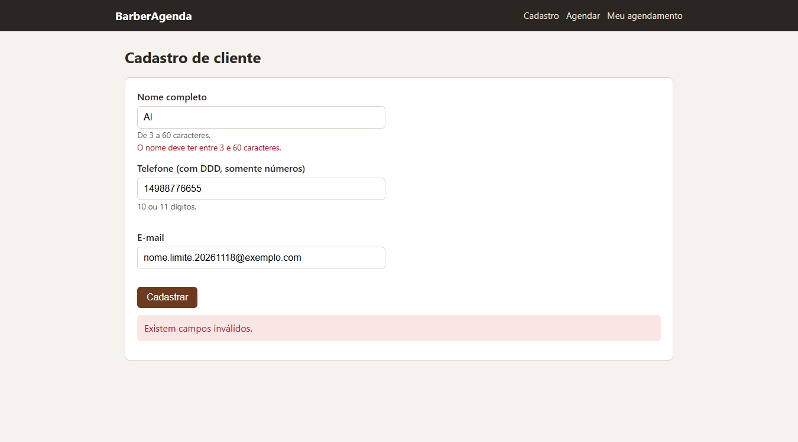{width=80%}
:::

::: {custom-style="Fonte"}
Fonte: Elaborado pelos autores (2026).
:::


::: {custom-style="Legenda"}
Figura 7 – EX-034 (CT-024): consulta recusada quando o código SEMENTE2 é usado com o e-mail de outro cliente
:::

::: {custom-style="Figura"}
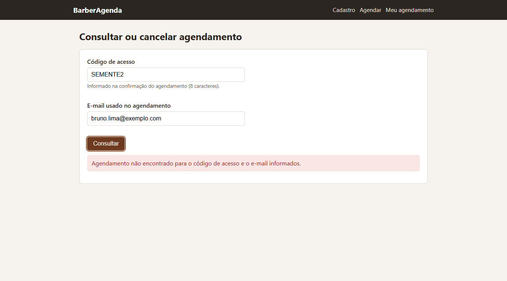{width=80%}
:::

::: {custom-style="Fonte"}
Fonte: Elaborado pelos autores (2026).
:::


## 6.3 Caso bloqueado

O **CT-036** (RF-09: cancelar com menos de 2 horas de antecedência deve ser recusado com HTTP 422) exige criar um agendamento para daqui a menos de 2 horas, ainda dentro do horário de funcionamento. A execução EX-046 foi feita às 23h, quando não existe nenhum horário válido nas 2 horas seguintes; por isso, o caso foi classificado como **Bloqueado**, e não como reprovado. A regra está coberta pelos testes de unidade e de integração criados no TDD, que usam um relógio fixo e passam em qualquer horário (seção 11.1). A execução manual em horário comercial é a ação M-02 do plano de melhoria.

## 6.4 Defeitos registrados

**Nenhum defeito foi observado na execução dos casos** e, portanto, nenhum foi registrado no GitHub Issues. O processo de registro está pronto: o repositório tem o modelo de relatório do Apêndice G do manual, etiquetas de severidade, prioridade e status e um script que exporta as issues para a planilha (`scripts/exportar_defeitos.py`). Nenhum defeito foi inventado para "ter o que registrar" (manual, seção 9.7).

Esse resultado precisa ser lido com contexto. O sistema é pequeno, foi construído pelo próprio grupo com uma especificação pensada para os testes, e os problemas mais relevantes foram encontrados **antes** da execução dos casos, por técnicas estáticas:

::: {custom-style="Legenda"}
Tabela 30 – Problemas encontrados antes da execução dos casos (detalhes no Apêndice C)
:::

| ID | Problema | Como foi encontrado | Correção |
|--------|-----------------------------------------|---------------------|------------------------------|
| A-01 | Rota de restauração dos dados (`POST /api/dev/reset`) acessível sem autenticação | Revisão de segurança do código | Versão 1.0.1: exige perfil de administrador |
| A-02 | Consulta do agendamento pelo número sequencial: um cliente podia ver o agendamento de outro trocando o número | Revisão de segurança do código | Versão 1.1.0: código de acesso aleatório de 8 caracteres + e-mail |
| A-03 | 3 alertas de bug (regra `java:S8696`) na comparação do dia da semana | SonarQube, 1ª análise | Versão 1.2.0: comparação reescrita, comportamento inalterado |
| A-04 | Mesmo padrão da regra `java:S8696` no código de teste (`TesteE2EBase`) | SonarQube, análise intermediária | Ajustado no código de teste |
| A-05 | 2 vulnerabilidades: cookie `XSRF-TOKEN` sem `HttpOnly` (`java:S3330`) e proteção CSRF restrita (`java:S4502`) | SonarQube | Mantidas como decisão de projeto justificada; risco aceito e ação M-03 |

::: {custom-style="Fonte"}
Fonte: Elaborado pelos autores (2026).
:::


## 6.5 Reteste e regressão

::: {custom-style="Legenda"}
Tabela 31 – Reexecuções e regressão após a mudança para a versão 1.2.0
:::

| Execução | O que foi verificado | Resultado |
|-------------------|--------------------------------------------|-------------------------------------|
| EX-043 (CT-022) | Cliente no limite de 3 ativos volta a poder agendar depois de cancelar, já com a regra das 2 horas | Aprovado |
| EX-044 (CT-025) | Cancelamento pela tela libera o horário, com antecedência maior que 2 horas | Aprovado |
| EX-045 (CT-026) | Cancelar agendamento já cancelado ou concluído continua sendo recusado | Aprovado |
| EX-046 (CT-036) | Cancelamento com menos de 2 horas recusado com HTTP 422 | Bloqueado (horário) |
| Regressão automatizada | Unidade + integração (58), Newman (26 requisições, 63 asserções) e Selenium (11 testes) na versão 1.2.0 | Todos aprovados (`entrega/12_TDD_CICD_MELHORIA/regressao_v1.2.0/`) |

::: {custom-style="Fonte"}
Fonte: Elaborado pelos autores (2026).
:::


## 6.6 Observações que não são defeitos

- **Falhas do script no ensaio.** No ensaio feito antes do registro oficial, algumas verificações falharam por erro do próprio script de execução assistida (por exemplo, comparação de texto com espaço especial e codificação de acentos na linha de comando). Essas falhas foram corrigidas no script e não são defeitos do sistema; por isso, o ensaio não entrou no registro oficial.

- **Falha proposital do pipeline.** A execução 44441895872 do GitHub Actions falhou de propósito, para demonstrar que o pipeline barra uma mudança que quebra um teste (seção 11.2). Também não é defeito do sistema.

- **Respostas 403 sem credencial.** Nas alterações administrativas sem credencial, o sistema responde 403 (e não 401), porque a proteção CSRF é verificada antes da autenticação. O comportamento atende ao RNF-02, que aceita 401 ou 403 sem dados no corpo.

# 7 AUTOMAÇÃO

## 7.1 Arquitetura dos testes

Os testes automatizados ficam no repositório, separados por nível, e usam a mesma massa fictícia dos testes manuais:

```text
barberagenda/
├── src/test/java/br/com/barberagenda/
│   ├── unit/          JUnit 5 + Mockito: regras e validações, relógio fixo (DadosTeste)
│   ├── integration/   Spring Boot Test + MockMvc: RF-09 de ponta a ponta na API
│   └── e2e/           Selenium (perfil Maven -Pe2e): testes e Page Objects (pages/)
├── postman/           coleção e ambiente do Postman (executados pelo Newman)
├── scripts/nf/        testes não funcionais em Python (desempenho, segurança, reinício)
├── dados/             fonte única: requisitos, riscos, casos, execuções e defeitos
└── .github/workflows/ci.yml   pipeline com 3 jobs
```

## 7.2 Testes de unidade (JUnit 5)

Os testes de unidade verificam as regras de negócio isoladamente, sem banco, rede ou interface: os repositórios são substituídos por *mocks* do Mockito e as validações usam o Bean Validation sem subir o Spring. O "agora" vem de um relógio fixo, de modo que os testes de data dão o mesmo resultado em qualquer dia. Cada teste tem uma única intenção, nome descritivo (`deveRejeitar...`, `deveAceitar...`) e `@DisplayName` com o caso e o requisito que representa; os valores limite usam testes parametrizados. A lista completa, método por método, está no Apêndice F.

::: {custom-style="Legenda"}
Tabela 32 – Testes de unidade e integração por classe (regressão da versão 1.2.0)
:::

| Classe de teste (descrição no @DisplayName) | Execuções | Falhas |
|---------------------------------------------------------------------------|---------------|----------|
| Integração — antecedência mínima para cancelamento (RF-09) | 2 | 0 |
| AgendamentoService — criação, conflitos, consulta e mudança de status | 17 | 0 |
| ClienteService e BarbeiroService — unicidade de e-mail e exclusão de barbeiro | 4 | 0 |
| RegrasAgendamento — funcionamento, intervalo e antecedência (RN-04, RN-05, RN-06) | 19 | 0 |
| Validação de entrada — RN-01, RN-02, RN-03 e RN-09 | 16 | 0 |
| **Total** | **58** | **0** |

::: {custom-style="Fonte"}
Fonte: Elaborado pelos autores (2026).
:::


**Cobertura de código (JaCoCo).** Na versão final, as suítes de unidade e integração cobrem 74,4% das linhas e 62,7% dos ramos do projeto; a classe de regras `RegrasAgendamento` tem 100% das linhas cobertas e `AgendamentoService`, mais de 90%. Na linha de base (só testes de unidade), a cobertura era de 36,4%: controllers, segurança e carga de dados só passaram a ser exercitados quando entraram os testes de integração com `@SpringBootTest`, criados no TDD.

## 7.3 Testes de integração/API (Postman + Newman)

A coleção do Postman verifica a cadeia interface → API → regras → banco. Ela restaura os dados, obtém os identificadores pelas consultas públicas e **encadeia** os dados entre as requisições (o cliente cadastrado é usado no agendamento; o código de acesso devolvido é usado na consulta e no cancelamento). As asserções conferem o status HTTP, o contrato da resposta (campos, tipos, cabeçalho `Location`, formato do código de acesso), as mensagens de erro sem detalhes internos e a ausência de efeito colateral (por exemplo, o serviço criado sem credencial não existe). Cada operação crítica tem um fluxo positivo e um negativo, e a coleção restaura os dados ao final.

::: {custom-style="Legenda"}
Tabela 33 – Coleção do Postman por pasta (lista completa no Apêndice F)
:::

| Pasta da coleção | Requisições | Asserções |
|------------------------------------------------------------------|------------------|----------------|
| 00 Preparação | 3 | 8 |
| 01 Clientes — POST /api/clientes | 3 | 10 |
| 02 Agendamento encadeado | 4 | 12 |
| 03 Regras de agendamento — POST /api/agendamentos | 5 | 13 |
| 04 Consulta — GET /api/agendamentos/{codigo} | 2 | 4 |
| 05 Segurança — sem credenciais (CT-029) | 4 | 7 |
| 06 Administração — HTTP Basic | 4 | 8 |
| 07 Limpeza | 1 | 1 |
| **Total** | **26** | **63** |

::: {custom-style="Fonte"}
Fonte: Elaborado pelos autores (2026).
:::


Na regressão da versão 1.2.0, o Newman executou 26 requisições com 63 asserções e 0 falhas (relatórios HTML e JUnit em `entrega/08_INTEGRACAO_API/relatorios/` e `entrega/12_TDD_CICD_MELHORIA/regressao_v1.2.0/`).

## 7.4 Testes de sistema/interface (Selenium)

Os testes de interface usam o padrão Page Object (uma classe por tela em `e2e/pages/`), localizadores estáveis (`id` e `data-testid`), esperas explícitas (`WebDriverWait`, sem esperas fixas), verificação do resultado na tela e captura automática de tela ao final de cada teste, com navegador, resolução e resultado no nome do arquivo. O navegador e o tamanho da janela são escolhidos na linha de comando (`-Dnavegador`, `-Djanela`), o que permitiu repetir a mesma suíte em 4 combinações.

::: {custom-style="Legenda"}
Tabela 34 – Testes de interface por classe (Chrome, 1366×768)
:::

| Classe de teste | Execuções | Falhas |
|---------------------------------------------------------------------------|---------------|----------|
| E2E — login do administrador e cadastro de serviço (RF-06, RF-07) | 1 | 0 |
| E2E — agendamento completo (RF-02, RF-03) | 1 | 0 |
| E2E — cadastro de cliente (RF-01) | 2 | 0 |
| E2E — consulta e cancelamento pelo cliente (RF-05) | 1 | 0 |
| E2E não funcional — compatibilidade de layout (RNF-03) | 5 | 0 |
| E2E não funcional — segurança básica na interface (RNF-02) | 1 | 0 |
| **Total (Chrome, 1366×768)** | **11** | **0** |

::: {custom-style="Fonte"}
Fonte: Elaborado pelos autores (2026).
:::


::: {custom-style="Legenda"}
Figura 8 – Teste Selenium do agendamento completo (CT-010): mensagem de sucesso com o código de acesso gerado
:::

::: {custom-style="Figura"}
{width=80%}
:::

::: {custom-style="Fonte"}
Fonte: Elaborado pelos autores (2026).
:::


## 7.5 Como executar

```bash
# unidade + integração, com cobertura JaCoCo
./mvnw test
# API: em outro terminal, subir a aplicação no perfil test e rodar a coleção
./mvnw spring-boot:run -Dspring-boot.run.profiles=test
newman run postman/BarberAgenda.postman_collection.json \
       -e postman/BarberAgenda.postman_environment.json
# interface (trocar por firefox e/ou 375x667 para as outras combinações)
./mvnw test -Pe2e -Dnavegador=chrome -Djanela=1366x768
# um teste com o navegador visível
./mvnw test -Pe2e -Dtest=AgendamentoE2ETest -Dheadless=false
```

## 7.6 Limitações da automação

- A captura de tela automática em caso de falha do Selenium não chegou a ser exercitada por um erro real, porque nenhum teste de interface falhou fora da demonstração do pipeline.

- Os testes rodam em Chrome e Firefox; Edge, Safari e dispositivos iOS ficaram fora do escopo por não estarem disponíveis no ambiente do grupo.

- O CT-036 depende do horário atual na execução manual; na automação, o relógio fixo elimina essa dependência.

- Não há teste automatizado de concorrência real (dois pedidos simultâneos para o mesmo horário); o tratamento existe no código, mas fica como ação M-05.

# 8 TESTES DE INTEGRAÇÃO E DE SISTEMA

Os testes de integração verificaram a comunicação entre componentes sem depender da tela; os testes de sistema percorreram os fluxos completos como o usuário faz.

::: {custom-style="Legenda"}
Tabela 35 – Integrações validadas e resultado
:::

| Comunicação validada | Evidência | Resultado |
|------------------------|-------------------------------------|---------------------------------------|
| Interface → API: cadastro e validação | CT-001 a CT-006; Newman pasta 01; Selenium `CadastroClienteE2ETest` | Atende: 201 com dados válidos; 400 com a mensagem do campo; 409 para e-mail repetido |
| API → regras: horários disponíveis | CT-007 a CT-009; `RegrasAgendamentoTest`; Newman pasta 00 | Atende: só horários de 30 em 30 min, dentro do funcionamento e livres |
| API → regras → banco: agendamento | CT-010 a CT-022; Newman pastas 02 e 03; Selenium `AgendamentoE2ETest` | Atende: limites de horário, antecedência, conflito e limite de ativos respeitados |
| API → banco: consulta e cancelamento | CT-023 a CT-026; Newman pasta 04; Selenium `CancelamentoE2ETest` | Atende: horário liberado após cancelar; consulta alheia recusada com a mesma mensagem |
| Spring Security → área administrativa | CT-027 a CT-029; Newman pasta 05; TNF-02 | Atende: 28/28 acessos sem credencial recusados, sem dados no corpo |
| API administrativa → banco | CT-030 a CT-035; Newman pasta 06; Selenium `AdminServicoE2ETest` | Atende: limites de duração e preço; exclusão recusada com agendamentos; agenda sem códigos de acesso |
| API → regra de cancelamento (RF-09) | `CancelamentoAntecedenciaIntegracaoTest` (MockMvc); `AgendamentoServiceTest` | Atende na automação (422 com 1h30; 200 com 2h); caso manual bloqueado por horário |
| Aplicação → banco após reinício | TNF-05 | Atende: dados iguais depois de parar e subir a aplicação |

::: {custom-style="Fonte"}
Fonte: Elaborado pelos autores (2026).
:::


**Fluxos ponta a ponta executados:** cadastro até a mensagem de sucesso; cadastro inválido até a mensagem do campo; escolha de barbeiro, serviço, data e horário até a confirmação com o código de acesso; consulta pelo código até o cancelamento e a liberação do horário; login do administrador, cadastro de serviço e saída; agenda do dia até a conclusão do atendimento.

::: {custom-style="Legenda"}
Figura 9 – Agenda do dia na área administrativa após marcar um atendimento como concluído (EX-040, CT-034)
:::

::: {custom-style="Figura"}
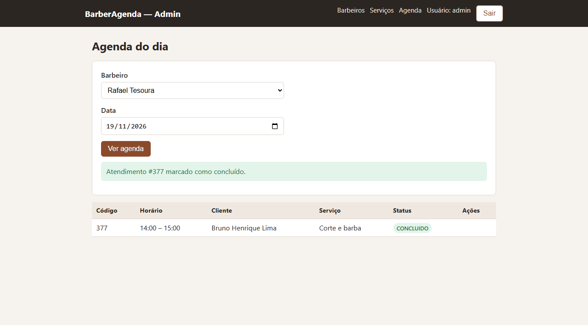{width=80%}
:::

::: {custom-style="Fonte"}
Fonte: Elaborado pelos autores (2026).
:::


# 9 TESTES DE ACEITAÇÃO E NÃO FUNCIONAIS

## 9.1 Testes de aceitação

Os quatro cenários de aceitação foram escritos no formato Dado / Quando / Então, do ponto de vista do cliente e do dono da barbearia, para execução por uma **pessoa que não participou da construção dos testes** (manual, seção 9.11). O grupo prepara o ambiente e apenas observa. Os roteiros completos estão no Apêndice E.

::: {custom-style="Legenda"}
Tabela 36 – Cenários de aceitação e situação
:::

| Cenário | Perfil | Tarefa | Situação |
|------------|-------------|-----------------------------------------------|-----------------------------|
| CA-01 | Cliente novo | Cadastrar-se e agendar o primeiro corte | Pronto; aguarda participante externo |
| CA-02 | Cliente | Consultar e cancelar o agendamento; ver o horário liberado | Pronto; aguarda participante externo |
| CA-03 | Dono | Confirmar que nenhum barbeiro recebe dois clientes ao mesmo tempo | Pronto; aguarda participante externo |
| CA-04 | Dono | Cadastrar um serviço, abrir a agenda do dia e concluir um atendimento | Pronto; aguarda participante externo |

::: {custom-style="Fonte"}
Fonte: Elaborado pelos autores (2026).
:::


A aceitação não pode ser simulada pelo grupo nem pela ferramenta de IA, porque seu objetivo é justamente a visão de quem não construiu o sistema. Os resultados serão registrados no P09 e em `dados/execucoes.csv` depois da sessão, e as métricas serão recalculadas pelos scripts.

## 9.2 Testes não funcionais

Foram planejados 8 testes não funcionais em 5 categorias (desempenho, segurança básica, confiabilidade, compatibilidade e usabilidade), acima do mínimo de 6 testes em 3 categorias. Sete foram executados; o de usabilidade depende de um participante externo. Nenhum teste foi destrutivo ou invasivo: todas as medições rodaram no ambiente local, sem carga, estresse ou invasão (manual, seção 15). Os registros completos, no modelo do Apêndice I do manual, estão no Apêndice E.

::: {custom-style="Legenda"}
Tabela 37 – Resultados dos testes não funcionais
:::

| ID | Categoria | Requisito | Resultado | Conclusão |
|-----------|-------------------------|---------------|-----------------------------------|--------------|
| TNF-01 | Desempenho básico | RNF-01 | p95 26,2 ms (horários) e 33,6 ms (agendar) | Atende |
| TNF-02 | Segurança básica — acesso | RNF-02 (a, d) | 28/28 respostas 401/403 sem dados nem detalhes internos | Atende |
| TNF-03 | Segurança básica — senha | RNF-02 (b) | Hash BCrypt `$2a$10$…` (60 caracteres); texto da senha ausente do banco | Atende |
| TNF-04 | Segurança básica — HTML/script | RNF-02 (c) | Exibido como texto; nenhum alerta executado (Chrome e Firefox) | Atende |
| TNF-05 | Confiabilidade — reinício | RNF-04 (a) | Cliente e agendamento iguais após parar e subir a aplicação | Atende |
| TNF-06 | Confiabilidade — entradas inválidas | RNF-04 (b) | 16/16 entradas inválidas com 4xx, nenhuma 500 | Atende |
| TNF-07 | Compatibilidade | RNF-03 | 11/11 testes em cada uma das 4 combinações navegador × resolução | Atende |
| TNF-08 | Usabilidade | RNF-05 | Não executado (requer participante externo) | — |

::: {custom-style="Fonte"}
Fonte: Elaborado pelos autores (2026).
:::


## 9.3 Desempenho (TNF-01)

O script `scripts/nf/desempenho.py` restaura os dados, faz 5 requisições de aquecimento e mede 30 requisições de cada operação principal do cliente: a consulta de horários disponíveis e a criação de agendamento (com 35 pedidos válidos em horários distintos). O critério do RNF-01 é o percentil 95 abaixo de 500 ms.

::: {custom-style="Legenda"}
Tabela 38 – Tempos de resposta medidos no TNF-01
:::

| Operação | n | Média (ms) | Mediana (ms) | p95 (ms) | Mín. (ms) | Máx. (ms) | Conclusão |
|----------------------------|------|-----------|-------------|---------|---------|----------|--------------|
| GET /api/horarios-disponiveis | 30 | 16,3 | 15,7 | 26,2 | 4,0 | 30,2 | Atende |
| POST /api/agendamentos | 30 | 17,4 | 16,7 | 33,6 | 8,0 | 33,8 | Atende |

::: {custom-style="Fonte"}
Fonte: Elaborado pelos autores (2026).
:::


::: {custom-style="Legenda"}
Figura 10 – Tempos de resposta das 60 medições do TNF-01 comparados com o critério
:::

::: {custom-style="Figura"}
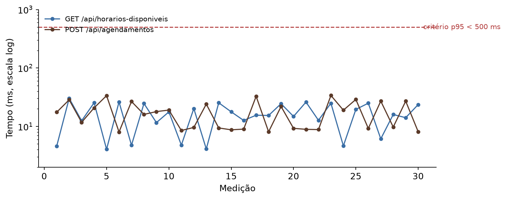{width=88%}
:::

::: {custom-style="Fonte"}
Fonte: Elaborado pelos autores (2026).
:::


As 60 medições ficaram entre 4 ms e 34 ms, com folga de mais de 14 vezes em relação ao critério. A ressalva é que o ambiente é local, com cliente e servidor na mesma máquina e sem latência de rede, e que o teste não mede carga concorrente.

## 9.4 Segurança básica (TNF-02 a TNF-04)

- **Controle de acesso (TNF-02):** 14 rotas restritas (`/api/admin/**`, listagem e detalhe de clientes e a rota de restauração) foram chamadas em 2 cenários – sem credencial e com senha errada –, num total de 28 requisições. Todas foram recusadas (401 nas consultas sem credencial e com senha errada; 403 nas alterações sem credencial, por causa do CSRF), com corpo contendo apenas `status`, `erro`, `mensagem` e `campos`, sem stack trace, nomes de classe ou SQL.

- **Armazenamento da senha (TNF-03):** com a aplicação parada, a consulta direta ao banco mostrou que a senha do administrador está guardada como hash BCrypt (prefixo `$2a$10$`, 60 caracteres) e que o texto da senha não aparece no banco.

- **HTML/script digitado pelo usuário (TNF-04):** um cliente cadastrado com o nome `` teve o nome exibido literalmente nas telas, sem criar elemento `` nem abrir alerta, nos 2 navegadores e nas 2 resoluções.

## 9.5 Confiabilidade (TNF-05 e TNF-06)

- **Recuperação após reinício (TNF-05):** no perfil `dev`, com banco em arquivo, um cliente e um agendamento foram criados, a aplicação foi encerrada e iniciada de novo, e o agendamento foi encontrado pelo código de acesso com todos os dados iguais.

- **Entradas inválidas (TNF-06):** 16 entradas inválidas – JSON malformado, corpo vazio, tipo errado, data inexistente (30/02), textos de 10.000 caracteres, parâmetros ausentes, rota inexistente, método e tipo de conteúdo não suportados, entre outras – receberam respostas 400, 404, 405 ou 415, nenhuma 500 e nenhuma com detalhes internos.

## 9.6 Compatibilidade (TNF-07)

A suíte Selenium completa (11 testes) foi executada no Chrome 157 e no Firefox 160, nas janelas de 1366×768 (computador) e 375×667 (celular): 44 execuções, todas aprovadas. Além dos fluxos, o teste `CompatibilidadeE2ETest` confere, em 5 páginas, que a largura do conteúdo não passa da largura visível, ou seja, que não há rolagem horizontal no celular.

::: {custom-style="Legenda"}
Figura 11 – Agendamento concluído pelo Selenium na largura de celular (375×667): Chrome à esquerda e Firefox à direita
:::

::: {custom-style="Figura"}
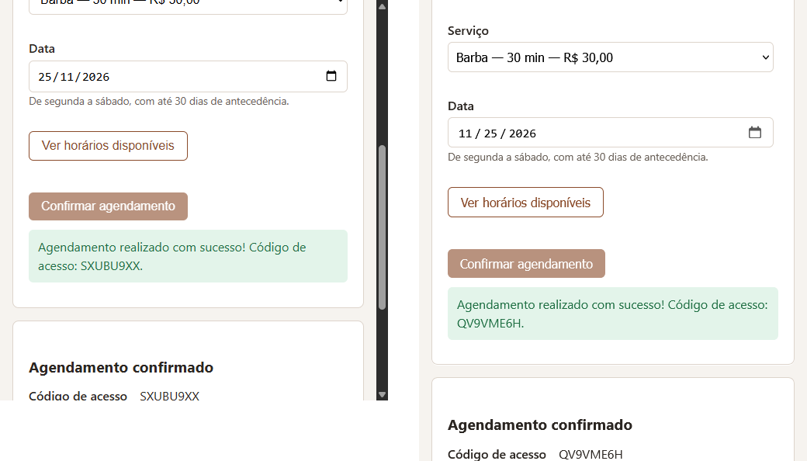{width=70%}
:::

::: {custom-style="Fonte"}
Fonte: Elaborado pelos autores (2026).
:::


## 9.7 Usabilidade (TNF-08)

O critério do RNF-05 é que um participante externo, sem instruções além do objetivo da tarefa, conclua o cadastro e o agendamento em até 5 minutos, sem ajuda, e avalie a facilidade com nota maior ou igual a 4 em 5. O roteiro de observação e o questionário estão prontos (`P09_Roteiro_Usabilidade.md`), mas o teste ainda **não foi executado**, porque depende de uma pessoa externa ao grupo. Por isso, o RNF-05 aparece como requisito sem teste executado nas métricas.

# 10 MÉTRICAS E INDICADORES

As métricas foram calculadas por `scripts/metricas.py` com os dados reais de `dados/` e conferidas com a aba Métricas da planilha P05, onde as mesmas fórmulas estão escritas. Em todas, vale o **último resultado** de cada caso. Os denominadores incluem os 48 casos e testes planejados: os 36 casos manuais, os 8 testes não funcionais e os 4 cenários de aceitação.

::: {custom-style="Legenda"}
Tabela 39 – Painel das 8 métricas obrigatórias (modelo do Apêndice K do manual)
:::

| Indicador | Cálculo | Valor |
|---------------------|----------------------------------|---------------------------------------------|
| 1. Percentual de execução | executados / planejados = 42 / 48 | 87,5% |
| 2. Taxa de aprovação | aprovados / executados = 42 / 42 | 100,0% |
| 3. Taxa de reprovação | reprovados / executados = 0 / 42 | 0,0% |
| 4. Cobertura de requisitos | requisitos com teste executado / requisitos = 12 / 14 | 85,7% |
| 5. Taxa de automação | automatizados / planejados para automação = 39 / 39 | 100,0% |
| 6. Defeitos por severidade | contagem por categoria | Crítica 0 · Alta 0 · Média 0 · Baixa 0 |
| 7. Defeitos por status | contagem por estado | Novo 0 · Em análise 0 · Em correção 0 · Pronto para reteste 0 · Encerrado 0 · Reaberto 0 |
| 8. Taxa de reabertura | reabertos / retestados = 0 / 0 | não se aplica |

::: {custom-style="Fonte"}
Fonte: Elaborado pelos autores (2026).
:::


::: {custom-style="Legenda"}
Figura 12 – Indicadores percentuais
:::

::: {custom-style="Figura"}
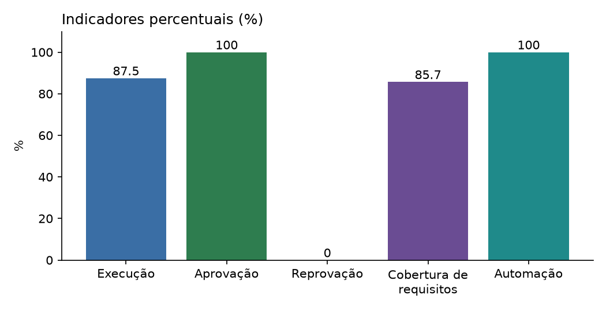{width=72%}
:::

::: {custom-style="Fonte"}
Fonte: Elaborado pelos autores (2026).
:::


**Interpretação.**

- **Percentual de execução (87,5%).** Dos 48 casos e testes planejados, 42 foram executados. Os 6 restantes são as 5 atividades que dependem de uma pessoa externa (4 cenários de aceitação e o teste de usabilidade) e o CT-036, bloqueado por horário. Tudo o que o grupo podia executar sozinho foi executado.

- **Taxa de aprovação (100,0%) e de reprovação (0,0%).** Todos os casos executados obtiveram o resultado esperado. O número é alto e não significa ausência de defeitos: significa que, no escopo e com as técnicas aplicadas, nenhuma falha foi observada. Os problemas relevantes foram encontrados antes, por técnicas estáticas (seção 6.4).

- **Cobertura de requisitos (85,7%).** 12 dos 14 requisitos têm teste executado. Faltam o RNF-05 (usabilidade, depende do participante externo) e o RF-09, cujo caso manual ficou bloqueado. O RF-09 está coberto pelos testes automatizados do TDD; considerando também a automação, a cobertura seria de 13/14 = 92,9%. A métrica oficial usa apenas os casos do catálogo.

- **Taxa de automação (100,0%).** Todos os candidatos à automação têm teste automatizado em todos os níveis planejados, e a regressão completa roda no pipeline a cada envio de código.

- **Defeitos por severidade e por status (0) e taxa de reabertura.** Sem defeitos registrados, não há itens abertos, e o critério de saída "nenhum defeito Crítico ou Alto aberto" está atendido. A taxa de reabertura é indefinida (0 reabertos / 0 retestados), e não 0%: a fórmula exige defeitos retestados.

::: {custom-style="Legenda"}
Figura 13 – Resultado atual dos casos e testes por requisito
:::

::: {custom-style="Figura"}
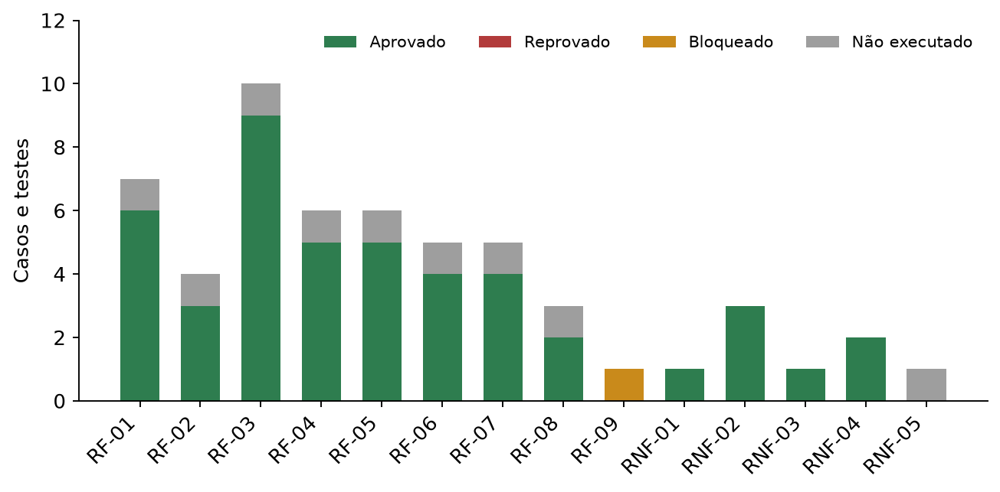{width=88%}
:::

::: {custom-style="Fonte"}
Fonte: Elaborado pelos autores (2026).
:::


O gráfico por requisito mostra que as pendências estão concentradas em três lugares: a aceitação (que aparece em RF-01 a RF-08, porque cada cenário cobre vários requisitos), o RNF-05 (usabilidade) e o RF-09 (caso manual bloqueado). Os requisitos de prioridade Alta (RF-01 a RF-06 e RNF-02) tiveram todos os seus casos manuais aprovados.

## 10.1 Indicadores complementares de qualidade (SonarQube)

::: {custom-style="Legenda"}
Tabela 40 – Indicadores do SonarQube: linha de base e análise final
:::

| Medida | Linha de base (Marco 5, v1.1.0) | Final (Marco 9, v1.2.0) | Variação |
|-----------------------------|----------------------|-------------------------|------------------------|
| Bugs | 3 | **0** | −3 |
| Vulnerabilidades | 2 | 2 | = (justificadas, ver abaixo) |
| Code smells | 0 | 0 | = |
| Cobertura | 38,9% | **72,3%** | +33,4 p.p. |
| Cobertura de linhas / ramos | 36,4% / 50,9% | 74,4% / 62,7% | +38,0 / +11,8 p.p. |
| Duplicação | 0,0% | 0,0% | = |
| Dívida técnica | 0 min | 0 min | = |
| Nota de confiabilidade | D | **A** | melhorou |
| Nota de segurança | D | D | = |
| Nota de manutenibilidade | A | A | = |
| Testes considerados | 52 (unidade) | 58 (unidade + integração) | +6 |
| Quality gate (Sonar way, código novo) | OK (sem código novo) | **OK** (cobertura do código novo 95,8%) | — |

::: {custom-style="Fonte"}
Fonte: Elaborado pelos autores (2026).
:::


::: {custom-style="Legenda"}
Figura 14 – Bugs e cobertura no SonarQube: linha de base e análise final
:::

::: {custom-style="Figura"}
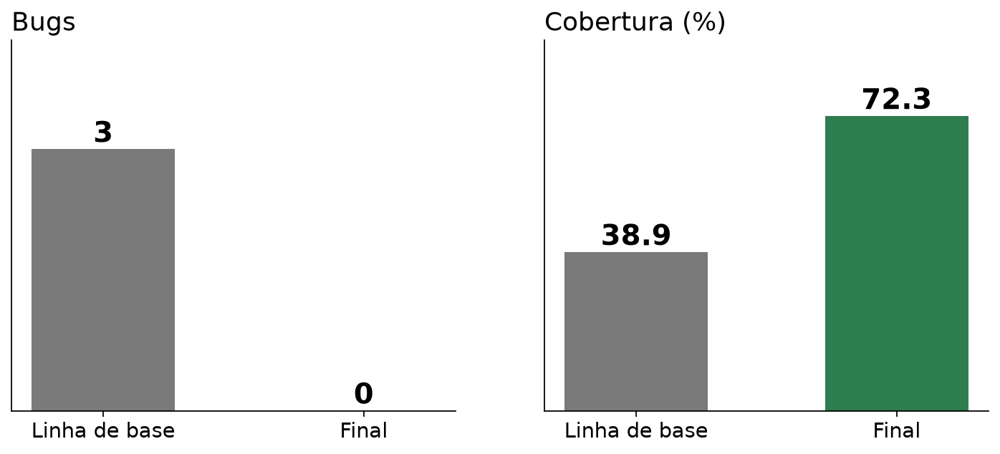{width=80%}
:::

::: {custom-style="Fonte"}
Fonte: Elaborado pelos autores (2026).
:::


## 10.2 Rastreabilidade

::: {custom-style="Legenda"}
Tabela 41 – Resumo da matriz de rastreabilidade por requisito (matriz completa no Apêndice D e na planilha P05)
:::

| Req. | Riscos | Casos | Exec. | Aprov. | Reprov. | Pend. | Defeitos | Situação |
|-----------|-----------|----------|---------|----------|------------|---------|-------------|---------------|
| RF-01 | R-05 | 7 | 6 | 6 | 0 | 1 | 0 | Atendido no que foi executado |
| RF-02 | R-02, R-04, R-11 | 4 | 3 | 3 | 0 | 1 | 0 | Atendido no que foi executado |
| RF-03 | R-02, R-04 | 10 | 9 | 9 | 0 | 1 | 0 | Atendido no que foi executado |
| RF-04 | R-01, R-06 | 6 | 5 | 5 | 0 | 1 | 0 | Atendido no que foi executado |
| RF-05 | R-07 | 6 | 5 | 5 | 0 | 1 | 0 | Atendido no que foi executado |
| RF-06 | R-03 | 5 | 4 | 4 | 0 | 1 | 0 | Atendido no que foi executado |
| RF-07 | R-05 | 5 | 4 | 4 | 0 | 1 | 0 | Atendido no que foi executado |
| RF-08 | R-03 | 3 | 2 | 2 | 0 | 1 | 0 | Atendido no que foi executado |
| RF-09 | R-12 | 1 | 0 | 0 | 0 | 1 | 0 | Sem teste executado |
| RNF-01 | R-11 | 1 | 1 | 1 | 0 | 0 | 0 | Atendido |
| RNF-02 | R-03, R-08 | 3 | 3 | 3 | 0 | 0 | 0 | Atendido |
| RNF-03 | R-09 | 1 | 1 | 1 | 0 | 0 | 0 | Atendido |
| RNF-04 | R-10 | 2 | 2 | 2 | 0 | 0 | 0 | Atendido |
| RNF-05 | R-09 | 1 | 0 | 0 | 0 | 1 | 0 | Sem teste executado |

::: {custom-style="Fonte"}
Fonte: Elaborado pelos autores (2026).
:::


A coluna "Pend." soma os casos bloqueados e não executados. Os requisitos marcados como "Atendido no que foi executado" têm todos os casos executados aprovados, mas ainda têm cenário de aceitação ou caso pendente.

# 11 TDD, CI/CD E MELHORIA CONTÍNUA

## 11.1 Evolução por TDD (RF-09)

O comportamento escolhido foi uma regra nova, que não existia na versão 1.1.0 e foi reservada desde o planejamento para esta etapa: **o cliente só pode cancelar um agendamento com no mínimo 2 horas de antecedência**; caso contrário, a API responde HTTP 422 com mensagem explicativa. A regra trata o risco R-12 (cancelamento em cima da hora deixa o horário ocioso). O ciclo Red-Green-Refactor teve um commit em cada etapa:

::: {custom-style="Legenda"}
Tabela 42 – Ciclo Red-Green-Refactor (modelo do Apêndice J do manual)
:::

| Etapa | Commit e horário | Mensagem do commit | `./mvnw test` |
|---------------|-------------------|---------------------------------------------------|---------------|
| RED | `35ce2a2` · 18/11/2026 22:58 | test(tdd-red): especifica antecedência mínima de 2h para cancelamento (RF-09, CT-036) | 58 testes, 4 falhas |
| GREEN | `c9c6e4c` · 18/11/2026 22:59 | feat(tdd-green): recusa cancelamento com menos de 2h de antecedência com HTTP 422 (RF-09) | 58 testes, 0 falhas |
| REFACTOR | `78b44e3` · 18/11/2026 22:59 | refactor(tdd): extrai a regra de antecedência para PoliticaCancelamento (RF-09) | 58 testes, 0 falhas |

::: {custom-style="Fonte"}
Fonte: Elaborado pelos autores (2026).
:::


::: {custom-style="Legenda"}
Figura 15 – Ciclo de TDD aplicado ao RF-09
:::

::: {custom-style="Figura"}
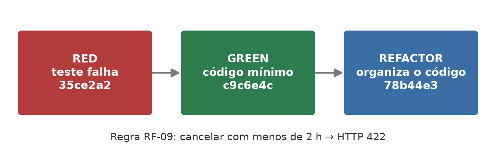{width=90%}
:::

::: {custom-style="Fonte"}
Fonte: Elaborado pelos autores (2026).
:::


**RED.** Os testes foram escritos antes da implementação: na unidade (`AgendamentoServiceTest`: cancelar 1h59, 1h30 e 30 minutos antes deve ser recusado; exatamente 2 horas antes deve ser aceito) e na integração (`CancelamentoAntecedenciaIntegracaoTest`, com MockMvc e relógio fixo em 18/11/2026 às 09:00). A execução de `./mvnw test` falhou pelo motivo esperado: "Expecting code to raise a throwable" nos testes de unidade e "Status expected:<422> but was:<200>" no de integração. O teste de integração, como estava no commit RED:

```java
@Test
@DisplayName("RF-09 (TDD) / CT-036 — cancelar 1h30 antes do horário responde 422 com mensagem explicativa")
void deveResponder422AoCancelarComMenosDeDuasHoras() throws Exception {
    String codigo = agendarHoje("10:30");

    mvc.perform(patch("/api/agendamentos/" + codigo + "/cancelar").contentType(MediaType.APPLICATION_JSON)
                    .content("{\"email\":\"ana.rocha@exemplo.com\"}"))
            .andExpect(status().isUnprocessableEntity())
            .andExpect(jsonPath("$.status").value(422))
            .andExpect(jsonPath("$.mensagem").value("O cancelamento só pode ser feito com no mínimo 2 horas de antecedência."));
}
```

**GREEN.** A implementação mínima verificou o prazo em `AgendamentoService.cancelarPeloCliente` e criou a exceção `CancelamentoForaDoPrazoException`, traduzida para 422 pelo tratador de erros. Todos os testes passaram.

**REFACTOR.** A regra foi isolada na classe `PoliticaCancelamento`, com a antecedência mínima em uma constante e a mensagem em um único lugar, usando o relógio injetável; o comportamento não mudou e todos os testes continuaram aprovados:

```java
@Component
public class PoliticaCancelamento {

    public static final Duration ANTECEDENCIA_MINIMA = Duration.ofHours(2);

    static final String MENSAGEM = "O cancelamento só pode ser feito com no mínimo "
            + ANTECEDENCIA_MINIMA.toHours() + " horas de antecedência.";

    /** Recusa o cancelamento quando faltar menos que a antecedência mínima para o início (exatamente 2h é permitido). */
    public void validarPrazo(Agendamento agendamento, LocalDateTime agora) {
        if (agendamento.getDataHoraInicio().isBefore(agora.plus(ANTECEDENCIA_MINIMA))) {
            throw new CancelamentoForaDoPrazoException(MENSAGEM);
        }
    }
}
```

**Aprendizado.** Escrever o teste antes obrigou a decidir o limite exato (2 horas é permitido; 1h59 não) e o código HTTP antes de programar. O relógio injetável permitiu testar uma regra dependente da hora atual a qualquer momento – ao contrário da execução manual do CT-036, que só é possível em horário comercial.

## 11.2 Pipeline de CI/CD

O pipeline está em `.github/workflows/ci.yml` e roda a cada `push` (em qualquer branch), a cada `pull_request` para a `main` e sob demanda. Ele tem três jobs; os de API e de interface dependem do primeiro e só rodam se os testes de unidade e integração passarem. Os relatórios de cada job são publicados como artefatos da execução.

::: {custom-style="Legenda"}
Figura 16 – Etapas do pipeline de CI/CD
:::

::: {custom-style="Figura"}
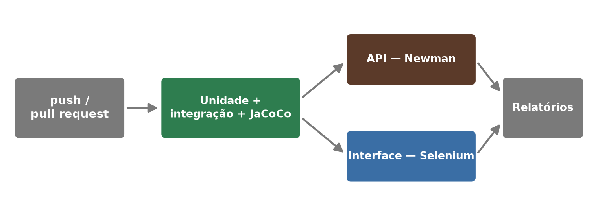{width=90%}
:::

::: {custom-style="Fonte"}
Fonte: Elaborado pelos autores (2026).
:::


::: {custom-style="Legenda"}
Tabela 43 – Jobs do pipeline
:::

| Job | Etapas | Publicação |
|------------------------|-----------------------------------------------|-----------------------------|
| Unidade + integração + cobertura | Checkout → Java 21 com cache do Maven → `./mvnw -B verify` (testes e JaCoCo) | Relatórios Surefire e JaCoCo |
| API (Postman + Newman) | Checkout → Java 21 → aplicação no perfil `test` → Node.js e Newman → coleção completa | Relatórios do Newman (CLI, HTML e JUnit) |
| Interface (Selenium) | Checkout → Java 21 → `./mvnw test -Pe2e` com Chrome headless | Relatórios Surefire e capturas de tela |

::: {custom-style="Fonte"}
Fonte: Elaborado pelos autores (2026).
:::


::: {custom-style="Legenda"}
Tabela 44 – Execuções do pipeline documentadas
:::

| Execução | Contexto | Resultado | Significado |
|--------------------|-------------------------------|-------------------------|------------------------|
| 44441467718 | `push` na `main` | 3 jobs aprovados | Pipeline funcionando na versão 1.2.0 |
| 44441895872 | Branch `demo/falha-pipeline`: teste do CT-007 alterado de propósito para esperar 20 horários em vez de 19 | Job de unidade reprovado (`Expected size: 20 but was: 19`); API e interface pulados | Falha controlada: o pipeline barra uma mudança que quebra um teste |
| 44442093641 | Commit seguinte na mesma branch, desfazendo a alteração | 3 jobs aprovados | Correção confirmada pelo pipeline |

::: {custom-style="Fonte"}
Fonte: Elaborado pelos autores (2026).
:::


A falha da execução 44441895872 foi **proposital**, não é defeito do sistema e não foi registrada como defeito. A branch de demonstração não foi integrada à `main` e fica no repositório como evidência. Todas as execuções podem ser abertas em `github.com/ZangrandeG/barberagenda/actions`.

## 11.3 Análise estática (SonarQube)

A análise estática foi feita duas vezes no SonarQube Community Build 26.11 local: a linha de base logo após os testes de unidade (versão 1.1.0) e a análise final depois do TDD (versão 1.2.0). Os números estão na Tabela da seção 10.1.

- **3 bugs (`java:S8696`).** A comparação `getDayOfWeek() == DayOfWeek.SUNDAY` foi apontada como bug. Como `DayOfWeek` é um enum, o `==` já funcionava corretamente (falso positivo da regra), mas a comparação foi reescrita com `equals()` para eliminar o alerta, sem mudança de comportamento, confirmada pela regressão. Uma análise intermediária apontou o mesmo padrão no código de teste, que também foi ajustado.

- **Cobertura de 38,9% para 72,3%.** Subiu porque os testes de integração com `@SpringBootTest`, criados no TDD, passaram a exercitar controllers, segurança e carga de dados, que os testes de unidade não alcançam. O código novo teve 95,8% de cobertura, e o quality gate ficou aprovado.

- **2 vulnerabilidades mantidas.** O cookie `XSRF-TOKEN` sem `HttpOnly` (`java:S3330`) é necessário, porque o JavaScript precisa lê-lo para enviar o token CSRF; a proteção CSRF restrita (`java:S4502`) é exigida justamente nas alterações feitas com sessão, enquanto as rotas públicas não usam sessão e as chamadas HTTP Basic não usam cookie. São decisões de projeto documentadas e ficam como risco aceito, com a ação M-03 no plano de melhoria.

## 11.4 Plano de melhoria contínua

::: {custom-style="Legenda"}
Tabela 45 – Ações de melhoria priorizadas
:::

| ID | Ação | Prioridade | Responsável | Critério de verificação |
|--------|-----------------------------------|---------------|------------------|------------------------|
| M-01 | Executar a aceitação (CA-01 a CA-04) e a usabilidade (TNF-08) com pessoa externa e tratar o que ela apontar | Alta | José Paulo Dassie Felippi | 4 decisões registradas no P09; RNF-05 com resultado; ajustes registrados como issues |
| M-02 | Executar o CT-036 manualmente em horário comercial | Média | José Paulo Dassie Felippi | Execução registrada como Aprovado/Reprovado em `dados/execucoes.csv` |
| M-03 | Reavaliar as vulnerabilidades S3330/S4502: aplicar `SameSite=Strict` e cabeçalho de origem nas alterações administrativas, ou registrar a aceitação formal do risco no SonarQube | Média | Guilherme Ribeiro Zangrande | Nota de segurança ≥ B, ou risco aceito com justificativa na ferramenta |
| M-04 | Limitar tentativas na consulta por código de acesso (ex.: 10 por minuto por IP) | Média | Guilherme Ribeiro Zangrande | Teste automatizado: a 11ª tentativa no mesmo minuto recebe HTTP 429 |
| M-05 | Testar concorrência real de agendamento (dois pedidos simultâneos para o mesmo horário) | Baixa | Guilherme Ribeiro Zangrande | Teste com 2 threads: exatamente 1 resposta 201 e 1 resposta 409 |
| M-06 | Incluir a análise do SonarQube no pipeline (SonarCloud, se o repositório for público) e falhar o build quando o quality gate reprovar | Baixa | Guilherme Ribeiro Zangrande | Job "qualidade" no `ci.yml`; execução com o quality gate visível no GitHub |
| M-07 | Validar o perfil PostgreSQL (docker-compose) | Baixa | José Paulo Dassie Felippi | Suítes de unidade, integração e API aprovadas com `dev,postgres` |

::: {custom-style="Fonte"}
Fonte: Elaborado pelos autores (2026).
:::


# 12 DISCUSSÃO DOS RESULTADOS

## 12.1 Pontos fortes

- **Regras de agendamento sólidas.** Funcionamento, intervalos, antecedência, conflito entre agendamentos e limite de ativos se comportaram como especificado em todos os valores limite, nos três níveis de teste.

- **Controle de acesso e proteção de dados.** As 28 tentativas de acesso sem credencial foram recusadas sem expor dados; a senha está com hash BCrypt; a consulta pelo cliente exige código aleatório e e-mail; HTML digitado não é executado.

- **Robustez.** Nenhuma das 16 entradas inválidas provocou erro interno (HTTP 500), e os dados sobreviveram ao reinício da aplicação.

- **Desempenho com grande folga.** As operações principais responderam em menos de 35 ms no ambiente local.

- **Processo reproduzível.** Uma única fonte de dados gera a planilha, os documentos, os gráficos e este relatório; os testes de data usam relógio fixo; os dados são restaurados por script; a regressão completa roda no pipeline a cada envio de código.

## 12.2 Pontos frágeis

- **Viés de quem construiu o sistema.** O grupo construiu o sistema que testou, com apoio de IA, e a especificação já foi pensada para os testes. A taxa de aprovação de 100% e a ausência de defeitos devem ser lidas com essa ressalva; a aceitação e a usabilidade com pessoas externas são justamente a forma de reduzir esse viés.

- **Execução manual assistida por script.** Os casos foram executados por um script que segue os passos do catálogo, e não manualmente pelos integrantes. O método é reproduzível e transparente, mas não substitui a observação humana de detalhes de usabilidade.

- **Escala dos testes não funcionais.** O desempenho foi medido localmente, sem carga e sem latência de rede, e a concorrência real não foi testada.

- **Consulta sem limite de tentativas.** O código de acesso aleatório torna improvável adivinhar um agendamento, mas não há limite de tentativas por minuto (ação M-04).

## 12.3 Riscos residuais

::: {custom-style="Legenda"}
Tabela 46 – Situação dos riscos de produto após os testes
:::

| Risco | Situação após os testes |
|----------------------------------------|------------------------------------------------------------|
| R-01 Horários sobrepostos | Mitigado: sobreposição total, parcial e encostada verificadas em unidade, API e interface |
| R-02 Fora do funcionamento ou dos intervalos | Mitigado: limites de início, término, domingo e minutos verificados |
| R-03 Acesso indevido | Mitigado: 28/28 acessos recusados; rota de restauração protegida desde a versão 1.0.1 |
| R-04 Regras de data perto dos limites | Mitigado: D+30/D+31 e "agora" verificados com relógio fixo |
| R-05 Dados inválidos aceitos | Mitigado: limites de nome, telefone, e-mail, duração e preço verificados |
| R-06 Mais de 3 agendamentos ativos | Mitigado: 3º aceito, 4º recusado, vaga liberada após cancelar |
| R-07 Consultar ou cancelar agendamento de outra pessoa | Mitigado em parte: código aleatório + e-mail; sem limite de tentativas (M-04) |
| R-08 HTML/script executado | Mitigado: TNF-04 aprovado em 2 navegadores e 2 resoluções |
| R-09 Interface ruim no celular ou no Firefox | Mitigado: 44/44 execuções aprovadas; usabilidade ainda não avaliada por pessoa externa |
| R-10 Perda de dados após reinício | Mitigado: TNF-05 aprovado |
| R-11 Consulta de horários lenta | Mitigado no ambiente local: p95 de 26,2 ms |
| R-12 Cancelamento em cima da hora | Tratado pela regra RF-09 (TDD); verificado na automação; caso manual pendente (M-02) |

::: {custom-style="Fonte"}
Fonte: Elaborado pelos autores (2026).
:::


Permanecem como riscos aceitos as duas vulnerabilidades do SonarQube (M-03) e o perfil PostgreSQL, que não foi validado por falta de Docker no ambiente (M-07).

## 12.4 Limitações deste trabalho

- A aceitação (CA-01 a CA-04) e a usabilidade (TNF-08) ainda não foram executadas, porque dependem de uma pessoa externa ao grupo.

- O CT-036 precisa ser executado manualmente em horário comercial.

- Os testes de interface cobrem Chrome e Firefox; Edge, Safari e iOS não foram testados.

- A análise do SonarQube foi feita em uma instalação local e ainda não faz parte do pipeline (ação M-06).

## 12.5 Lições aprendidas

A principal lição foi que **técnicas estáticas e dinâmicas se complementam**: a revisão de código e o SonarQube encontraram mais problemas do que a execução dos casos, e os casos confirmaram que as correções continuaram valendo. A segunda foi o valor do **relógio injetável**: ele tornou reproduzíveis os testes de regras de data, que de outra forma dependeriam do dia e da hora da execução. A terceira foi a vantagem de manter **uma única fonte de dados**: requisitos, casos, execuções e métricas ficaram consistentes em todos os documentos, e qualquer nova execução atualiza a planilha, os gráficos e este relatório com um comando.

# 13 CONCLUSÃO

O projeto aplicou os nove tópicos da disciplina a um sistema real e executável: planejamento orientado a riscos, 36 casos especificados com quatro técnicas de projeto, execução com evidências de cada verificação, automação em três níveis com 100,0% dos candidatos automatizados, testes de integração, de sistema e não funcionais em cinco categorias, métricas interpretadas, um ciclo completo de TDD e um pipeline de CI/CD com falha e correção demonstradas, além da análise estática com SonarQube.

::: {custom-style="Legenda"}
Tabela 47 – Critérios de saída do plano de testes e situação final
:::

| Critério de saída (P03, seção 13) | Situação |
|--------------------------------------|--------------------------------------------------------------|
| 100% dos casos executados ou com justificativa | Atendido: os não executados e o bloqueado têm justificativa registrada |
| Todos os requisitos com ao menos um teste executado | Parcial: 12/14 (RF-09, RNF-05 pendentes) |
| Nenhum defeito Crítico ou Alto aberto | Atendido: nenhum defeito aberto |
| Defeitos corrigidos com reteste e regressão | Não se aplica: nenhum defeito registrado; regressão completa feita após a mudança de versão |
| Suítes automatizadas aprovadas no pipeline | Atendido: execução 44441467718 e regressão da versão 1.2.0 |
| Mínimos do manual e 8 métricas com dados reais | Atendido |

::: {custom-style="Fonte"}
Fonte: Elaborado pelos autores (2026).
:::


**Prontidão do sistema.** Dentro do escopo testado, o BarberAgenda 1.2.0 atende aos 12 requisitos com teste executado, sem defeitos observados e com todas as suítes automatizadas aprovadas no pipeline. O sistema está **apto para uso em ambiente de demonstração**. Para uso real, o critério de saída ainda não está completo: faltam a aceitação e a usabilidade com pessoas externas e a execução do CT-036 em horário comercial.

**Recomendação.** Executar primeiro as ações M-01 (aceitação e usabilidade) e M-02 (CT-036); em seguida, M-04 (limite de tentativas na consulta) e M-03 (segurança do CSRF); depois, recalcular as métricas e rodar a regressão completa pelo pipeline. Com esses itens concluídos, o sistema atende a todos os critérios de saída do plano.

# REFERÊNCIAS

GITHUB. **GitHub Actions documentation**. Disponível em: https://docs.github.com/actions. Acesso em: 18 nov. 2026.

INTERNATIONAL SOFTWARE TESTING QUALIFICATIONS BOARD. **Certified Tester Foundation Level Syllabus**. Versão 4.0. ISTQB, 2023.

ISO/IEC. **ISO/IEC 25010**: systems and software engineering – product quality model. Geneva: ISO, 2023.

JACOCO. **JaCoCo Java Code Coverage Library documentation**. Disponível em: https://www.jacoco.org/jacoco/. Acesso em: 18 nov. 2026.

JUNIT. **JUnit 5 User Guide**. Disponível em: https://junit.org/junit5/docs/current/user-guide/. Acesso em: 18 nov. 2026.

POSTMAN. **Newman: command-line collection runner**. Disponível em: https://learning.postman.com/docs/collections/using-newman-cli/. Acesso em: 18 nov. 2026.

SELENIUM. **Selenium WebDriver documentation**. Disponível em: https://www.selenium.dev/documentation/webdriver/. Acesso em: 18 nov. 2026.

SILVA, E. G. da. **Projeto Integrado P2**: planejamento, execução e avaliação da qualidade de um sistema de software – manual completo de desenvolvimento e entrega. Bauru: UNISAGRADO, 2026. Material da disciplina Testes e Qualidade de Software.

SONARSOURCE. **SonarQube Community Build documentation**. Disponível em: https://docs.sonarsource.com/sonarqube-community-build/. Acesso em: 18 nov. 2026.

SPRING. **Spring Boot reference documentation** (versão 3.5). Disponível em: https://docs.spring.io/spring-boot/. Acesso em: 18 nov. 2026.

# APÊNDICE A – CATÁLOGO COMPLETO DOS CASOS DE TESTE

Cada caso segue o modelo do Apêndice E do manual. O campo "Último resultado" considera a execução mais recente do caso. Fonte: `dados/casos.json` (o mesmo conteúdo do P04).

### CT-001 – Cadastrar cliente com dados válidos

| Campo | Conteúdo |
|----------------------|------------------------------------------------------------------------------|
| Rastreabilidade | Requisito RF-01 · risco R-05 · regra RN-01, RN-02, RN-03 |
| Classificação | Sistema / Funcional · Positivo · prioridade Média · interface: Tela |
| Técnica | Particionamento de equivalência (classes válidas) |
| Pré-condições | PC-PADRÃO. |
| Dados de teste | Nome: Marina Lopes Teixeira; Telefone: 14988776655; E-mail: marina.<AAAAMMDD>@exemplo.com |
| Passos | 1. Abrir http://localhost:8080/cadastro.html. 2. Preencher Nome, Telefone e E-mail com os dados. 3. Clicar em "Cadastrar". |
| Resultado esperado | Mensagem "Cadastro realizado com sucesso! Código do cliente: N." (N = número) e botão "Agendar um horário" visível. Campos do formulário limpos. |
| Automação | Sim – Unidade: CadastroServiceTest#deveCadastrarClienteComDadosValidos; API (Postman): 01 Clientes › CT-001; Interface (Selenium): CadastroClienteE2ETest#deveCadastrarClientePelaTela |
| Responsável · resultado | José Paulo Dassie Felippi · último resultado: **Aprovado** (EX-020) |

### CT-002 – Cadastro aceita nome e telefone nos limites válidos

| Campo | Conteúdo |
|---------------------|-------------------------------------------------------------------------------|
| Rastreabilidade | Requisito RF-01 · risco R-05 · regra RN-01, RN-02 |
| Classificação | Sistema / Funcional · Fronteira · prioridade Média · interface: Tela |
| Técnica | Análise de valor limite |
| Pré-condições | PC-PADRÃO. |
| Dados de teste | (a) Nome com 3 caracteres "Léa", telefone com 10 dígitos 1432221100, e-mail lea.<AAAAMMDD>@exemplo.com. (b) Nome com 60 caracteres "Maria Eduarda Fernandes Albuquerque Cavalcanti Souza Ribeiro", telefone com 11 dígitos 14999990000, e-mail maria.eduarda.<AAAAMMDD>@exemplo.com |
| Passos | 1. Abrir a tela de cadastro. 2. Preencher com os dados (a) e clicar em "Cadastrar". 3. Preencher com os dados (b) e clicar em "Cadastrar". |
| Resultado esperado | Nos dois cadastros, mensagem "Cadastro realizado com sucesso!" com o código do cliente. |
| Automação | Sim – Unidade: ValidacaoEntradaTest#deveAceitarNomeETelefoneNosLimitesValidos |
| Responsável · resultado | José Paulo Dassie Felippi · último resultado: **Aprovado** (EX-021) |

### CT-003 – Cadastro recusa nome com 2 e com 61 caracteres

| Campo | Conteúdo |
|----------------------|------------------------------------------------------------------------------|
| Rastreabilidade | Requisito RF-01 · risco R-05 · regra RN-01 |
| Classificação | Sistema / Funcional · Fronteira · prioridade Média · interface: Tela |
| Técnica | Análise de valor limite |
| Pré-condições | PC-PADRÃO. |
| Dados de teste | (a) Nome "Al" (2 caracteres). (b) Nome com 61 caracteres "Maria Eduarda Fernandes Albuquerque Cavalcanti Souza Ribeiros". Telefone 14988776655 e e-mail nome.limite.<AAAAMMDD>@exemplo.com nos dois. |
| Passos | 1. Abrir a tela de cadastro. 2. Preencher com o nome (a) e os demais dados; clicar em "Cadastrar". 3. Trocar o nome para (b) e clicar em "Cadastrar". |
| Resultado esperado | Nas duas tentativas: mensagem "O nome deve ter entre 3 e 60 caracteres." abaixo do campo Nome, mensagem geral "Existem campos inválidos." e nenhum código de cliente exibido. |
| Automação | Sim – Unidade: ValidacaoEntradaTest#deveRejeitarNomeForaDoLimite; Interface (Selenium): CadastroClienteE2ETest#deveRecusarNomeCurtoPelaTela |
| Responsável · resultado | José Paulo Dassie Felippi · último resultado: **Aprovado** (EX-022) |

### CT-004 – Cadastro recusa telefone fora do padrão

| Campo | Conteúdo |
|----------------------|------------------------------------------------------------------------------|
| Rastreabilidade | Requisito RF-01 · risco R-05 · regra RN-02 |
| Classificação | Sistema / Funcional · Negativo · prioridade Média · interface: Tela |
| Técnica | Análise de valor limite e particionamento (classe com não dígitos) |
| Pré-condições | PC-PADRÃO. |
| Dados de teste | Nome: Rodrigo Teste; e-mail rodrigo.<AAAAMMDD>@exemplo.com; telefones: (a) 149887766 (9 dígitos); (b) 149887766551 (12 dígitos); (c) 14-98877-6655 (com hífens). |
| Passos | 1. Abrir a tela de cadastro. 2. Para cada telefone (a), (b) e (c): preencher os dados e clicar em "Cadastrar". |
| Resultado esperado | Nas três tentativas: mensagem "O telefone deve conter somente dígitos, com 10 ou 11 dígitos (incluindo DDD)." abaixo do campo Telefone e nenhum cadastro realizado. |
| Automação | Sim – Unidade: ValidacaoEntradaTest#deveRejeitarTelefoneForaDoPadrao |
| Responsável · resultado | José Paulo Dassie Felippi · último resultado: **Aprovado** (EX-023) |

### CT-005 – Cadastro recusa e-mail em formato inválido

| Campo | Conteúdo |
|------------------------|----------------------------------------------------------------------------|
| Rastreabilidade | Requisito RF-01 · risco R-05 · regra RN-03 |
| Classificação | Sistema / Funcional · Negativo · prioridade Média · interface: Tela |
| Técnica | Particionamento de equivalência (classes inválidas) |
| Pré-condições | PC-PADRÃO. |
| Dados de teste | Nome: Paula Teste; telefone 14988776655; e-mails: (a) paula.exemplo.com (sem @); (b) paula@exemplo (sem domínio de topo). |
| Passos | 1. Abrir a tela de cadastro. 2. Para cada e-mail (a) e (b): preencher os dados e clicar em "Cadastrar". |
| Resultado esperado | Nas duas tentativas: mensagem "O e-mail informado é inválido." abaixo do campo E-mail e nenhum cadastro realizado. |
| Automação | Sim – Unidade: ValidacaoEntradaTest#deveRejeitarEmailEmFormatoInvalido; API (Postman): 01 Clientes › CT-005 |
| Responsável · resultado | José Paulo Dassie Felippi · último resultado: **Aprovado** (EX-024) |

### CT-006 – Cadastro recusa e-mail já cadastrado, mesmo com maiúsculas

| Campo | Conteúdo |
|------------------------|----------------------------------------------------------------------------|
| Rastreabilidade | Requisito RF-01 · risco R-05 · regra RN-03 |
| Classificação | Sistema / Funcional · Exceção · prioridade Média · interface: Tela |
| Técnica | Particionamento de equivalência (e-mail existente) |
| Pré-condições | PC-PADRÃO (cliente ana.rocha@exemplo.com existe na massa). |
| Dados de teste | Nome: Ana Repetida; telefone 14988776655; e-mail ANA.ROCHA@EXEMPLO.COM |
| Passos | 1. Abrir a tela de cadastro. 2. Preencher os dados e clicar em "Cadastrar". |
| Resultado esperado | Mensagem "Já existe um cliente cadastrado com este e-mail." (HTTP 409) e nenhum cadastro realizado. |
| Automação | Sim – Unidade: CadastroServiceTest#deveRejeitarCadastroComEmailJaCadastrado; API (Postman): 01 Clientes › CT-006 |
| Responsável · resultado | José Paulo Dassie Felippi · último resultado: **Aprovado** (EX-025) |

### CT-007 – Horários disponíveis respeitam funcionamento, intervalo e duração do serviço

| Campo | Conteúdo |
|-----------------------|-----------------------------------------------------------------------------|
| Rastreabilidade | Requisito RF-02 · risco R-02 · regra RN-04, RN-05 |
| Classificação | Sistema / Funcional · Positivo · prioridade Alta · interface: Tela |
| Técnica | Análise de valor limite (último início possível) |
| Pré-condições | PC-PADRÃO. Carlos Navalha não tem agendamentos em DF3. |
| Dados de teste | Barbeiro: Carlos Navalha; Serviço: Corte e barba (60 min); Data: DF3 |
| Passos | 1. Abrir http://localhost:8080/agendar.html. 2. Selecionar barbeiro, serviço e data. 3. Clicar em "Ver horários disponíveis". |
| Resultado esperado | 19 horários, de 09:00 a 18:00, de 30 em 30 minutos (09:00, 09:30, ..., 18:00). Não aparecem 18:30 nem horários antes de 09:00. |
| Automação | Sim – Unidade: RegrasAgendamentoTest#deveGerarHorariosDe09hA18hParaServicoDe60Minutos |
| Responsável · resultado | José Paulo Dassie Felippi · último resultado: **Aprovado** (EX-008) |

### CT-008 – Horários ocupados pelo barbeiro não são oferecidos

| Campo | Conteúdo |
|------------------------|----------------------------------------------------------------------------|
| Rastreabilidade | Requisito RF-02, RF-04 · risco R-01, R-02 · regra RN-07 |
| Classificação | Sistema / Funcional · Alternativo · prioridade Alta · interface: Tela |
| Técnica | Análise de valor limite (vizinhos do horário ocupado) |
| Pré-condições | PC-PADRÃO. Rafael Tesoura tem agendamento (SEMENTE3) em DF1, 14:00–15:00. |
| Dados de teste | Barbeiro: Rafael Tesoura; Serviço: Corte de cabelo (30 min); Data: DF1 |
| Passos | 1. Abrir a tela de agendamento. 2. Selecionar barbeiro, serviço e data. 3. Clicar em "Ver horários disponíveis". |
| Resultado esperado | Não aparecem 14:00 nem 14:30. Aparecem 13:30 e 15:00. Total de 18 horários (09:00 a 18:30, menos os 2 ocupados). |
| Automação | Sim – Unidade: AgendamentoServiceTest#naoDeveOferecerHorariosOcupadosPeloBarbeiro |
| Responsável · resultado | José Paulo Dassie Felippi · último resultado: **Aprovado** (EX-009) |

### CT-009 – Datas sem atendimento retornam lista de horários vazia

| Campo | Conteúdo |
|------------------------|----------------------------------------------------------------------------|
| Rastreabilidade | Requisito RF-02 · risco R-04 · regra RN-04, RN-06 |
| Classificação | Sistema / Funcional · Alternativo · prioridade Média · interface: API |
| Técnica | Particionamento de equivalência (datas inválidas) |
| Pré-condições | PC-PADRÃO. Ids de Carlos Navalha e Corte de cabelo obtidos em GET /api/barbeiros e GET /api/servicos. |
| Dados de teste | Datas: (a) DOM; (b) D+31; (c) ONTEM |
| Passos | 1. Para cada data, enviar GET /api/horarios-disponiveis?barbeiroId={Carlos}&servicoId={Corte}&data=<data>. |
| Resultado esperado | As três respostas têm HTTP 200 e "horarios": [] (lista vazia). |
| Automação | Sim – Unidade: RegrasAgendamentoTest#deveRetornarListaVaziaParaDataSemAtendimento |
| Responsável · resultado | José Paulo Dassie Felippi · último resultado: **Aprovado** (EX-026) |

### CT-010 – Agendar horário pela tela com sucesso

| Campo | Conteúdo |
|----------------------|------------------------------------------------------------------------------|
| Rastreabilidade | Requisito RF-03 · risco R-02 · regra RN-04, RN-05, RN-06, RN-10 |
| Classificação | Sistema / Funcional · Positivo · prioridade Alta · interface: Tela |
| Técnica | Caso de uso (fluxo principal) |
| Pré-condições | PC-PADRÃO. Cliente camila.prado@exemplo.com sem agendamentos ativos. |
| Dados de teste | E-mail: camila.prado@exemplo.com; Barbeiro: Carlos Navalha; Serviço: Barba; Data: DF3; Horário: 11:00 |
| Passos | 1. Abrir a tela de agendamento. 2. Informar o e-mail; selecionar barbeiro, serviço e data. 3. Clicar em "Ver horários disponíveis" e escolher 11:00. 4. Clicar em "Confirmar agendamento". |
| Resultado esperado | Mensagem "Agendamento realizado com sucesso! Código de acesso: XXXXXXXX." e quadro "Agendamento confirmado" com código de 8 caracteres, Carlos Navalha, Barba, data DF3 11:00 e status AGENDADO. |
| Automação | Sim – API (Postman): 02 Agendamento encadeado › CT-010; Interface (Selenium): AgendamentoE2ETest#deveAgendarHorarioPelaTela |
| Responsável · resultado | José Paulo Dassie Felippi · último resultado: **Aprovado** (EX-010) |

### CT-011 – Agendamento aceito no primeiro e no último horário do dia

| Campo | Conteúdo |
|-----------------------|-----------------------------------------------------------------------------|
| Rastreabilidade | Requisito RF-03 · risco R-02 · regra RN-04 |
| Classificação | Sistema / Funcional · Fronteira · prioridade Alta · interface: Tela |
| Técnica | Análise de valor limite (abertura 09:00; término 19:00) |
| Pré-condições | PC-PADRÃO. Cliente felipe.nunes@exemplo.com sem agendamentos ativos. |
| Dados de teste | E-mail: felipe.nunes@exemplo.com; Barbeiro: Carlos Navalha; Serviço: Corte de cabelo (30 min); Data: DF3; Horários: (a) 09:00; (b) 18:30 (termina 19:00) |
| Passos | 1. Na tela de agendamento, agendar o horário (a). 2. Recarregar a página e agendar o horário (b). |
| Resultado esperado | Os dois agendamentos são confirmados com status AGENDADO e código de acesso. |
| Automação | Sim – Unidade: RegrasAgendamentoTest#deveAceitarAgendamentoNosLimitesDoFuncionamento |
| Responsável · resultado | José Paulo Dassie Felippi · último resultado: **Aprovado** (EX-011) |

### CT-012 – Agendamento recusado quando começa antes de 09:00 ou termina depois de 19:00

| Campo | Conteúdo |
|----------------------|------------------------------------------------------------------------------|
| Rastreabilidade | Requisito RF-03 · risco R-02 · regra RN-04 |
| Classificação | Sistema / Funcional · Fronteira · prioridade Alta · interface: API |
| Técnica | Análise de valor limite |
| Pré-condições | PC-PADRÃO. Ids de Carlos Navalha, Corte de cabelo (30 min) e Corte e barba (60 min) obtidos nas consultas públicas. |
| Dados de teste | emailCliente: gabriela.teixeira@exemplo.com; barbeiro Carlos; (a) Corte de cabelo, DF3T08:30:00; (b) Corte e barba, DF3T18:30:00 (terminaria 19:30); (c) Corte e barba, DF3T18:00:00 (termina 19:00) |
| Passos | 1. Para cada combinação, enviar POST /api/agendamentos com {"emailCliente", "barbeiroId", "servicoId", "dataHoraInicio"}. |
| Resultado esperado | (a) e (b): HTTP 400 com mensagem "O atendimento deve ocorrer entre 09:00 e 19:00 e o serviço precisa terminar até 19:00." (c): HTTP 201, status AGENDADO. |
| Automação | Sim – Unidade: RegrasAgendamentoTest#deveRejeitarAgendamentoForaDoHorarioDeFuncionamento; API (Postman): 03 Regras › CT-012 |
| Responsável · resultado | José Paulo Dassie Felippi · último resultado: **Aprovado** (EX-012) |

### CT-013 – Agendamento recusado fora dos intervalos de 30 minutos

| Campo | Conteúdo |
|-----------------------|-----------------------------------------------------------------------------|
| Rastreabilidade | Requisito RF-03 · risco R-02 · regra RN-05 |
| Classificação | Sistema / Funcional · Negativo · prioridade Alta · interface: API |
| Técnica | Particionamento de equivalência (minutos diferentes de 00 e 30) e valor limite |
| Pré-condições | PC-PADRÃO. Ids de Carlos Navalha e Corte de cabelo obtidos nas consultas públicas. |
| Dados de teste | emailCliente: gabriela.teixeira@exemplo.com; dataHoraInicio: (a) DF3T10:15:00; (b) DF3T10:01:00 |
| Passos | 1. Para cada horário, enviar POST /api/agendamentos. |
| Resultado esperado | HTTP 400 com mensagem "Os agendamentos devem começar em intervalos de 30 minutos (ex.: 09:00, 09:30)." e campo dataHoraInicio em "campos". |
| Automação | Sim – Unidade: RegrasAgendamentoTest#deveRejeitarInicioForaDoIntervaloDe30Minutos |
| Responsável · resultado | José Paulo Dassie Felippi · último resultado: **Aprovado** (EX-013) |

### CT-014 – Agendamento recusado no domingo

| Campo | Conteúdo |
|--------------------------|--------------------------------------------------------------------------|
| Rastreabilidade | Requisito RF-03 · risco R-02 · regra RN-04 |
| Classificação | Sistema / Funcional · Negativo · prioridade Alta · interface: API |
| Técnica | Particionamento de equivalência (dia da semana) |
| Pré-condições | PC-PADRÃO. Ids de Carlos Navalha e Corte de cabelo obtidos nas consultas públicas. |
| Dados de teste | emailCliente: gabriela.teixeira@exemplo.com; dataHoraInicio: DOMT10:00:00 |
| Passos | 1. Enviar POST /api/agendamentos com os dados. |
| Resultado esperado | HTTP 400 com mensagem "A barbearia não abre aos domingos." |
| Automação | Sim – Unidade: RegrasAgendamentoTest#deveRejeitarAgendamentoNoDomingo |
| Responsável · resultado | José Paulo Dassie Felippi · último resultado: **Aprovado** (EX-014) |

### CT-015 – Antecedência: aceita D+30 e recusa D+31

| Campo | Conteúdo |
|-----------------------|-----------------------------------------------------------------------------|
| Rastreabilidade | Requisito RF-03 · risco R-04 · regra RN-06 |
| Classificação | Sistema / Funcional · Fronteira · prioridade Média · interface: API |
| Técnica | Análise de valor limite |
| Pré-condições | PC-PADRÃO. D+30 não pode cair em domingo (se cair, registrar "Bloqueado" e executar no dia seguinte). Ids de Carlos Navalha e Corte de cabelo obtidos. |
| Dados de teste | emailCliente: heitor.moreira@exemplo.com; dataHoraInicio: (a) D+30T10:00:00; (b) D+31T10:00:00 |
| Passos | 1. Enviar POST /api/agendamentos com a data (a). 2. Enviar POST /api/agendamentos com a data (b). |
| Resultado esperado | (a): HTTP 201, status AGENDADO. (b): HTTP 400 com mensagem "A antecedência máxima para agendamento é de 30 dias." |
| Automação | Sim – Unidade: RegrasAgendamentoTest#deveAceitarAgendamentoComTrintaDiasDeAntecedencia; #deveRejeitarAgendamentoComTrintaEUmDiasDeAntecedencia |
| Responsável · resultado | José Paulo Dassie Felippi · último resultado: **Aprovado** (EX-027) |

### CT-016 – Agendamento recusado em data ou horário que já passou

| Campo | Conteúdo |
|------------------------|----------------------------------------------------------------------------|
| Rastreabilidade | Requisito RF-03 · risco R-04 · regra RN-06 |
| Classificação | Sistema / Funcional · Negativo · prioridade Média · interface: API |
| Técnica | Análise de valor limite (agora) e particionamento (passado) |
| Pré-condições | PC-PADRÃO. Para o dado (b), executar de segunda a sábado depois das 09:30. |
| Dados de teste | emailCliente: heitor.moreira@exemplo.com; Carlos; Corte de cabelo; dataHoraInicio: (a) ONTEMT10:00:00; (b) hoje às 09:00 |
| Passos | 1. Enviar POST /api/agendamentos com (a). 2. Enviar POST /api/agendamentos com (b). |
| Resultado esperado | Nas duas: HTTP 400 com mensagem "Não é permitido agendar em data ou horário que já passou." |
| Automação | Sim – Unidade: RegrasAgendamentoTest#deveRejeitarAgendamentoNoPassado; #deveAceitarProximoHorarioDoDiaDeHoje |
| Responsável · resultado | José Paulo Dassie Felippi · último resultado: **Aprovado** (EX-028) |

### CT-017 – Barbeiro e serviço inativos não são oferecidos nem aceitos

| Campo | Conteúdo |
|----------------------|------------------------------------------------------------------------------|
| Rastreabilidade | Requisito RF-03 · risco R-02 · regra RN-10 |
| Classificação | Sistema / Funcional · Exceção · prioridade Média · interface: Tela e API |
| Técnica | Particionamento de equivalência (ativo × inativo) |
| Pré-condições | PC-PADRÃO (Diego Máquina e Relaxamento capilar estão inativos na massa). Ids obtidos em GET /api/admin/barbeiros e /api/admin/servicos (admin:admin123). |
| Dados de teste | emailCliente: gabriela.teixeira@exemplo.com; DF3T10:00:00; (a) Diego Máquina + Corte de cabelo; (b) Carlos Navalha + Relaxamento capilar |
| Passos | 1. Abrir a tela de agendamento e abrir as listas de barbeiros e serviços. 2. Enviar POST /api/agendamentos com (a). 3. Enviar POST /api/agendamentos com (b). |
| Resultado esperado | Passo 1: Diego Máquina e Relaxamento capilar não aparecem. (a): HTTP 400 "O barbeiro selecionado está inativo." (b): HTTP 400 "O serviço selecionado está inativo." |
| Automação | Sim – Unidade: AgendamentoServiceTest#deveRejeitarAgendamentoComBarbeiroInativo; #deveRejeitarAgendamentoComServicoInativo |
| Responsável · resultado | José Paulo Dassie Felippi · último resultado: **Aprovado** (EX-029) |

### CT-018 – Agendamento com e-mail não cadastrado é recusado

| Campo | Conteúdo |
|-----------------------|-----------------------------------------------------------------------------|
| Rastreabilidade | Requisito RF-03 · risco R-05 · regra — |
| Classificação | Sistema / Funcional · Exceção · prioridade Média · interface: Tela |
| Técnica | Particionamento de equivalência (cliente inexistente) |
| Pré-condições | PC-PADRÃO. |
| Dados de teste | E-mail: nao.cadastrado@exemplo.com; Carlos Navalha; Barba; DF3; 15:00 |
| Passos | 1. Na tela de agendamento, preencher os dados, buscar horários e escolher 15:00. 2. Clicar em "Confirmar agendamento". |
| Resultado esperado | Mensagem "Cliente não encontrado para o e-mail informado. Faça o cadastro antes de agendar." e nenhum código de acesso exibido. |
| Automação | Sim – Unidade: AgendamentoServiceTest#deveRejeitarAgendamentoDeClienteNaoCadastrado; API (Postman): 03 Regras › CT-018 |
| Responsável · resultado | José Paulo Dassie Felippi · último resultado: **Aprovado** (EX-030) |

### CT-019 – Agendamento sobreposto ao de outro cliente com o mesmo barbeiro é recusado

| Campo | Conteúdo |
|-----------------------|-----------------------------------------------------------------------------|
| Rastreabilidade | Requisito RF-04 · risco R-01 · regra RN-07 |
| Classificação | Sistema / Funcional · Negativo · prioridade Alta · interface: API |
| Técnica | Análise de valor limite (sobreposição parcial no início e no fim) |
| Pré-condições | PC-PADRÃO. Rafael Tesoura tem SEMENTE3 em DF1, 14:00–15:00. Ids obtidos nas consultas públicas. |
| Dados de teste | emailCliente: joao.mendes@exemplo.com; Rafael; (a) Corte de cabelo DF1T14:30:00 (14:30–15:00); (b) Corte e barba DF1T13:30:00 (13:30–14:30) |
| Passos | 1. Enviar POST /api/agendamentos com (a). 2. Enviar POST /api/agendamentos com (b). |
| Resultado esperado | Nas duas: HTTP 409 com mensagem "O barbeiro já possui agendamento nesse horário." |
| Automação | Sim – Unidade: AgendamentoServiceTest#deveRejeitarAgendamentoQuandoHorarioConflitaComOutroDoMesmoBarbeiro; API (Postman): 03 Regras › CT-019 |
| Responsável · resultado | Guilherme Ribeiro Zangrande · último resultado: **Aprovado** (EX-015) |

### CT-020 – Horário encostado e mesmo horário com outro barbeiro são aceitos

| Campo | Conteúdo |
|----------------------|------------------------------------------------------------------------------|
| Rastreabilidade | Requisito RF-04 · risco R-01 · regra RN-07 |
| Classificação | Sistema / Funcional · Fronteira · prioridade Alta · interface: API |
| Técnica | Análise de valor limite (intervalos que se tocam) |
| Pré-condições | PC-PADRÃO. Rafael Tesoura tem SEMENTE3 em DF1, 14:00–15:00. Ids obtidos. |
| Dados de teste | emailCliente: isabela.pires@exemplo.com; Corte de cabelo (30 min); (a) Rafael DF1T13:30:00 (termina 14:00); (b) Rafael DF1T15:00:00 (começa às 15:00); (c) Carlos DF1T14:00:00 |
| Passos | 1. Enviar POST /api/agendamentos com (a), (b) e (c), nesta ordem. |
| Resultado esperado | As três respostas: HTTP 201 com status AGENDADO. |
| Automação | Sim – API (Postman): 03 Regras › CT-020 |
| Responsável · resultado | Guilherme Ribeiro Zangrande · último resultado: **Aprovado** (EX-016) |

### CT-021 – Limite de agendamentos ativos: 3º aceito e 4º recusado

| Campo | Conteúdo |
|----------------------|------------------------------------------------------------------------------|
| Rastreabilidade | Requisito RF-04 · risco R-06 · regra RN-08 |
| Classificação | Sistema / Funcional · Fronteira · prioridade Média · interface: API |
| Técnica | Análise de valor limite (3 e 4) |
| Pré-condições | PC-PADRÃO. Ids de Carlos Navalha e Corte de cabelo obtidos. |
| Dados de teste | Cliente novo: nome "Cliente Limite", telefone 14977770021, e-mail ct021.<AAAAMMDD>@exemplo.com; agendamentos com Carlos, Corte de cabelo, DF3: 09:00, 09:30, 10:00 e 10:30 |
| Passos | 1. Cadastrar o cliente: POST /api/clientes. 2. Enviar POST /api/agendamentos para 09:00, 09:30 e 10:00. 3. Enviar POST /api/agendamentos para 10:30. |
| Resultado esperado | Passo 2: três respostas HTTP 201 (o 3º agendamento é aceito). Passo 3: HTTP 409 com mensagem "O cliente já possui 3 agendamentos ativos, que é o limite permitido." |
| Automação | Sim – Unidade: AgendamentoServiceTest#deveRejeitarQuartoAgendamentoAtivoDoCliente; #deveAceitarTerceiroAgendamentoAtivoDoCliente |
| Responsável · resultado | Guilherme Ribeiro Zangrande · último resultado: **Aprovado** (EX-031) |

### CT-022 – Após cancelar um agendamento, cliente no limite volta a poder agendar

| Campo | Conteúdo |
|----------------------|------------------------------------------------------------------------------|
| Rastreabilidade | Requisito RF-04, RF-05 · risco R-06 · regra RN-08 |
| Classificação | Sistema / Funcional · Alternativo · prioridade Média · interface: Tela e API |
| Técnica | Transição de estados (AGENDADO → CANCELADO libera vaga) |
| Pré-condições | PC-PADRÃO. Cliente ct022.<AAAAMMDD>@exemplo.com cadastrado com 3 agendamentos ativos com Carlos em DF3 (09:00, 09:30, 10:00), criados como em CT-021; anotar o código de acesso do agendamento das 09:00. |
| Dados de teste | Código de acesso do agendamento das 09:00; e-mail ct022.<AAAAMMDD>@exemplo.com; novo agendamento: Carlos, Corte de cabelo, DF3T10:30:00 |
| Passos | 1. Abrir http://localhost:8080/consulta.html, informar código e e-mail e clicar em "Consultar". 2. Clicar em "Cancelar agendamento" e em "Sim, cancelar". 3. Enviar POST /api/agendamentos para DF3T10:30:00. |
| Resultado esperado | Passo 2: status CANCELADO. Passo 3: HTTP 201 (o cliente volta a ter 3 ativos). |
| Automação | Não – Cenário com várias etapas e estado; o limite já é automatizado em CT-021 e o cancelamento em CT-025. |
| Responsável · resultado | Guilherme Ribeiro Zangrande · último resultado: **Aprovado** (EX-043) |

### CT-023 – Consultar agendamento com código de acesso (em minúsculas) e e-mail

| Campo | Conteúdo |
|----------------------|------------------------------------------------------------------------------|
| Rastreabilidade | Requisito RF-05 · risco R-07 · regra — |
| Classificação | Sistema / Funcional · Positivo · prioridade Média · interface: Tela |
| Técnica | Tabela de decisão (código certo × e-mail certo) |
| Pré-condições | PC-PADRÃO (SEMENTE2 pertence a ana.rocha@exemplo.com). |
| Dados de teste | Código: semente2 (minúsculas); E-mail: ana.rocha@exemplo.com |
| Passos | 1. Abrir http://localhost:8080/consulta.html. 2. Informar código e e-mail e clicar em "Consultar". |
| Resultado esperado | Quadro "Agendamento SEMENTE2" com Cliente Ana Beatriz Rocha, Barbeiro Carlos Navalha, Serviço Corte de cabelo (30 min), Data DF1 10:00, Valor R$ 45,00, Status AGENDADO e botão "Cancelar agendamento" visível. |
| Automação | Sim – API (Postman): 02 Agendamento encadeado › CT-023; Interface (Selenium): CancelamentoE2ETest#deveConsultarECancelarAgendamentoLiberandoOHorario |
| Responsável · resultado | Guilherme Ribeiro Zangrande · último resultado: **Aprovado** (EX-033) |

### CT-024 – Consulta recusada quando código e e-mail não conferem

| Campo | Conteúdo |
|----------------------|------------------------------------------------------------------------------|
| Rastreabilidade | Requisito RF-05 · risco R-07 · regra — |
| Classificação | Sistema / Funcional (segurança) · Negativo · prioridade Média · interface: Tela |
| Técnica | Tabela de decisão |
| Pré-condições | PC-PADRÃO. |
| Dados de teste | (a) SEMENTE2 + bruno.lima@exemplo.com (e-mail de outro cliente); (b) ZZZZ9999 + ana.rocha@exemplo.com (código inexistente); (c) 1 + ana.rocha@exemplo.com (número sequencial) |
| Passos | 1. Abrir a tela de consulta. 2. Para cada combinação, informar código e e-mail e clicar em "Consultar". |
| Resultado esperado | Nas três: mensagem "Agendamento não encontrado para o código de acesso e o e-mail informados." e nenhum dado de agendamento exibido. |
| Automação | Sim – Unidade: AgendamentoServiceTest#deveRecusarConsultaComEmailDeOutroCliente; API (Postman): 04 Consulta › CT-024 (2 requisições) |
| Responsável · resultado | Guilherme Ribeiro Zangrande · último resultado: **Aprovado** (EX-034) |

### CT-025 – Cancelar agendamento pela tela libera o horário

| Campo | Conteúdo |
|---------------------|-------------------------------------------------------------------------------|
| Rastreabilidade | Requisito RF-05 · risco R-07 · regra — |
| Classificação | Sistema / Funcional · Positivo · prioridade Média · interface: Tela |
| Técnica | Transição de estados (AGENDADO → CANCELADO) |
| Pré-condições | PC-PADRÃO (SEMENTE6: eduarda.costa@exemplo.com, Carlos Navalha, Sobrancelha, DF2 16:00, AGENDADO). |
| Dados de teste | Código: SEMENTE6; E-mail: eduarda.costa@exemplo.com |
| Passos | 1. Na tela de consulta, consultar o agendamento. 2. Clicar em "Cancelar agendamento" e depois em "Sim, cancelar". 3. Abrir a tela de agendamento e listar horários de Carlos Navalha, Sobrancelha, DF2. |
| Resultado esperado | Passo 2: mensagem "Agendamento cancelado com sucesso.", status CANCELADO e botão de cancelar oculto. Passo 3: o horário 16:00 aparece na lista. |
| Automação | Sim – Unidade: AgendamentoServiceTest#deveCancelarAgendamentoAtivoDoCliente; #deveOferecerHorarioDeAgendamentoCancelado; API (Postman): 02 Agendamento encadeado › CT-025; Interface (Selenium): CancelamentoE2ETest#deveConsultarECancelarAgendamentoLiberandoOHorario |
| Responsável · resultado | Guilherme Ribeiro Zangrande · último resultado: **Aprovado** (EX-044) |

### CT-026 – Cancelar agendamento já cancelado ou concluído é recusado

| Campo | Conteúdo |
|---------------------|-------------------------------------------------------------------------------|
| Rastreabilidade | Requisito RF-05 · risco R-07 · regra — |
| Classificação | Sistema / Funcional · Alternativo · prioridade Média · interface: Tela e API |
| Técnica | Transição de estados (transições inválidas) |
| Pré-condições | PC-PADRÃO (SEMENTE4: camila.prado, CANCELADO; SEMENTE5: daniel.alves, CONCLUIDO). |
| Dados de teste | (a) SEMENTE4 + camila.prado@exemplo.com; (b) SEMENTE5 + daniel.alves@exemplo.com |
| Passos | 1. Na tela de consulta, consultar (a). 2. Enviar PATCH /api/agendamentos/SEMENTE4/cancelar com {"email": "camila.prado@exemplo.com"}. 3. Enviar PATCH /api/agendamentos/SEMENTE5/cancelar com {"email": "daniel.alves@exemplo.com"}. |
| Resultado esperado | Passo 1: status CANCELADO e botão "Cancelar agendamento" não exibido. Passos 2 e 3: HTTP 409 com mensagem "Somente agendamentos com status AGENDADO podem ser cancelados." |
| Automação | Sim – Unidade: AgendamentoServiceTest#deveRejeitarCancelamentoDeAgendamentoJaCancelado; API (Postman): 02 Agendamento encadeado › CT-026 |
| Responsável · resultado | Guilherme Ribeiro Zangrande · último resultado: **Aprovado** (EX-045) |

### CT-027 – Login do administrador com credencial válida e saída

| Campo | Conteúdo |
|----------------------|------------------------------------------------------------------------------|
| Rastreabilidade | Requisito RF-06 · risco R-03 · regra RN-11 |
| Classificação | Sistema / Funcional · Positivo · prioridade Alta · interface: Tela |
| Técnica | Caso de uso (fluxo principal) |
| Pré-condições | PC-PADRÃO. Navegador sem sessão administrativa aberta. |
| Dados de teste | Usuário: admin; Senha: admin123 (credencial fictícia) |
| Passos | 1. Abrir http://localhost:8080/admin/. 2. Informar usuário e senha e clicar em "Entrar". 3. Clicar em "Sair". 4. Abrir novamente http://localhost:8080/admin/index.html. |
| Resultado esperado | Passo 1: tela de login. Passo 2: "Painel administrativo" com "Usuário: admin". Passo 3: tela de login com "Você saiu da área administrativa." Passo 4: redirecionamento para a tela de login. |
| Automação | Sim – Interface (Selenium): AdminServicoE2ETest#deveEntrarCadastrarServicoESair |
| Responsável · resultado | Guilherme Ribeiro Zangrande · último resultado: **Aprovado** (EX-017) |

### CT-028 – Login com senha incorreta é recusado

| Campo | Conteúdo |
|-------------------------|---------------------------------------------------------------------------|
| Rastreabilidade | Requisito RF-06 · risco R-03 · regra RN-11 |
| Classificação | Sistema / Funcional (segurança) · Negativo · prioridade Alta · interface: Tela |
| Técnica | Particionamento de equivalência (credencial inválida) |
| Pré-condições | PC-PADRÃO. |
| Dados de teste | Usuário: admin; Senha: senhaerrada |
| Passos | 1. Abrir http://localhost:8080/admin/login.html. 2. Informar usuário e senha e clicar em "Entrar". |
| Resultado esperado | Mensagem "Usuário ou senha inválidos." e permanência na tela de login. |
| Automação | Não – Verificação simples e de baixo custo manual; o controle de acesso já é automatizado em CT-029. |
| Responsável · resultado | Guilherme Ribeiro Zangrande · último resultado: **Aprovado** (EX-018) |

### CT-029 – Área administrativa e dados de clientes inacessíveis sem login

| Campo | Conteúdo |
|----------------------|------------------------------------------------------------------------------|
| Rastreabilidade | Requisito RF-06 · risco R-03 · regra RN-11 |
| Classificação | Sistema / Funcional (segurança) · Exceção · prioridade Alta · interface: Tela e API |
| Técnica | Particionamento de equivalência (sem credencial) |
| Pré-condições | PC-PADRÃO. Navegador e ferramenta de API sem sessão nem credenciais. |
| Dados de teste | Página /admin/agenda.html; GET /api/admin/barbeiros; GET /api/clientes; POST /api/admin/servicos com {"nome": "Serviço Invasor", "duracaoMinutos": 30, "preco": 10.00} |
| Passos | 1. Abrir http://localhost:8080/admin/agenda.html. 2. Enviar GET /api/admin/barbeiros. 3. Enviar GET /api/clientes. 4. Enviar POST /api/admin/servicos com o corpo dos dados. 5. Enviar GET /api/servicos. |
| Resultado esperado | Passo 1: redirecionamento para a tela de login. Passos 2 e 3: HTTP 401 com mensagem "Autenticação necessária." e sem dados. Passo 4: HTTP 403. Passo 5: "Serviço Invasor" não aparece. |
| Automação | Sim – API (Postman): 05 Segurança › CT-029 (4 requisições) |
| Responsável · resultado | Guilherme Ribeiro Zangrande · último resultado: **Aprovado** (EX-019) |

### CT-030 – Cadastrar serviços com duração e preço nos limites válidos

| Campo | Conteúdo |
|-----------------------|-----------------------------------------------------------------------------|
| Rastreabilidade | Requisito RF-07 · risco R-05 · regra RN-09 |
| Classificação | Sistema / Funcional · Fronteira · prioridade Média · interface: Tela |
| Técnica | Análise de valor limite |
| Pré-condições | PC-PADRÃO. Administrador autenticado. |
| Dados de teste | (a) Nome "Acabamento", duração 15, preço 1,00; (b) Nome "Tratamento completo", duração 180, preço 1000,00 |
| Passos | 1. Abrir http://localhost:8080/admin/servicos.html. 2. Preencher (a) e clicar em "Salvar". 3. Preencher (b) e clicar em "Salvar". |
| Resultado esperado | Para cada um: mensagem "Serviço cadastrado (código N)." e linha na tabela com "15 min / R$ 1,00" e "180 min / R$ 1.000,00", situação Ativo. |
| Automação | Sim – Unidade: ValidacaoEntradaTest#deveAceitarServicoNosLimitesValidos; Interface (Selenium): AdminServicoE2ETest#deveEntrarCadastrarServicoESair |
| Responsável · resultado | Guilherme Ribeiro Zangrande · último resultado: **Aprovado** (EX-037) |

### CT-031 – Cadastro de serviço recusa duração e preço fora dos limites

| Campo | Conteúdo |
|--------------------|--------------------------------------------------------------------------------|
| Rastreabilidade | Requisito RF-07 · risco R-05 · regra RN-09 |
| Classificação | Sistema / Funcional · Negativo · prioridade Média · interface: Tela |
| Técnica | Análise de valor limite e particionamento (múltiplo de 15) |
| Pré-condições | PC-PADRÃO. Administrador autenticado. |
| Dados de teste | Nome "Serviço Limite"; (a) duração 14, preço 10; (b) duração 20, preço 10; (c) duração 195, preço 10; (d) duração 30, preço 0,99; (e) duração 30, preço 1000,01 |
| Passos | 1. Abrir a tela de serviços. 2. Para cada combinação, preencher e clicar em "Salvar". |
| Resultado esperado | (a) Mensagem de erro no campo Duração — 14 viola o mínimo e o múltiplo de 15 ao mesmo tempo, então "A duração deve ser de no mínimo 15 minutos." ou "A duração deve ser múltipla de 15 minutos." é aceita. (b) "A duração deve ser múltipla de 15 minutos." (c) "A duração deve ser de no máximo 180 minutos." (d) "O preço deve ser de no mínimo R$ 1,00." (e) "O preço deve ser de no máximo R$ 1.000,00." Nenhum serviço cadastrado. |
| Automação | Sim – Unidade: ValidacaoEntradaTest#deveRejeitarDuracaoForaDosLimites; #deveRejeitarPrecoForaDosLimites; API (Postman): 06 Administração › CT-031 |
| Responsável · resultado | Guilherme Ribeiro Zangrande · último resultado: **Aprovado** (EX-038) |

### CT-032 – Barbeiro desativado deixa de aparecer para o cliente

| Campo | Conteúdo |
|----------------------|------------------------------------------------------------------------------|
| Rastreabilidade | Requisito RF-07 · risco R-05 · regra RN-10 |
| Classificação | Sistema / Funcional · Alternativo · prioridade Baixa · interface: Tela |
| Técnica | Particionamento de equivalência (ativo × inativo) |
| Pré-condições | PC-PADRÃO. Administrador autenticado. Restaurar os dados ao final. |
| Dados de teste | Barbeiro: Rafael Tesoura |
| Passos | 1. Abrir http://localhost:8080/admin/barbeiros.html. 2. Clicar em "Editar" na linha de Rafael Tesoura, desmarcar "Ativo" e clicar em "Salvar". 3. Abrir http://localhost:8080/agendar.html e abrir a lista de barbeiros. |
| Resultado esperado | Passo 2: mensagem "Barbeiro atualizado." e situação Inativo. Passo 3: Rafael Tesoura não aparece. |
| Automação | Não – Prioridade baixa; a regra de inativos já é automatizada em CT-017. |
| Responsável · resultado | Guilherme Ribeiro Zangrande · último resultado: **Aprovado** (EX-042) |

### CT-033 – Excluir barbeiro: recusado com agendamentos e aceito sem agendamentos

| Campo | Conteúdo |
|----------------------|------------------------------------------------------------------------------|
| Rastreabilidade | Requisito RF-07 · risco R-05 · regra — |
| Classificação | Sistema / Funcional · Exceção · prioridade Média · interface: Tela |
| Técnica | Particionamento de equivalência (com × sem agendamentos) |
| Pré-condições | PC-PADRÃO. Administrador autenticado. |
| Dados de teste | (a) Carlos Navalha (tem agendamentos); (b) novo barbeiro "Barbeiro Temporário" |
| Passos | 1. Na tela de barbeiros, clicar em "Excluir" e em "Confirmar exclusão" na linha de Carlos Navalha. 2. Cadastrar "Barbeiro Temporário". 3. Clicar em "Excluir" e em "Confirmar exclusão" na linha de Barbeiro Temporário. |
| Resultado esperado | Passo 1: mensagem "O barbeiro possui agendamentos e não pode ser excluído. Desative-o em vez de excluir." e Carlos continua na tabela. Passo 3: mensagem "Barbeiro excluído." e a linha some. |
| Automação | Sim – Unidade: CadastroServiceTest#deveRejeitarExclusaoDeBarbeiroComAgendamentos; #deveExcluirBarbeiroSemAgendamentos |
| Responsável · resultado | Guilherme Ribeiro Zangrande · último resultado: **Aprovado** (EX-039) |

### CT-034 – Agenda do dia exibe os agendamentos e permite concluir atendimento

| Campo | Conteúdo |
|----------------------|------------------------------------------------------------------------------|
| Rastreabilidade | Requisito RF-08 · risco R-03 · regra — |
| Classificação | Sistema / Funcional · Positivo · prioridade Média · interface: Tela |
| Técnica | Transição de estados (AGENDADO → CONCLUIDO) |
| Pré-condições | PC-PADRÃO. Administrador autenticado. |
| Dados de teste | Barbeiro: Rafael Tesoura; Data: DF1 |
| Passos | 1. Abrir http://localhost:8080/admin/agenda.html. 2. Selecionar barbeiro e data e clicar em "Ver agenda". 3. Clicar em "Concluir" na linha das 14:00. |
| Resultado esperado | Passo 2: linha "14:00 – 15:00", Bruno Henrique Lima, Corte e barba, status AGENDADO, botão "Concluir"; nenhum código de acesso exibido. Passo 3: mensagem "Atendimento #N marcado como concluído.", status CONCLUIDO e botão oculto. |
| Automação | Não – Fluxo administrativo de menor risco; a transição inválida é automatizada em CT-035. |
| Responsável · resultado | Guilherme Ribeiro Zangrande · último resultado: **Aprovado** (EX-040) |

### CT-035 – Concluir agendamento cancelado é recusado

| Campo | Conteúdo |
|-----------------------|-----------------------------------------------------------------------------|
| Rastreabilidade | Requisito RF-08 · risco R-03 · regra — |
| Classificação | Sistema / Funcional · Alternativo · prioridade Média · interface: API |
| Técnica | Transição de estados (transição inválida) |
| Pré-condições | PC-PADRÃO. Credencial de administrador (admin:admin123) via HTTP Basic. |
| Dados de teste | Barbeiro: Carlos Navalha; Data: DF2; agendamento das 09:30 (SEMENTE4, CANCELADO) |
| Passos | 1. Enviar GET /api/admin/agenda?barbeiroId={Carlos}&data=DF2 e anotar o id do agendamento das 09:30. 2. Enviar PATCH /api/admin/agendamentos/{id}/concluir. |
| Resultado esperado | Passo 1: o agendamento das 09:30 tem status CANCELADO. Passo 2: HTTP 409 com mensagem "Somente agendamentos com status AGENDADO podem ser concluídos." |
| Automação | Sim – Unidade: AgendamentoServiceTest#deveRejeitarConclusaoDeAgendamentoCancelado |
| Responsável · resultado | Guilherme Ribeiro Zangrande · último resultado: **Aprovado** (EX-041) |

### CT-036 – Cancelamento com menos de 2 horas de antecedência é recusado (422)

| Campo | Conteúdo |
|---------------------|-------------------------------------------------------------------------------|
| Rastreabilidade | Requisito RF-09 · risco R-12 · regra RF-09 |
| Classificação | Sistema / Funcional · Fronteira · prioridade Média · interface: API |
| Técnica | Análise de valor limite (antecedência de 2 horas) |
| Pré-condições | PC-PADRÃO. Executar de segunda a sábado entre 09:00 e 16:30: é preciso haver hoje um horário livre que comece em menos de 2 horas e outro que comece em 2 horas ou mais. Fora desse período, registrar "Bloqueado". |
| Dados de teste | emailCliente: ana.rocha@exemplo.com; Carlos Navalha; Corte de cabelo; H1 = primeiro horário livre de hoje que comece em menos de 2 horas; H2 = primeiro horário livre de hoje que comece em 2 horas ou mais |
| Passos | 1. Enviar POST /api/agendamentos para hoje às H1 e anotar o código de acesso. 2. Enviar PATCH /api/agendamentos/{codigo}/cancelar com {"email": "ana.rocha@exemplo.com"}. 3. Enviar POST /api/agendamentos para hoje às H2 e cancelar da mesma forma. |
| Resultado esperado | Passo 2: HTTP 422 com mensagem "O cancelamento só pode ser feito com no mínimo 2 horas de antecedência." e o agendamento continua AGENDADO. Passo 3: HTTP 200 com status CANCELADO. |
| Automação | Sim – Unidade: AgendamentoServiceTest#deveRejeitarCancelamentoComMenosDeDuasHorasDeAntecedencia; #deveAceitarCancelamentoComExatamenteDuasHorasDeAntecedencia; Integração: CancelamentoAntecedenciaIntegracaoTest |
| Responsável · resultado | Guilherme Ribeiro Zangrande · último resultado: **Bloqueado** (EX-046) |


# APÊNDICE B – REGISTRO DE EXECUÇÃO

Registro de todas as 46 execuções, no modelo do Apêndice F do manual, na ordem em que foram feitas: EX-001 a EX-007 são os testes não funcionais; EX-008 a EX-042, o ciclo principal dos casos manuais na versão 1.1.0, em 18/11/2026; EX-043 a EX-046, as reexecuções na versão 1.2.0, no mesmo dia. O título de cada caso está no Apêndice A, e as evidências seguem o padrão `EX-NNN_CT-NNN_AAAA-MM-DD` (`.txt` com a transcrição e `.png` com as capturas de tela). A coluna "Resultado obtido" reproduz as linhas de verificação da transcrição de cada execução (✓ quando o obtido confere com o esperado); as requisições e respostas completas estão nos arquivos de evidência, na pasta `05_EXECUCAO_MANUAL/evidencias/` (casos manuais) ou `10_ACEITACAO_NAO_FUNCIONAIS/evidencias/` (não funcionais). Todas as execuções foram feitas por Claude (IA) a pedido do grupo – por script ou teste automatizado (EX-001 a EX-007) ou por execução assistida por script (EX-008 a EX-046).

::: {custom-style="Legenda"}
Tabela 48 – Registro de todas as execuções (modelo do Apêndice F do manual)
:::

| Exec. | Caso | Versão | Resultado | Resultado obtido (verificações registradas na transcrição) |
|-----------|-----------|-----------|--------------|-----------------------------------------------------|
| **EX-001** | TNF-01 | 1.1.0 | **Aprovado** | p95 26,2 ms (GET) e 33,6 ms (POST) |
| **EX-002** | TNF-02 | 1.1.0 | **Aprovado** | 28/28 |
| **EX-003** | TNF-03 | 1.1.0 | **Aprovado** | hash $2a$10$, 60 caracteres |
| **EX-004** | TNF-04 | 1.1.0 | **Aprovado** | Chrome e Firefox, 1366x768 e 375x667 |
| **EX-005** | TNF-05 | 1.1.0 | **Aprovado** | dados iguais após reinício |
| **EX-006** | TNF-06 | 1.1.0 | **Aprovado** | 16/16 sem HTTP 500 |
| **EX-007** | TNF-07 | 1.1.0 | **Aprovado** | 44/44 (4 combinações × 11 testes) |
| **EX-008** | CT-007 | 1.1.0 | **Aprovado** | ✓ 19 horários de 09:00 a 18:00 em 2026-11-21 — obtido: 19 horários: 09:00 … 18:00 |
| **EX-009** | CT-008 | 1.1.0 | **Aprovado** | ✓ 14:00 e 14:30 ausentes; ✓ 13:30 e 15:00 presentes; ✓ 18 horários — obtido: 18 |
| **EX-010** | CT-010 | 1.1.0 | **Aprovado** | ✓ mensagem com código de acesso — obtido: Agendamento realizado com sucesso! Código de acesso: BTWPU8WW.; ✓ código com 8 caracteres — obtido: BTWPU8WW; ✓ resumo: Carlos Navalha, Barba, data 11:00, AGENDADO |
| **EX-011** | CT-011 | 1.1.0 | **Aprovado** | ✓ (a) agendamento às 09:00 confirmado — obtido: Agendamento realizado com sucesso! Código de acesso: 26M4T3VS.; ✓ (a) status AGENDADO; ✓ (b) agendamento às 18:30 confirmado — obtido: Agendamento realizado com sucesso! Código de acesso: 2PNHVU8B.; ✓ (b) status AGENDADO |
| **EX-012** | CT-012 | 1.1.0 | **Aprovado** | ✓ (a) Corte de cabelo às 08:30: HTTP 400 — obtido: 400; ✓ (b) Corte e barba às 18:30: HTTP 400 — obtido: 400; ✓ (c) Corte e barba às 18:00: HTTP 201 — obtido: 201 |
| **EX-013** | CT-013 | 1.1.0 | **Aprovado** | ✓ 10:15: HTTP 400, mensagem e campo dataHoraInicio — obtido: 400; ✓ 10:01: HTTP 400, mensagem e campo dataHoraInicio — obtido: 400 |
| **EX-014** | CT-014 | 1.1.0 | **Aprovado** | ✓ domingo 2026-11-22: HTTP 400 'A barbearia não abre aos domingos.' — obtido: 400 |
| **EX-015** | CT-019 | 1.1.0 | **Aprovado** | ✓ (a) 14:30: HTTP 409 horário ocupado — obtido: 409; ✓ (b) 13:30: HTTP 409 horário ocupado — obtido: 409 |
| **EX-016** | CT-020 | 1.1.0 | **Aprovado** | ✓ (a) Rafael Tesoura 13:30: HTTP 201 — obtido: 201; ✓ (b) Rafael Tesoura 15:00: HTTP 201 — obtido: 201; ✓ (c) Carlos Navalha 14:00: HTTP 201 — obtido: 201 |
| **EX-017** | CT-027 | 1.1.0 | **Aprovado** | ✓ passo 1: tela de login — obtido: http://localhost:8080/admin/login.html; ✓ passo 2: painel com 'Usuário: admin'; ✓ passo 3: mensagem de saída; ✓ passo 4: volta a exigir login — obtido: http://localhost:8080/admin/login.html |
| **EX-018** | CT-028 | 1.1.0 | **Aprovado** | ✓ mensagem de credencial inválida e permanência no login — obtido: Usuário ou senha inválidos. |
| **EX-019** | CT-029 | 1.1.0 | **Aprovado** | ✓ página administrativa redireciona ao login — obtido: http://localhost:8080/admin/login.html; ✓ GET /api/admin/barbeiros: HTTP 401 sem dados — obtido: 401; ✓ GET /api/clientes: HTTP 401 sem dados — obtido: 401; ✓ POST sem credenciais: HTTP 403 — obtido: 403; ✓ 'Serviço Invasor' não existe |
| **EX-020** | CT-001 | 1.1.0 | **Aprovado** | ✓ mensagem de sucesso com código do cliente — obtido: Cadastro realizado com sucesso! Código do cliente: 506.; ✓ botão 'Agendar um horário' visível |
| **EX-021** | CT-002 | 1.1.0 | **Aprovado** | ✓ (a) nome com 3 caracteres e telefone com 10 dígitos aceitos — obtido: Cadastro realizado com sucesso! Código do cliente: 517.; ✓ (b) nome com 60 caracteres e telefone com 11 dígitos aceitos — obtido: Cadastro realizado com sucesso! Código do cliente: 518. |
| **EX-022** | CT-003 | 1.1.0 | **Aprovado** | ✓ (a) nome com 2 caracteres: erro no campo — obtido: O nome deve ter entre 3 e 60 caracteres.; ✓ (a) mensagem geral e nenhum código — obtido: Existem campos inválidos.; ✓ (b) nome com 61 caracteres: erro no campo — obtido: O nome deve ter entre 3 e 60 caracteres.; ✓ (b) mensagem geral e nenhum código — obtido: Existem campos inválidos. |
| **EX-023** | CT-004 | 1.1.0 | **Aprovado** | ✓ (a) telefone '149887766' recusado — obtido: O telefone deve conter somente dígitos, com 10 ou 11 dígitos (incluindo DDD).; ✓ (b) telefone '149887766551' recusado — obtido: O telefone deve conter somente dígitos, com 10 ou 11 dígitos (incluindo DDD).; ✓ (c) telefone '14-98877-6655' recusado — obtido: O telefone deve conter somente dígitos, com 10 ou 11 dígitos (incluindo DDD). |
| **EX-024** | CT-005 | 1.1.0 | **Aprovado** | ✓ (a) e-mail 'paula.exemplo.com' recusado — obtido: O e-mail informado é inválido.; ✓ (b) e-mail 'paula@exemplo' recusado — obtido: O e-mail informado é inválido. |
| **EX-025** | CT-006 | 1.1.0 | **Aprovado** | ✓ e-mail repetido recusado — obtido: Já existe um cliente cadastrado com este e-mail. |
| **EX-026** | CT-009 | 1.1.0 | **Aprovado** | ✓ DOM (2026-11-22): HTTP 200 e lista vazia — obtido: 200; ✓ D+31 (2026-12-19): HTTP 200 e lista vazia — obtido: 200; ✓ ONTEM (2026-11-17): HTTP 200 e lista vazia — obtido: 200 |
| **EX-027** | CT-015 | 1.1.0 | **Aprovado** | ✓ D+30 (2026-12-18): HTTP 201 AGENDADO — obtido: 201; ✓ D+31 (2026-12-19): HTTP 400 antecedência máxima — obtido: 400 |
| **EX-028** | CT-016 | 1.1.0 | **Aprovado** | ✓ (a) ontem 2026-11-17 10:00: HTTP 400 — obtido: 400; ✓ (b) hoje 2026-11-18 09:00: HTTP 400 — obtido: 400 |
| **EX-029** | CT-017 | 1.1.0 | **Aprovado** | ✓ Diego Máquina e Relaxamento capilar não aparecem na tela; ✓ (a) barbeiro inativo: HTTP 400 — obtido: 400; ✓ (b) serviço inativo: HTTP 400 — obtido: 400 |
| **EX-030** | CT-018 | 1.1.0 | **Aprovado** | ✓ mensagem de cliente não encontrado — obtido: Cliente não encontrado para o e-mail informado. Faça o cadastro antes de agendar.; ✓ nenhum resumo/código exibido |
| **EX-031** | CT-021 | 1.1.0 | **Aprovado** | ✓ 1º, 2º e 3º agendamentos: HTTP 201 — obtido: [201, 201, 201]; ✓ 4º agendamento: HTTP 409 limite — obtido: 409 |
| **EX-032** | CT-022 | 1.1.0 | **Aprovado** | ✓ agendamento das 09:00 cancelado pela tela; ✓ novo agendamento após cancelar: HTTP 201 — obtido: 201 |
| **EX-033** | CT-023 | 1.1.0 | **Aprovado** | ✓ detalhes exibidos conforme o esperado — obtido: {'codigo': 'SEMENTE2', 'cliente': 'Ana Beatriz Rocha', 'barbeiro': 'Carlos Navalha', 'servico': 'Corte de cabelo (30 min)', 'data-hora': '19/11/2026 10:00', 'preco': 'R$ 45,00', 'status': 'AGENDADO'}; ✓ botão 'Cancelar agendamento' visível |
| **EX-034** | CT-024 | 1.1.0 | **Aprovado** | ✓ (a) SEMENTE2 + bruno.lima@exemplo.com: não encontrado, sem dados — obtido: Agendamento não encontrado para o código de acesso e o e-mail informados.; ✓ (b) ZZZZ9999 + ana.rocha@exemplo.com: não encontrado, sem dados — obtido: Agendamento não encontrado para o código de acesso e o e-mail informados.; ✓ (c) 1 + ana.rocha@exemplo.com: não encontrado, sem dados — obtido: Agendamento não encontrado para o código de acesso e o e-mail informados. |
| **EX-035** | CT-025 | 1.1.0 | **Aprovado** | ✓ mensagem e status CANCELADO; ✓ botão de cancelar oculto; ✓ 16:00 volta a ser oferecido em 2026-11-20 |
| **EX-036** | CT-026 | 1.1.0 | **Aprovado** | ✓ SEMENTE4 exibido como CANCELADO, sem botão de cancelar; ✓ cancelar SEMENTE4: HTTP 409 — obtido: 409; ✓ cancelar SEMENTE5: HTTP 409 — obtido: 409 |
| **EX-037** | CT-030 | 1.1.0 | **Aprovado** | ✓ (a) 'Acabamento' cadastrado e na tabela — obtido: 338 Acabamento 15 min R$ 1,00 Ativo; ✓ (b) 'Tratamento completo' cadastrado e na tabela — obtido: 339 Tratamento completo 180 min R$ 1.000,00 Ativo |
| **EX-038** | CT-031 | 1.1.0 | **Aprovado** | ✓ (a) duração 14, preço 10: mensagem esperada — obtido: A duração deve ser de no mínimo 15 minutos.; ✓ (b) duração 20, preço 10: mensagem esperada — obtido: A duração deve ser múltipla de 15 minutos.; ✓ (c) duração 195, preço 10: mensagem esperada — obtido: A duração deve ser de no máximo 180 minutos.; ✓ (d) duração 30, preço 0.99: mensagem esperada — obtido: O preço deve ser de no mínimo R$ 1,00.; ✓ (e) duração 30, preço 1000.01: mensagem esperada — obtido: O preço deve ser de no máximo R$ 1.000,00.; ✓ nenhum 'Serviço Limite' cadastrado |
| **EX-039** | CT-033 | 1.1.0 | **Aprovado** | ✓ Carlos não pode ser excluído — obtido: O barbeiro possui agendamentos e não pode ser excluído. Desative-o em vez de excluir.; ✓ Barbeiro Temporário excluído e removido da tabela |
| **EX-040** | CT-034 | 1.1.0 | **Aprovado** | ✓ linha 14:00 – 15:00, Bruno Henrique Lima, Corte e barba, AGENDADO, sem código de acesso — obtido: 377 14:00 – 15:00 Bruno Henrique Lima Corte e barba AGENDADO Concluir; ✓ atendimento concluído — obtido: Atendimento #377 marcado como concluído. |
| **EX-041** | CT-035 | 1.1.0 | **Aprovado** | ✓ agendamento das 09:30 está CANCELADO — obtido: CANCELADO; ✓ concluir: HTTP 409 — obtido: 409 |
| **EX-042** | CT-032 | 1.1.0 | **Aprovado** | ✓ Rafael atualizado como Inativo — obtido: Barbeiro atualizado. \| 217 Rafael Tesoura Inativo; ✓ Rafael Tesoura não aparece para o cliente |
| **EX-043** | CT-022 | 1.2.0 | **Aprovado** | ✓ agendamento das 09:00 cancelado pela tela; ✓ novo agendamento após cancelar: HTTP 201 — obtido: 201 |
| **EX-044** | CT-025 | 1.2.0 | **Aprovado** | ✓ mensagem e status CANCELADO; ✓ botão de cancelar oculto; ✓ 16:00 volta a ser oferecido em 2026-11-20 |
| **EX-045** | CT-026 | 1.2.0 | **Aprovado** | ✓ SEMENTE4 exibido como CANCELADO, sem botão de cancelar; ✓ cancelar SEMENTE4: HTTP 409 — obtido: 409; ✓ cancelar SEMENTE5: HTTP 409 — obtido: 409 |
| **EX-046** | CT-036 | 1.2.0 | **Bloqueado** | [BLOQUEADO] pré-condição não atendida: executado às 23:02 — exige segunda a sábado entre 09:00 e 16:30 (a regra é verificada a qualquer hora pelos testes de unidade e de integração com relógio fixo) |

::: {custom-style="Fonte"}
Fonte: Elaborado pelos autores (2026).
:::


# APÊNDICE C – RELATÓRIOS DE DEFEITO E ACHADOS

## C.1 Defeitos da execução

Nenhum defeito foi observado na execução dos casos de teste; por isso, não há relatório de defeito no modelo do Apêndice G do manual. O repositório tem o modelo pronto (`.github/ISSUE_TEMPLATE/defeito.md`), com os campos: requisito, caso, execução, ambiente e versão, responsável, pré-condições, dados, passos para reproduzir, resultado esperado, resultado obtido, evidências, severidade, prioridade, reteste e conclusão; e as etiquetas `defeito`, `severidade:*`, `prioridade:*` e `status:*`.

## C.2 Achados antes da execução

Os problemas abaixo foram encontrados por técnicas estáticas, antes da execução dos casos, e corrigidos. Eles são registrados aqui para que o histórico de qualidade fique completo, mas não entram nas métricas de defeitos, que se referem à execução dos testes.

::: {custom-style="TituloQuadro"}
A-01 – Rota de restauração dos dados sem autenticação
:::

| Campo | Conteúdo |
|--------------------|--------------------------------------------------------------------------------|
| Versão afetada | 1.0.0 (tag `v1.0-sistema-base`) |
| Como foi encontrado | Revisão de segurança do código, antes do início dos testes |
| Descrição | A rota `POST /api/dev/reset`, que apaga e recria os dados fictícios, podia ser chamada sem autenticação |
| Impacto | Qualquer pessoa poderia apagar todos os agendamentos; severidade equivalente a Crítica |
| Correção | Versão 1.0.1 (tag `v1.0.1-sistema-base`): a rota exige o perfil de administrador |
| Verificação | TNF-02 (rota incluída nas 14 rotas restritas, recusada sem credencial e com senha errada) |


::: {custom-style="TituloQuadro"}
A-02 – Consulta de agendamento pelo número sequencial
:::

| Campo | Conteúdo |
|-------------------|---------------------------------------------------------------------------------|
| Versão afetada | 1.0.0 e 1.0.1 |
| Como foi encontrado | Revisão de segurança do código, antes do início dos testes |
| Descrição | A consulta pelo cliente usava o número do agendamento, que é sequencial; trocando o número, era possível tentar ver o agendamento de outra pessoa |
| Impacto | Exposição de dados pessoais (risco R-07); severidade equivalente a Alta |
| Correção | Versão 1.1.0 (tag `v1.1.0-sistema-base`): código de acesso aleatório de 8 caracteres, exigido junto com o e-mail |
| Verificação | CT-023 e CT-024 (inclusive com número sequencial no lugar do código); Newman, pasta 04 |


::: {custom-style="TituloQuadro"}
A-03 e A-04 – Alertas de bug do SonarQube (`java:S8696`)
:::

| Campo | Conteúdo |
|----------------------|------------------------------------------------------------------------------|
| Versão afetada | 1.1.0 (código de produção) e código de teste (`TesteE2EBase`) |
| Como foi encontrado | SonarQube: 1ª análise (linha de base) e análise intermediária |
| Descrição | Comparação de `getDayOfWeek()` com `DayOfWeek.SUNDAY` usando `==` |
| Impacto | Nenhum na prática: como `DayOfWeek` é enum, o `==` funcionava (falso positivo da regra) |
| Correção | Comparação reescrita com `equals()` na versão 1.2.0 |
| Verificação | Regressão completa aprovada; análise final com 0 bugs |


::: {custom-style="TituloQuadro"}
A-05 – Vulnerabilidades do SonarQube mantidas como decisão de projeto
:::

| Campo | Conteúdo |
|------------|----------------------------------------------------------------------------------------|
| Regras | `java:S3330` (cookie `XSRF-TOKEN` sem `HttpOnly`) e `java:S4502` (proteção CSRF restrita) |
| Situação | Mantidas, com justificativa: o JavaScript precisa ler o cookie para enviar o token CSRF, e a proteção é exigida nas alterações feitas com sessão |
| Ação | M-03: aplicar `SameSite=Strict` e verificação de origem, ou registrar a aceitação formal do risco na ferramenta |


# APÊNDICE D – MATRIZ DE RASTREABILIDADE

Matriz completa no modelo do Apêndice H do manual: requisito → riscos → caso → última execução → resultado → defeito. A mesma matriz, com fórmulas, está na aba Rastreabilidade da planilha P05.

::: {custom-style="Legenda"}
Tabela 49 – Matriz de rastreabilidade completa
:::

| Requisito | Riscos | Caso | Última execução | Resultado | Defeito |
|----------------|----------------|-------------|-----------------------|--------------------|-------------|
| RF-01 | R-05 | CT-001 | EX-020 | Aprovado | — |
| RF-01 | R-05 | CT-002 | EX-021 | Aprovado | — |
| RF-01 | R-05 | CT-003 | EX-022 | Aprovado | — |
| RF-01 | R-05 | CT-004 | EX-023 | Aprovado | — |
| RF-01 | R-05 | CT-005 | EX-024 | Aprovado | — |
| RF-01 | R-05 | CT-006 | EX-025 | Aprovado | — |
| RF-01 | R-02 | CA-01 | — | Não executado | — |
| RF-02 | R-02 | CT-007 | EX-008 | Aprovado | — |
| RF-02 | R-01, R-02 | CT-008 | EX-009 | Aprovado | — |
| RF-02 | R-04 | CT-009 | EX-026 | Aprovado | — |
| RF-02 | R-02 | CA-01 | — | Não executado | — |
| RF-03 | R-02 | CT-010 | EX-010 | Aprovado | — |
| RF-03 | R-02 | CT-011 | EX-011 | Aprovado | — |
| RF-03 | R-02 | CT-012 | EX-012 | Aprovado | — |
| RF-03 | R-02 | CT-013 | EX-013 | Aprovado | — |
| RF-03 | R-02 | CT-014 | EX-014 | Aprovado | — |
| RF-03 | R-04 | CT-015 | EX-027 | Aprovado | — |
| RF-03 | R-04 | CT-016 | EX-028 | Aprovado | — |
| RF-03 | R-02 | CT-017 | EX-029 | Aprovado | — |
| RF-03 | R-05 | CT-018 | EX-030 | Aprovado | — |
| RF-03 | R-02 | CA-01 | — | Não executado | — |
| RF-04 | R-01, R-02 | CT-008 | EX-009 | Aprovado | — |
| RF-04 | R-01 | CT-019 | EX-015 | Aprovado | — |
| RF-04 | R-01 | CT-020 | EX-016 | Aprovado | — |
| RF-04 | R-06 | CT-021 | EX-031 | Aprovado | — |
| RF-04 | R-06 | CT-022 | EX-043 | Aprovado | — |
| RF-04 | R-01 | CA-03 | — | Não executado | — |
| RF-05 | R-06 | CT-022 | EX-043 | Aprovado | — |
| RF-05 | R-07 | CT-023 | EX-033 | Aprovado | — |
| RF-05 | R-07 | CT-024 | EX-034 | Aprovado | — |
| RF-05 | R-07 | CT-025 | EX-044 | Aprovado | — |
| RF-05 | R-07 | CT-026 | EX-045 | Aprovado | — |
| RF-05 | R-07 | CA-02 | — | Não executado | — |
| RF-06 | R-03 | CT-027 | EX-017 | Aprovado | — |
| RF-06 | R-03 | CT-028 | EX-018 | Aprovado | — |
| RF-06 | R-03 | CT-029 | EX-019 | Aprovado | — |
| RF-06 | R-03 | TNF-02 | EX-002 | Aprovado | — |
| RF-06 | R-03 | CA-04 | — | Não executado | — |
| RF-07 | R-05 | CT-030 | EX-037 | Aprovado | — |
| RF-07 | R-05 | CT-031 | EX-038 | Aprovado | — |
| RF-07 | R-05 | CT-032 | EX-042 | Aprovado | — |
| RF-07 | R-05 | CT-033 | EX-039 | Aprovado | — |
| RF-07 | R-03 | CA-04 | — | Não executado | — |
| RF-08 | R-03 | CT-034 | EX-040 | Aprovado | — |
| RF-08 | R-03 | CT-035 | EX-041 | Aprovado | — |
| RF-08 | R-03 | CA-04 | — | Não executado | — |
| RF-09 | R-12 | CT-036 | EX-046 | Bloqueado | — |
| RNF-01 | R-11 | TNF-01 | EX-001 | Aprovado | — |
| RNF-02 | R-03 | TNF-02 | EX-002 | Aprovado | — |
| RNF-02 | R-03 | TNF-03 | EX-003 | Aprovado | — |
| RNF-02 | R-08 | TNF-04 | EX-004 | Aprovado | — |
| RNF-03 | R-09 | TNF-07 | EX-007 | Aprovado | — |
| RNF-04 | R-10 | TNF-05 | EX-005 | Aprovado | — |
| RNF-04 | R-05 | TNF-06 | EX-006 | Aprovado | — |
| RNF-05 | R-09 | TNF-08 | — | Não executado | — |

::: {custom-style="Fonte"}
Fonte: Elaborado pelos autores (2026).
:::


# APÊNDICE E – REGISTROS DOS TESTES DE ACEITAÇÃO E NÃO FUNCIONAIS

## E.1 Cenários de aceitação

Os campos de resultado e decisão serão preenchidos com a execução real pela pessoa externa ao grupo.

### CA-01 — Cliente novo agenda o primeiro corte (RF-01, RF-02, RF-03)

::: {custom-style="TituloQuadro"}
Cenário CA-01 (Dado / Quando / Então)
:::

| Campo | Conteúdo |
|--------------------------|--------------------------------------------------------------------------|
| Objetivo | Verificar se um cliente sem cadastro consegue se cadastrar e agendar sozinho |
| Dado que | sou um cliente que nunca usou o sistema |
| Quando | me cadastro e agendo um "Corte de cabelo" com qualquer barbeiro, no primeiro horário livre de um dia útil da próxima semana |
| Então | vejo a confirmação com um **código de acesso** e o resumo (barbeiro, serviço, data e horário) igual ao que escolhi |
| Dados | Nome e telefone fictícios à escolha; e-mail `aceitacao.<data>@exemplo.com` |
| Critério de sucesso | Concluído sem ajuda, em até 5 minutos, com o resumo correto |
| Resultado observado / dificuldades | Pendente: depende da execução pela pessoa externa |
| Decisão | Pendente (opções: Aceito / Aceito com ressalvas / Não aceito) |


### CA-02 — Cliente desiste e cancela o agendamento (RF-05)

::: {custom-style="TituloQuadro"}
Cenário CA-02 (Dado / Quando / Então)
:::

| Campo | Conteúdo |
|-------------------------------|---------------------------------------------------------------------|
| Objetivo | Verificar se o cliente consegue cancelar sozinho e se o horário volta a ficar livre |
| Dado que | tenho o agendamento de código `SEMENTE2` (e-mail `ana.rocha@exemplo.com`) |
| Quando | consulto meu agendamento e o cancelo |
| Então | o status passa a CANCELADO e o mesmo horário volta a aparecer para novos agendamentos |
| Critério de sucesso | Cancelamento concluído sem ajuda e horário liberado |
| Resultado observado / dificuldades | Pendente: depende da execução pela pessoa externa |
| Decisão | Pendente (opções: Aceito / Aceito com ressalvas / Não aceito) |


### CA-03 — O sistema protege a agenda do barbeiro (RF-04)

::: {custom-style="TituloQuadro"}
Cenário CA-03 (Dado / Quando / Então)
:::

| Campo | Conteúdo |
|------------------------------|----------------------------------------------------------------------|
| Objetivo | Verificar, do ponto de vista do dono, que nenhum barbeiro recebe dois clientes ao mesmo tempo |
| Dado que | Rafael Tesoura já atende das 14:00 às 15:00 no próximo dia de funcionamento (massa fictícia) |
| Quando | tento agendar Rafael Tesoura nesse dia, com um serviço de 30 minutos |
| Então | os horários 14:00 e 14:30 não são oferecidos, e 13:30 e 15:00 são |
| Critério de sucesso | Nenhum horário em conflito oferecido |
| Resultado observado / dificuldades | Pendente: depende da execução pela pessoa externa |
| Decisão | Pendente (opções: Aceito / Aceito com ressalvas / Não aceito) |


### CA-04 — Dono organiza o dia de trabalho (RF-06, RF-07, RF-08)

::: {custom-style="TituloQuadro"}
Cenário CA-04 (Dado / Quando / Então)
:::

| Campo | Conteúdo |
|------------------------|----------------------------------------------------------------------------|
| Objetivo | Verificar se o dono consegue administrar serviços e a agenda do dia |
| Dado que | sou o dono e tenho acesso à área administrativa (`admin` / `admin123`, credencial fictícia) |
| Quando | cadastro o serviço "Pezinho" (15 min, R$ 10,00), abro a agenda de Rafael Tesoura no próximo dia de funcionamento e marco o atendimento das 14:00 como concluído |
| Então | o serviço aparece para os clientes na tela de agendamento e o atendimento fica CONCLUIDO |
| Critério de sucesso | As três tarefas concluídas sem ajuda |
| Resultado observado / dificuldades | Pendente: depende da execução pela pessoa externa |
| Decisão | Pendente (opções: Aceito / Aceito com ressalvas / Não aceito) |


## E.2 Testes não funcionais

### TNF-01 — Desempenho básico

::: {custom-style="TituloQuadro"}
Registro do TNF-01 (modelo do Apêndice I do manual)
:::

| Campo | Conteúdo |
|------------------|----------------------------------------------------------------------------------|
| ID e categoria | TNF-01 — Desempenho básico |
| Objetivo | Medir o tempo de resposta das operações principais do cliente |
| Ambiente | Comum (perfil `test`); cliente e servidor na mesma máquina |
| Métrica/critério | Média e percentil 95 (posto mais próximo) do tempo de resposta; critério **p95 < 500 ms** por operação |
| Procedimento | `python scripts/nf/desempenho.py <pasta>`: restaura os dados, faz 5 requisições de aquecimento e mede 30 de cada operação (tempo da requisição até a leitura completa da resposta) |
| Dados e repetições | `GET /api/horarios-disponiveis` (Carlos Navalha, Corte de cabelo, data 7 dias à frente); `POST /api/agendamentos` com 35 pedidos válidos em horários livres distintos (12 clientes criados, até 3 agendamentos por cliente). 30 medições por operação |
| Resultado obtido | Horários: média 16,3 ms, p95 26,2 ms, máximo 30,2 ms. Agendar: média 17,4 ms, p95 33,6 ms, máximo 33,8 ms |
| Conclusão | **Atende** |
| Evidências | `evidencias/TNF-01_desempenho_resultado.json`, `evidencias/TNF-01_desempenho_amostras.csv` (as 60 medições) |


### TNF-02 — Segurança básica: controle de acesso e exposição indevida

::: {custom-style="TituloQuadro"}
Registro do TNF-02 (modelo do Apêndice I do manual)
:::

| Campo | Conteúdo |
|------------------|----------------------------------------------------------------------------------|
| ID e categoria | TNF-02 — Segurança básica |
| Objetivo | Garantir que rotas administrativas e de dados pessoais não respondam dados sem credencial válida e que erros não exponham detalhes internos |
| Ambiente | Comum (perfil `test`) |
| Métrica/critério | Toda requisição sem credencial ou com senha errada recebe 401 ou 403, com corpo contendo apenas `{status, erro, mensagem, campos}` e sem stack trace, nomes de classes ou SQL |
| Procedimento | `python scripts/nf/seguranca_robustez.py <pasta>` — 14 rotas restritas (GET/POST/PUT/DELETE/PATCH de `/api/admin/**`, `GET /api/clientes`, `/api/clientes/{id}`, `POST /api/dev/reset`) × 2 cenários (sem credencial; senha errada). Os dados são restaurados ao final |
| Dados e repetições | 28 requisições |
| Resultado obtido | 28/28 conforme o critério (consultas sem credencial: 401; alterações sem credencial: 403, pois o token CSRF é verificado antes; senha errada: 401) |
| Conclusão | **Atende** |
| Evidências | `evidencias/TNF-02_seguranca_acesso.json`, `evidencias/TNF-02_TNF-06_saida.txt` |


### TNF-03 — Segurança básica: armazenamento da senha

::: {custom-style="TituloQuadro"}
Registro do TNF-03 (modelo do Apêndice I do manual)
:::

| Campo | Conteúdo |
|-------------------|---------------------------------------------------------------------------------|
| ID e categoria | TNF-03 — Segurança básica |
| Objetivo | Verificar que a senha do administrador não é armazenada em texto |
| Ambiente | Aplicação no perfil `dev` com banco H2 em arquivo temporário (porta 8099) |
| Métrica/critério | Valor da coluna `SENHA_HASH` é um hash BCrypt (`$2a$`/`$2b$`/`$2y$`, 60 caracteres) e o texto `admin123` não aparece no banco |
| Procedimento | `python scripts/nf/reinicio_e_senha.py <pasta>`: com a aplicação parada, consulta direta ao arquivo do banco com o H2 Shell (`SELECT LOGIN, SENHA_HASH FROM USUARIO`) |
| Dados e repetições | 1 consulta |
| Resultado obtido | Prefixo `$2a$10$` (BCrypt, custo 10), 60 caracteres; texto da senha ausente |
| Conclusão | **Atende** |
| Evidências | `evidencias/TNF-05_TNF-03_resultado.json` (somente prefixo e tamanho do hash) |


### TNF-04 — Segurança básica: HTML/script digitado pelo usuário

::: {custom-style="TituloQuadro"}
Registro do TNF-04 (modelo do Apêndice I do manual)
:::

| Campo | Conteúdo |
|--------------------|--------------------------------------------------------------------------------|
| ID e categoria | TNF-04 — Segurança básica |
| Objetivo | Verificar que conteúdo HTML/JavaScript digitado não é executado na interface |
| Ambiente | Chrome 157 e Firefox 160, headless, 1366×768 e 375×667 |
| Métrica/critério | O nome `` aparece literalmente, nenhum elemento `` é criado e nenhum alerta é aberto |
| Procedimento | Teste Selenium `SegurancaE2ETest`: cadastra o cliente com esse nome pela tela, agenda e consulta o agendamento |
| Dados e repetições | 4 execuções (2 navegadores × 2 resoluções) |
| Resultado obtido | 4/4 aprovadas |
| Conclusão | **Atende** |
| Evidências | `evidencias/TNF-07_compatibilidade/` (logs, relatórios e capturas `SegurancaE2ETest_*`) |


### TNF-05 — Confiabilidade: recuperação após reinício

::: {custom-style="TituloQuadro"}
Registro do TNF-05 (modelo do Apêndice I do manual)
:::

| Campo | Conteúdo |
|-------------------|---------------------------------------------------------------------------------|
| ID e categoria | TNF-05 — Confiabilidade |
| Objetivo | Verificar que os dados permanecem após a aplicação ser encerrada e iniciada novamente |
| Ambiente | Perfil `dev` (H2 em arquivo temporário), porta 8099 |
| Métrica/critério | 100% dos dados criados antes da parada iguais depois do reinício |
| Procedimento | `python scripts/nf/reinicio_e_senha.py <pasta>`: sobe a aplicação, cria cliente e agendamento, aguarda 3 s, encerra o processo, sobe de novo e consulta o agendamento pelo código de acesso e e-mail |
| Dados e repetições | 1 cliente e 1 agendamento (código `TDESX7X4`); 1 ciclo de parada e reinício |
| Resultado obtido | Agendamento encontrado (HTTP 200) com código, cliente, barbeiro, serviço, data/hora e status iguais |
| Conclusão | **Atende** |
| Evidências | `evidencias/TNF-05_TNF-03_resultado.json`, `evidencias/TNF-05_aplicacao.log` |


### TNF-06 — Confiabilidade: tratamento de entradas inválidas

::: {custom-style="TituloQuadro"}
Registro do TNF-06 (modelo do Apêndice I do manual)
:::

| Campo | Conteúdo |
|------------------|----------------------------------------------------------------------------------|
| ID e categoria | TNF-06 — Confiabilidade |
| Objetivo | Verificar que entradas inválidas são tratadas sem falha interna |
| Ambiente | Comum (perfil `test`) |
| Métrica/critério | Nenhuma resposta HTTP 500; todas 4xx sem detalhes internos |
| Procedimento | `python scripts/nf/seguranca_robustez.py <pasta>` |
| Dados e repetições | 16 entradas: JSON malformado, corpo vazio, tipo errado, data em formato inválido, campos nulos, número gigante, textos de 10.000 caracteres, parâmetro ausente, parâmetro de tipo errado, data inexistente (30/02), barbeiro inexistente, código com caracteres especiais, rota inexistente, método não suportado, tipo de conteúdo não suportado, cancelamento sem e-mail |
| Resultado obtido | 16/16 com respostas 400, 404, 405 ou 415, sem detalhes internos |
| Conclusão | **Atende** |
| Evidências | `evidencias/TNF-06_entradas_invalidas.json`, `evidencias/TNF-02_TNF-06_saida.txt` |


### TNF-07 — Compatibilidade de navegador e resolução

::: {custom-style="TituloQuadro"}
Registro do TNF-07 (modelo do Apêndice I do manual)
:::

| Campo | Conteúdo |
|------------------|----------------------------------------------------------------------------------|
| ID e categoria | TNF-07 — Compatibilidade |
| Objetivo | Verificar que os fluxos principais funcionam em navegadores e tamanhos de tela diferentes |
| Ambiente | Chrome 157 e Firefox 160 (headless); janelas 1366×768 (desktop) e 375×667 (celular) |
| Métrica/critério | Todos os testes E2E aprovados em cada combinação; nenhuma página com rolagem horizontal; botão principal visível |
| Procedimento | `./mvnw test -Pe2e -Dnavegador=<chrome\\|firefox> -Djanela=<1366x768\\|375x667>`: os 5 testes de fluxo (cadastro, agendamento, consulta/cancelamento, administração), o TNF-04 e `CompatibilidadeE2ETest` (5 páginas: largura do conteúdo ≤ largura visível) |
| Dados e repetições | 4 combinações × 11 testes = 44 execuções |
| Resultado obtido | 44/44 aprovadas (11/11 em cada combinação) |
| Conclusão | **Atende** |
| Evidências | `evidencias/TNF-07_compatibilidade/` (um log e um relatório Surefire por combinação; capturas com navegador e resolução no nome) |


### TNF-08 — Usabilidade

::: {custom-style="TituloQuadro"}
Registro do TNF-08 (modelo do Apêndice I do manual)
:::

| Campo | Conteúdo |
|---------------------|-------------------------------------------------------------------------------|
| ID e categoria | TNF-08 — Usabilidade |
| Objetivo | Avaliar se um usuário sem treinamento consegue se cadastrar e agendar |
| Ambiente | Notebook do grupo, Chrome, perfil `dev` com dados restaurados |
| Métrica/critério | RNF-05: cadastro + agendamento em até 5 minutos, sem ajuda, e facilidade avaliada com nota ≥ 4 de 5 |
| Procedimento | Roteiro e questionário em `P09_Roteiro_Usabilidade.md` |
| Dados e repetições | 1 participante externo (mínimo) |
| Resultado obtido | Pendente: depende da execução pela pessoa externa |
| Conclusão | Pendente (opções: Atende / Atende parcialmente / Não atende) |
| Evidências | Pendente: depende da execução pela pessoa externa |


# APÊNDICE F – TESTES AUTOMATIZADOS

## F.1 Testes de unidade e integração (JUnit 5)

::: {custom-style="Legenda"}
Tabela 50 – Lista dos testes JUnit (código em `src/test/java/br/com/barberagenda/unit` e `integration`)
:::

| Classe.método | Descrição (@DisplayName: caso e requisito) | Param. |
|----------------------------------------------|--------------------------------------------|----------|
| AgendamentoServiceTest.deveRejeitarAgendamentoQuandoHorarioConflitaComOutroDoMesmoBarbeiro | CT-019 / RF-04 — recusa agendamento sobreposto a outro do mesmo barbeiro | não |
| AgendamentoServiceTest.deveRejeitarQuartoAgendamentoAtivoDoCliente | CT-021 / RF-04 — recusa o 4º agendamento quando o cliente já tem 3 ativos | não |
| AgendamentoServiceTest.deveAceitarTerceiroAgendamentoAtivoDoCliente | CT-021 / RF-04 — aceita o 3º agendamento ativo e grava status, término e código de acesso | não |
| AgendamentoServiceTest.deveRejeitarAgendamentoComBarbeiroInativo | CT-017 / RF-03 — recusa agendamento com barbeiro inativo | não |
| AgendamentoServiceTest.deveRejeitarAgendamentoComServicoInativo | CT-017 / RF-03 — recusa agendamento com serviço inativo | não |
| AgendamentoServiceTest.deveRejeitarAgendamentoDeClienteNaoCadastrado | CT-018 / RF-03 — recusa agendamento de e-mail não cadastrado | não |
| AgendamentoServiceTest.naoDeveOferecerHorariosOcupadosPeloBarbeiro | CT-008 / RF-02 — não oferece horários que se sobrepõem a agendamento do barbeiro (14:00–15:00) | não |
| AgendamentoServiceTest.deveOferecerHorarioDeAgendamentoCancelado | CT-025 / RF-05 — agendamento cancelado não ocupa o horário | não |
| AgendamentoServiceTest.deveCancelarAgendamentoAtivoDoCliente | CT-025 / RF-05 — cliente cancela agendamento ativo informando código e e-mail | não |
| AgendamentoServiceTest.deveRecusarConsultaComEmailDeOutroCliente | CT-024 / RF-05 — consulta com e-mail de outra pessoa é recusada como não encontrada | não |
| AgendamentoServiceTest.deveRejeitarCancelamentoDeAgendamentoJaCancelado | CT-026 / RF-05 — recusa cancelar agendamento que já está cancelado | não |
| AgendamentoServiceTest.deveAceitarCancelamentoComExatamenteDuasHorasDeAntecedencia | RF-09 (TDD) / CT-036 — aceita cancelamento com exatamente 2 horas de antecedência | não |
| AgendamentoServiceTest.deveRejeitarConclusaoDeAgendamentoCancelado | CT-035 / RF-08 — recusa concluir agendamento cancelado | não |
| AgendamentoServiceTest.deveConcluirAgendamentoAtivo | CT-034 / RF-08 — conclui agendamento ativo | não |
| CadastroServiceTest.deveRejeitarCadastroComEmailJaCadastrado | CT-006 / RF-01 — recusa cadastro com e-mail já cadastrado, mesmo em maiúsculas | não |
| CadastroServiceTest.deveCadastrarClienteComDadosValidos | CT-001 / RF-01 — cadastra cliente com dados válidos e data de cadastro do relógio | não |
| CadastroServiceTest.deveRejeitarExclusaoDeBarbeiroComAgendamentos | CT-033 / RF-07 — recusa excluir barbeiro que possui agendamentos | não |
| CadastroServiceTest.deveExcluirBarbeiroSemAgendamentos | CT-033 / RF-07 — exclui barbeiro sem agendamentos | não |
| RegrasAgendamentoTest.deveGerarHorariosDe09hA18hParaServicoDe60Minutos | CT-007 / RF-02 — serviço de 60 min tem 19 inícios possíveis, de 09:00 a 18:00, de 30 em 30 min | não |
| RegrasAgendamentoTest.naoDeveOferecerHorariosJaPassadosNoDiaDeHoje | RF-02 — no dia de hoje não são oferecidos horários que já passaram (agora = 10:00) | não |
| RegrasAgendamentoTest.deveRetornarListaVaziaParaDataSemAtendimento | CT-009 / RF-02 — data sem atendimento não tem horários disponíveis | sim |
| RegrasAgendamentoTest.deveAceitarAgendamentoNosLimitesDoFuncionamento | CT-011 / RF-03 — aceita agendamento nos limites do horário de funcionamento | sim |
| RegrasAgendamentoTest.deveRejeitarAgendamentoForaDoHorarioDeFuncionamento | CT-012 / RF-03 — recusa agendamento que começa antes de 09:00 ou termina depois de 19:00 | sim |
| RegrasAgendamentoTest.deveRejeitarInicioForaDoIntervaloDe30Minutos | CT-013 / RF-03 — recusa início fora dos intervalos de 30 minutos | sim |
| RegrasAgendamentoTest.deveRejeitarAgendamentoNoDomingo | CT-014 / RF-03 — recusa agendamento no domingo | não |
| RegrasAgendamentoTest.deveAceitarAgendamentoComTrintaDiasDeAntecedencia | CT-015 / RF-03 — aceita agendamento com exatamente 30 dias de antecedência (D+30) | não |
| RegrasAgendamentoTest.deveRejeitarAgendamentoComTrintaEUmDiasDeAntecedencia | CT-015 / RF-03 — recusa agendamento com 31 dias de antecedência (D+31) | não |
| RegrasAgendamentoTest.deveRejeitarAgendamentoNoPassado | CT-016 / RF-03 — recusa agendamento em data ou horário que já passou | sim |
| RegrasAgendamentoTest.deveAceitarProximoHorarioDoDiaDeHoje | CT-016 / RF-03 — aceita o próximo horário do dia de hoje (10:30, com agora = 10:00) | não |
| ValidacaoEntradaTest.deveAceitarNomeETelefoneNosLimitesValidos | CT-002 / RF-01 — aceita nome e telefone nos limites válidos | sim |
| ValidacaoEntradaTest.deveRejeitarNomeForaDoLimite | CT-003 / RF-01 — recusa nome com 2 e com 61 caracteres | sim |
| ValidacaoEntradaTest.deveRejeitarTelefoneForaDoPadrao | CT-004 / RF-01 — recusa telefone com 9 ou 12 dígitos ou com caracteres não numéricos | sim |
| ValidacaoEntradaTest.deveRejeitarEmailEmFormatoInvalido | CT-005 / RF-01 — recusa e-mail sem @ ou sem domínio de topo | sim |
| ValidacaoEntradaTest.deveAceitarServicoNosLimitesValidos | CT-030 / RF-07 — aceita duração e preço nos limites válidos | sim |
| ValidacaoEntradaTest.deveRejeitarDuracaoForaDosLimites | CT-031 / RF-07 — recusa duração menor que 15, não múltipla de 15 ou maior que 180 | sim |
| ValidacaoEntradaTest.deveRejeitarPrecoForaDosLimites | CT-031 / RF-07 — recusa preço abaixo de R$ 1,00 ou acima de R$ 1.000,00 | sim |
| CancelamentoAntecedenciaIntegracaoTest.deveResponder422AoCancelarComMenosDeDuasHoras | RF-09 (TDD) / CT-036 — cancelar 1h30 antes do horário responde 422 com mensagem explicativa | não |
| CancelamentoAntecedenciaIntegracaoTest.devePermitirCancelarComExatamenteDuasHoras | RF-09 (TDD) / CT-036 — cancelar exatamente 2 horas antes é permitido | não |

::: {custom-style="Fonte"}
Fonte: Elaborado pelos autores (2026).
:::


## F.2 Requisições da coleção do Postman

::: {custom-style="Legenda"}
Tabela 51 – Requisições e asserções da coleção do Postman
:::

| Pasta | Requisição (caso / requisito) | Método e rota | Asserções (pm.test) |
|----------|-------------------------|----------------------------|-------------------------------------|
| 00 | Restaurar dados fictícios (administrador) | `POST /api/dev/reset` | HTTP 200; massa restaurada: 3 barbeiros, 5 serviços, 10 clientes, 5 agendamentos |
| 00 | Listar barbeiros ativos | `GET /api/barbeiros` | HTTP 200; contrato: lista de {id: número, nome: texto, ativo: verdadeiro}; RN-10: barbeiro inativo (Diego Máquina) não é listado |
| 00 | Listar serviços ativos | `GET /api/servicos` | HTTP 200; contrato: duracaoMinutos e preco numéricos; RN-10: serviço inativo (Relaxamento capilar) não é listado |
| 01 | CT-001 / RF-01 — cadastrar cliente válido | `POST /api/clientes` | HTTP 201 Created; contrato: id, nome, telefone, email, dataCadastro; nome sem espaços nas pontas e e-mail em minúsculas; cabeçalho Location aponta para o cliente criado |
| 01 | CT-005 / RF-01 — e-mail em formato inválido | `POST /api/clientes` | HTTP 400; contrato de erro padronizado, sem detalhes internos; mensagem do campo email |
| 01 | CT-006 / RF-01 — e-mail já cadastrado (em maiúsculas) | `POST /api/clientes` | HTTP 409 Conflict; contrato de erro padronizado; mensagem de e-mail repetido |
| 02 | CT-010 / RF-03 — agendar para o cliente recém-cadastrado | `POST /api/agendamentos` | HTTP 201 Created; código de acesso com 8 caracteres do alfabeto sem ambíguos; status AGENDADO, término = início + 30 min; dados encadeados: cliente, barbeiro e serviço corretos; Location aponta para o código de acesso |
| 02 | CT-023 / RF-05 — consultar pelo código de acesso e e-mail | `GET /api/agendamentos/{{codigoAcesso}}?email={{clienteEmail}}` | HTTP 200; é o agendamento criado, ainda AGENDADO |
| 02 | CT-025 / RF-05 — cancelar o agendamento | `PATCH /api/agendamentos/{{codigoAcesso}}/cancelar` | HTTP 200; status CANCELADO |
| 02 | CT-026 / RF-05 — cancelar de novo é recusado | `PATCH /api/agendamentos/{{codigoAcesso}}/cancelar` | HTTP 409; contrato de erro padronizado; mensagem de transição inválida |
| 03 | Obter SEMENTE3 (base dos testes de conflito) | `GET /api/agendamentos/SEMENTE3?email=bruno.lima@exemplo.com` | HTTP 200; SEMENTE3 é do Rafael Tesoura, 60 min, AGENDADO |
| 03 | CT-019 / RF-04 — sobreposição com agendamento do mesmo barbeiro | `POST /api/agendamentos` | HTTP 409; contrato de erro padronizado; mensagem de horário ocupado |
| 03 | CT-020 / RF-04 — horário encostado no término é aceito | `POST /api/agendamentos` | HTTP 201; começa exatamente quando o outro termina |
| 03 | CT-012 / RF-03 — início às 08:30 é recusado | `POST /api/agendamentos` | HTTP 400; contrato de erro padronizado; erro no campo dataHoraInicio |
| 03 | CT-018 / RF-03 — e-mail não cadastrado | `POST /api/agendamentos` | HTTP 404; contrato de erro padronizado; mensagem orienta o cadastro |
| 04 | CT-024 / RF-05 — código certo, e-mail de outro cliente | `GET /api/agendamentos/SEMENTE2?email=bruno.lima@exemplo.com` | HTTP 404; contrato e mensagem sem revelar o agendamento |
| 04 | CT-024 / RF-05 — número sequencial no lugar do código | `GET /api/agendamentos/1?email=ana.rocha@exemplo.com` | HTTP 404; mesma mensagem |
| 05 | CT-029 / RF-06 — listar barbeiros (admin) sem credenciais | `GET /api/admin/barbeiros` | HTTP 401; corpo é só o erro padronizado, sem dados |
| 05 | CT-029 / RF-06 — listar clientes sem credenciais | `GET /api/clientes` | HTTP 401; nenhum e-mail de cliente no corpo |
| 05 | CT-029 / RF-06 — cadastrar serviço sem credenciais | `POST /api/admin/servicos` | HTTP 403 (token CSRF verificado antes da autenticação) |
| 05 | CT-029 / RF-06 — serviço invasor não foi criado | `GET /api/servicos` | HTTP 200; "Serviço Invasor |
| 06 | RF-07 — cadastrar serviço válido | `POST /api/admin/servicos` | HTTP 201; contrato do serviço |
| 06 | CT-031 / RF-07 — duração não múltipla de 15 | `POST /api/admin/servicos` | HTTP 400; erro no campo duracaoMinutos |
| 06 | RF-07 — excluir serviço sem agendamentos | `DELETE /api/admin/servicos/{{servicoTemporarioId}}` | HTTP 204 No Content |
| 06 | RF-08 — agenda do dia não expõe códigos de acesso | `GET /api/admin/agenda?barbeiroId={{rafaelId}}&data={{dataSemente3}}` | HTTP 200; lista os agendamentos do dia em ordem de horário; nenhum agendamento traz codigoAcesso |
| 07 | Restaurar dados fictícios ao final | `POST /api/dev/reset` | HTTP 200 |

::: {custom-style="Fonte"}
Fonte: Elaborado pelos autores (2026).
:::


## F.3 Testes de interface (Selenium)

::: {custom-style="Legenda"}
Tabela 52 – Lista dos testes Selenium (código em `src/test/java/br/com/barberagenda/e2e`)
:::

| Classe.método | Descrição (@DisplayName) |
|--------------------------------------------|--------------------------------------------------------|
| AdminServicoE2ETest.deveEntrarCadastrarServicoESair | CT-027 + CT-030 / RF-06, RF-07 — área restrita exige login; admin cadastra serviço no limite mínimo e sai |
| AgendamentoE2ETest.deveAgendarHorarioPelaTela | CT-010 / RF-03 — cliente escolhe barbeiro, serviço, data e horário e recebe o código de acesso |
| CadastroClienteE2ETest.deveCadastrarClientePelaTela | CT-001 / RF-01 — cadastro com dados válidos mostra sucesso, código e atalho para agendar |
| CadastroClienteE2ETest.deveRecusarNomeCurtoPelaTela | CT-003 / RF-01 — nome com 2 caracteres é recusado com mensagem no campo |
| CancelamentoE2ETest.deveConsultarECancelarAgendamentoLiberandoOHorario | CT-023 + CT-025 / RF-05 — consulta com código em minúsculas, cancela e o horário volta a ficar livre |
| CompatibilidadeE2ETest.devePaginaCaberNaLarguraDaJanela | TNF-07 / RNF-03 — página sem rolagem horizontal e com o botão principal visível |
| SegurancaE2ETest.naoDeveExecutarHtmlDigitadoPeloUsuario | TNF-04 / RNF-02 — nome com HTML/script é exibido como texto e não é executado |

::: {custom-style="Fonte"}
Fonte: Elaborado pelos autores (2026).
:::


# APÊNDICE G – REGISTRO DE TDD E CI/CD

Registro no modelo do Apêndice J do manual. As saídas completas do `./mvnw test` em cada etapa estão em `entrega/12_TDD_CICD_MELHORIA/tdd/`, e o trecho do log da execução com falha, em `entrega/12_TDD_CICD_MELHORIA/cicd/`.

::: {custom-style="Legenda"}
Tabela 53 – Registro de TDD e CI/CD
:::

| Etapa | Evidência e descrição |
|--------------------|--------------------------------------------------------------------------------|
| Comportamento escolhido | **RF-09:** o cliente só pode cancelar um agendamento com no mínimo 2 horas de antecedência; caso contrário, a API responde **HTTP 422** com mensagem explicativa. A regra não existia na versão 1.1.0 (reservada para esta etapa). |
| RED — teste falhando | Commit `35ce2a2` (`test(tdd-red)`). Testes escritos **antes** da implementação: unidade (`AgendamentoServiceTest`: cancelar 1h59, 1h30 e 30 min antes deve ser recusado; exatamente 2h deve ser aceito) e integração (`CancelamentoAntecedenciaIntegracaoTest`, MockMvc com relógio fixo em 18/11/2026 09:00: cancelar 1h30 antes → 422). `./mvnw test`: **4 falhas pelo motivo esperado** — "Expecting code to raise a throwable" (3) e "Status expected:<422> but was:<200>" (1). Saída: `tdd/01_RED_mvnw_test.log`. |
| GREEN — implementação mínima | Commit `c9c6e4c` (`feat(tdd-green)`). Verificação do prazo em `AgendamentoService.cancelarPeloCliente` e `CancelamentoForaDoPrazoException` → 422 no `TratadorErros`. `./mvnw test`: **58 testes, 0 falhas**. Saída: `tdd/02_GREEN_mvnw_test.log`. |
| REFACTOR — melhoria | Commit `78b44e3` (`refactor(tdd)`). Regra isolada em `PoliticaCancelamento` (constante `ANTECEDENCIA_MINIMA` de 2h, mensagem única), usando o `Clock` injetável; comportamento inalterado. `./mvnw test`: **58 testes, 0 falhas**. Saída: `tdd/03_REFACTOR_mvnw_test.log`. |
| Commits relacionados | `35ce2a2` → `c9c6e4c` → `78b44e3`; versão 1.2.0 (tag `v1.2.0-sistema`, commit `3848e26`) com P02 v1.1 (RF-09, R-12), especificação v1.3 e CT-036 |
| Pipeline — arquivo e gatilho | `.github/workflows/ci.yml` — gatilhos `push` (todas as branches), `pull_request` para `main` e execução manual. Jobs: **testes** (Java 21 com cache do Maven → `./mvnw -B verify`: unidade, integração e JaCoCo), **api** (sobe a aplicação no perfil `test` → Newman) e **interface** (`./mvnw test -Pe2e`, Chrome headless). Relatórios Surefire, JaCoCo, Newman e capturas do Selenium publicados como artefatos. |
| Pipeline — execução aprovada | Run [44441467718](https://github.com/ZangrandeG/barberagenda/actions/runs/44441467718) (push na `main`, commit do workflow): **3 jobs com sucesso**. |
| Pipeline — execução com falha | Branch `demo/falha-pipeline`: commit que altera de propósito o teste do CT-007 para esperar 20 horários em vez de 19 (**demonstração controlada — não é defeito do sistema e não foi registrada como defeito**). Run [44441895872](https://github.com/ZangrandeG/barberagenda/actions/runs/44441895872): **falhou como planejado** — job "Unidade + integração + cobertura" reprovado (`Expected size: 20 but was: 19`, trecho em `cicd/run_44441895872_falha_trecho.txt`); jobs de API e interface pulados por dependerem dele. |
| Pipeline — correção | Commit seguinte na mesma branch desfazendo a quebra. Run [44442093641](https://github.com/ZangrandeG/barberagenda/actions/runs/44442093641): **3 jobs com sucesso**. A branch de demonstração não foi integrada à `main` (fica no repositório como evidência). |
| Aprendizados e melhoria | O teste escrito antes obrigou a definir o limite exato (2h é permitido; 1h59 não) e o código HTTP (422) antes de programar. O relógio injetável permitiu testar uma regra dependente da hora atual a qualquer momento — já a execução manual do CT-036 só é possível em horário comercial (ficou **Bloqueada** quando executada às 23h). O pipeline barra a integração de mudanças que quebram testes, como a demonstração mostrou. |

::: {custom-style="Fonte"}
Fonte: Elaborado pelos autores (2026).
:::


# APÊNDICE H – PENDÊNCIAS E COMO CONCLUÍ-LAS

Itens que dependem de pessoas ou de condições que não estavam disponíveis e que o grupo precisa concluir. Depois de cada um, as execuções são lançadas em `dados/execucoes.csv` e os scripts regeneram a planilha, as métricas e este relatório.

::: {custom-style="Legenda"}
Tabela 54 – Pendências
:::

| Pendência | Por que não foi feita | Como concluir |
|------------------------|-----------------------------|-----------------------------------------------|
| Aceitação (CA-01 a CA-04) | Exige pessoa externa ao grupo | Aplicar os cenários do Apêndice E.1 com um colega de outro grupo ou um cliente de barbearia; registrar a decisão de cada cenário |
| Usabilidade (TNF-08) | Exige participante externo | Aplicar o roteiro e o questionário do P09; registrar tempo, ajuda necessária e nota |
| CT-036 | Exige horário comercial (agendamento para menos de 2 horas à frente) | Executar entre 09:00 e 16:30 e registrar como nova execução |
| Representante do usuário no plano (P03) | Depende da pessoa escolhida para a aceitação | Registrar o nome e o papel no P03, seção 10 |
| Vídeo de contingência | Gravação pelos integrantes | Gravar até 5 minutos seguindo o roteiro do P13 |
| Diário de participação (P14) | Deve refletir a participação real | Preencher responsável, colaboradores, tempo e evidência de cada atividade |
| Assinaturas | Ação dos integrantes | Assinar a declaração do Apêndice J e o comprovante de entrega |
| Acesso ao repositório | Decisão do grupo | Tornar o repositório público ou adicionar o professor como colaborador; testar os links em janela anônima |
| Pasta no Drive | Entrega oficial | Copiar `entrega/` para `P2_TQS_2026_A_GRUPO_GUILHERME_JOSEPAULO_BARBERAGENDA` e liberar visualização |

::: {custom-style="Fonte"}
Fonte: Elaborado pelos autores (2026).
:::


# APÊNDICE I – INVENTÁRIO DE EVIDÊNCIAS

Arquivos da pasta de entrega (`entrega/`), que espelha as pastas obrigatórias do Drive. Contagem feita pelo script no momento da geração deste relatório.

::: {custom-style="Legenda"}
Tabela 55 – Inventário de evidências por pasta
:::

| Pasta da entrega | Arquivos | Tipos (principais) |
|-----------------------------------------|-------------|----------------------------------------------|
| `00_IDENTIFICACAO_E_README` | 5 | 4 md, 1 pdf |
| `01_SISTEMA_ALVO` | 5 | 3 txt, 1 sem extensão, 1 md |
| `02_REQUISITOS_ESCOPO_RISCOS` | 1 | 1 md |
| `03_PLANO_DE_TESTES` | 2 | 2 md |
| `04_CASOS_E_RASTREABILIDADE` | 2 | 1 md, 1 xlsx |
| `05_EXECUCAO_MANUAL` | 91 | 47 png, 40 txt, 4 md |
| `06_DEFEITOS` | 2 | 1 csv, 1 md |
| `07_AUTOMACAO_UNITARIA` | 144 | 112 html, 16 gif, 5 xml, 4 txt, 2 css, 2 js |
| `08_INTEGRACAO_API` | 6 | 2 json, 1 md, 1 html, 1 xml, 1 txt |
| `09_SISTEMA_INTERFACE` | 15 | 5 png, 4 txt, 4 xml, 1 log, 1 md |
| `10_ACEITACAO_NAO_FUNCIONAIS` | 89 | 28 png, 25 txt, 24 xml, 5 log, 4 json, 2 md |
| `11_METRICAS_E_QUALIDADE` | 16 | 7 json, 4 png, 3 md, 2 log |
| `12_TDD_CICD_MELHORIA` | 10 | 5 log, 2 md, 2 txt, 1 xml |
| `13_RELATORIO_FINAL` | 3 | 1 docx, 1 md, 1 pdf |
| `14_APRESENTACAO_E_VIDEO_CONTINGENCIA` | 14 | 11 png, 1 pdf, 1 pptx, 1 md |
| `15_DIARIO_DE_PARTICIPACAO` | 1 | 1 md |
| `16_BACKUP_ENTREGA` | 2 | 1 zip, 1 md |

::: {custom-style="Fonte"}
Fonte: Elaborado pelos autores (2026).
:::


Também fazem parte da entrega: o código-fonte e os testes no repositório (tags `v1.2.0-sistema` e `entrega-final`), a coleção e o ambiente do Postman em JSON, a planilha `P05_Matriz_Rastreabilidade.xlsx` e os artefatos de cada execução do pipeline no GitHub Actions.

# APÊNDICE J – DECLARAÇÃO FINAL DO GRUPO

Declaramos que os arquivos entregues representam o trabalho efetivamente realizado pelo grupo, que as execuções e as métricas são reais, que os dados utilizados são fictícios e que respeitamos as autorizações, as licenças e as orientações da disciplina, inclusive quanto ao uso de inteligência artificial.

::: {custom-style="Assinatura"}
______________________________________  Data: ____/____/2026
:::

::: {custom-style="AssinaturaNome"}
Guilherme Ribeiro Zangrande (RA 23110757)
:::

::: {custom-style="Assinatura"}
______________________________________  Data: ____/____/2026
:::

::: {custom-style="AssinaturaNome"}
José Paulo Dassie Felippi (RA 24111563)
:::